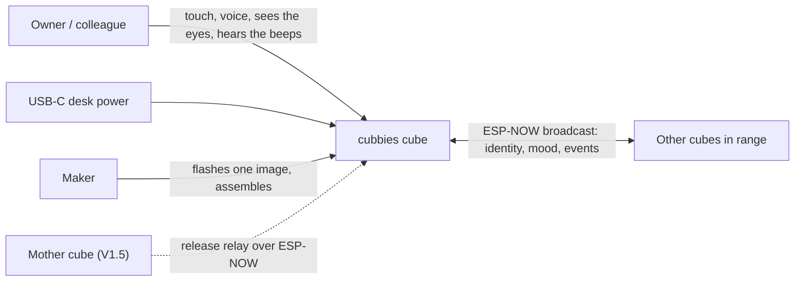

# Architecture — cubbies

arc42-lite overview (ADR-0011): only the sections whose question applies, numbered as in arc42.
§7 Deployment is omitted (one image flashed per cube, no infrastructure) and §9 Decisions is the
ADR index in [../decisions/](../decisions/README.md). Requirements, decisions and diagrams live
in their own files; this page is the map.

| Need | Where |
|------|-------|
| What the cube must do, measurably | [specs/requirements.md](specs/requirements.md) |
| Who wants what, step by step | [specs/use-cases.md](specs/use-cases.md) |
| Why a choice was made | [../decisions/](../decisions/README.md) (ADR-0001..0012) |
| How each requirement is checked | [verification-plan.md](verification-plan.md) |
| When design is frozen | [gates.md](gates.md) (PDR per feature, CDR before the series) |
| Proof of coverage | [traceability-matrix.md](traceability-matrix.md) |
| Electronics, enclosure, assembly | [../hardware/](../hardware/electronics-spec.md) |

## 1. Introduction and goals

A fleet of small cube desk companions offered to a team: colour OLED eyes, a buzzer, a touch
pad, a microphone. Alone on a desk a cube feels alive; when other cubes are in range they greet,
share moods and react together, with no pairing, app or server (ADR-0001). Top quality goals, in
order: **zero friction for a non-maker recipient**, **a face that never looks dead**, **never
loud**, **buildable by hand in a series of more than ten**.

Stakeholders: the owner (designs, builds, gives), the colleagues (own one cube each), the maker
community (public repository, OSHWA-style documentation).

## 2. Constraints

From [requirements.md §3](specs/requirements.md): zero friction, no app, pairing or
credentials (C1), USB-C power only in V1 (C2), XIAO ESP32-C3
with an 11-GPIO hard budget (C3), one firmware image for every cube (C4), ESP-NOW broadcast with
no router (C5), ≈ 40 mm printed cube (C6), audio never leaves the microphone boundary (C7),
nothing vulgar and gags stay rare (C8), MIT + CC BY-SA with no GPL linked (C9), **no time source
in V1** (C10). Toolchain: PlatformIO on the pinned pioarduino platform, Arduino core 3.3.x
(ADR-0004).

## 3. Context and scope

In scope for V1: the solo behaviours (tier A) and the proximity social layer (presence,
contagion, chain reaction). Out of scope: phone or cloud connectivity, battery (V2), wireless
charging (V3), voice (V4 idea).

## 4. Solution strategy

- **Conception first**: requirements → textual use cases → UML views → PDR, then code
  (`gates.md`). The dossier is the source of truth; code conforms.
- **Pure logic, thin adapters**: behaviour (moods, sleep, identity, protocol, Sound gate) is
  plain C++ in `firmware/lib/` with injected time, randomness and storage; hardware access lives
  in `firmware/src/` adapters behind the ports of the component diagram. Tested on the host.
- **Verified hardware**: calculations and targeted simulations are committed and reviewed; the
  GPIO allocation is a signed contract at the CDR.
- **Crescendo**: V1 USB-C, V1.5 mother cube, V2 battery, V3 Qi; backlog ordered from simplest to
  hardest in [../roadmap.md](../roadmap.md).

## 5. Building blocks

Level 1 (containers): one firmware image per cube, one printed enclosure, the shared radio
medium. Level 2 (components): the [component diagram](diagrams/cube-core/03-component.md)
splits `firmware/lib/` (gesture classifier, sound classifier, stimulus router, mood engine,
sleep cycle, eyes renderer, identity rules, social protocol, Sound gate) from `firmware/src/` adapters (SSD1331 display,
buzzer PWM, TTP223, INMP441 over I2S, ESP-NOW, NVS, uptime clock, RNG) through the ports
`IDisplay`, `IAudio`, `ITouchSource`, `IMic`, `IRadio`, `IStorage`, `IClock`, `IRng`. Every port
is planned with one real adapter and one test fake; a PNG-rendering display adapter (T8) will
back the golden-image tests.

## 6. Runtime view

The UML study ([index below](#uml-study)): first boot and adoption ritual (identity), presence
broadcast and greeting (social), mood engine and sleep/wake state machines (cube-core).

## 8. Crosscutting concepts

- **Time**: `IClock` is a monotonic uptime; no wall clock in V1 (C10). The V1 "quiet hours"
  come from inactivity only (sleep cycle, S5); a light-based rhythm waits for the light sensor
  and an `ILight` port (S8, tier B).
- **Sound**: every sound passes through the single Sound gate in `lib/`, which applies the
  volume (a constant in V1); the sleep cycle mutes it while asleep.
- **Identity**: colour derived from the MAC by default, overridden by the adoption ritual,
  stored in NVS (ADR-0008); the MAC keys the social layer.
- **Radio frames**: versioned, fixed layout, parsed by allowlist, unknown or malformed frames
  dropped silently; broadcast is unauthenticated by accepted decision (ADR-0012), with a fleet
  key in NVS as the V2 hook.
- **Privacy**: only a sound level and event flags leave the microphone adapter (C7).
- **Determinism**: injected clock and RNG make every behaviour replayable in native tests;
  eyes will be verified by golden images (T8).

## 10. Quality requirements

Measurable targets in [requirements.md §5](specs/requirements.md): touch latency ≤ 150 ms,
eyes ≥ 25 fps, ≤ 55 dB(A) at 1 m at max (≤ 40 default), ≤ 300 mA typical / 500 mA peak, ≥ 10 m indoor range, no crash
on fuzzed frames, OLED drift against burn-in, reproducible builds, ≤ 45 min assembly, snap-fit
enclosure printed without supports. Verification method per item in
[verification-plan.md](verification-plan.md).

## 11. Risks and technical debt

| Risk | Mitigation | Owner of the check |
|------|------------|--------------------|
| Buzzer stage on strapping pins (GPIO2 XIAO, GPIO8 Super Mini) | boot and download mode verified with the stage fitted; swap plan ready | CDR |
| XIAO LDO thermal budget at sustained 300 mA | measured on the prototype; typical current kept ≈ 100 mA | CDR |
| OLED burn-in on static eyes | drift and dimming rules (REQ-NF-08) | PDR cube-core |
| Unauthenticated ESP-NOW broadcast | bounded blast radius, rate limits, fleet key in V2 | ADR-0012 |
| pioarduino platform maintained by a small team | pinned release archive; fallback documented | ADR-0004 |
| `.FCStd` not diffable | Python script is the source, exports are artefacts | ADR-0010 |

## 12. Glossary

| Term | Meaning |
|------|---------|
| Adoption | the first-boot ritual where a colleague picks the colour of their cube's eyes |
| Mood | one of five discrete states (happy, curious, tired, bored, annoyed) driving eyes and sounds |
| Presence frame | the small ESP-NOW broadcast carrying identity and mood |
| Sound gate | the single exit point for sound, applying volume and silence rules |
| Golden image | a reference PNG of an expression, compared in native tests |
| PDR / CDR | the two design gates: per feature before code, once before ordering the series |

## UML study

Conventions: Mermaid under `diagrams/<feature>/<NN>-<type>.md`; only the views whose question
applies; use cases are actor-initiated goals grouped by domain, never by module; the component
diagram is the only place where the lib/adapters split appears.

Status: validated by the owner (PR #5), to be re-validated against `requirements.md` at the
`cube-core` PDR. Class diagrams are deferred until a feature introduces three or more domain
types.

| Feature | Diagram | Question it answers |
|---------|---------|---------------------|
| `cube-core` | [01-use-case](diagrams/cube-core/01-use-case.md) | Who wants what, by domain (Identity, Mood, Social, Settings, Making) |
| `cube-core` | [03-component](diagrams/cube-core/03-component.md) | Pure logic in `firmware/lib/` versus adapters in `firmware/src/`, and the ports between them |
| `cube-core` | [05a-state-mood-engine](diagrams/cube-core/05a-state-mood-engine.md) | The five moods and what moves them |
| `cube-core` | [05b-state-sleep-wake](diagrams/cube-core/05b-state-sleep-wake.md) | Awake, dozing, asleep, waking, and what wakes the cube |
| `cube-core` | [05c-state-gesture-classifier](diagrams/cube-core/05c-state-gesture-classifier.md) | How a one-bit touch level becomes tap, double tap or stroke |
| `cube-core` | [05d-state-sound-classifier](diagrams/cube-core/05d-state-sound-classifier.md) | How rms and peak per tick become voice, clap or loud |
| `cube-core` | [05e-state-sound-gate](diagrams/cube-core/05e-state-sound-gate.md) | What reaches the buzzer, at what volume, and when the cube is silent |
| `identity` | [02a-sequence-first-boot](diagrams/identity/02a-sequence-first-boot.md) | How every boot ends with a colour (NVS, else MAC-derived) |
| `identity` | [02b-sequence-adoption-ritual](diagrams/identity/02b-sequence-adoption-ritual.md) | Tap cycles the palette, long stroke confirms; the only entry is a hold during the post-boot invitation window (ADR-0013) |
| `social-presence` | [02-sequence-presence](diagrams/social-presence/02-sequence-presence.md) | Presence broadcast, neighbour table, greeting a newcomer |
| `social-presence` | [06-data-flow](diagrams/social-presence/06-data-flow.md) | The 8-byte versioned frame, allowlist parsing, where untrusted frames die |

Shared vocabulary across the diagrams: module names and port names come from the component
diagram, timer names (`T_*`) are tuning constants listed in each diagram's table, and the mood
byte on the air is the mood enum plus one "asleep" value.
