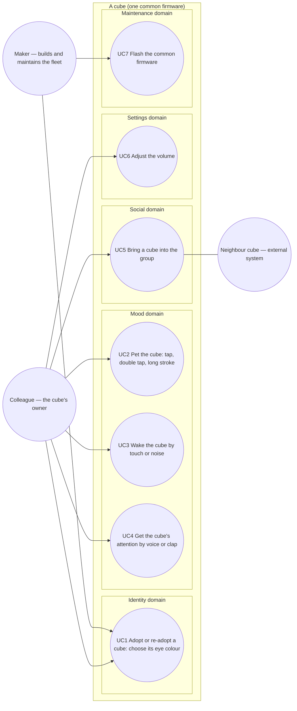

# Use case diagram — cube-core — who wants what from a cube

> **Frame**: `uc — cube-core V1`
> **Feature**: `cube-core` — backlog items S1–S7, G1, T1–T3 in [docs/roadmap.md](../../../roadmap.md)
> **Related ADRs**: ADR-0001 (concept), ADR-0005 (radio), ADR-0007 (sensor tiers), ADR-0008 (identity)
> **Scope**: V1 only (tier A behaviours, P0 + P1 hardware). Tier B/C goals (choir, poll, flirting) are not modelled yet.

## Context

This diagram answers "who interacts with a cube, and to achieve what?". Every oval is a goal an
actor initiates and can observe the outcome of. System-initiated behaviours (the cube dozes off,
a mood decays, a frame arrives) are **not** use cases: they belong to the state diagrams
([05a](05a-state-mood-engine.md), [05b](05b-state-sleep-wake.md)) and the presence sequence
([social-presence/02](../social-presence/02-sequence-presence.md)). Use cases are grouped by
domain, never by the firmware module that implements them (that split is in
[03-component.md](03-component.md)).

## Diagram

## Use cases (Cockburn brief)

| UC | Primary actor | Success guarantee | Backlog |
|----|---------------|-------------------|---------|
| UC1 Adopt or re-adopt a cube | Colleague (Maker during pre-adoption tests) | Chosen colour stored in NVS and rendered by the eyes. Abandoning the ritual keeps the previous colour | S6 |
| UC2 Pet the cube | Colleague | Visible reaction within one frame in every mood: surprise, joy, purr with eyes closed | S3 |
| UC3 Wake the cube | Colleague | The cube opens its eyes. From deep sleep it also plays the wake-up melody | S5, S7 |
| UC4 Get the cube's attention | Colleague | Eyes widen and look up, mood shifts to curious | S7 |
| UC5 Bring a cube into the group | Colleague, with the Neighbour cubes as secondary actors | The awake cubes already present greet the newcomer, and it greets back if awake, each at most once per arrival, as soon as the greeting policy allows. A cube not awake at that moment skips the greeting | G1 |
| UC6 Adjust the volume | Colleague | Volume level persisted in NVS and applied to every sound | S4 |
| UC7 Flash the common firmware | Maker | Same binary on every cube, identity untouched (NVS survives) | T1, T2 |

## Notes

- **One adoption use case**: first adoption and re-adoption share the same entry (the touch pad
  held while plugging in) and the same steps, so a separate "re-adopt" oval with an «include»
  would model nothing. The sequence is in [identity/02b](../identity/02b-sequence-adoption-ritual.md).
- **Actor generalisation is deliberately absent**: the Maker shares UC1 with the Colleague only to
  test the ritual, so UC1 is linked to both actors rather than inventing a parent actor.
- **The Neighbour cube is a secondary actor of UC5**, not the primary actor of a goal of its own:
  receiving a presence frame is a trigger, not a goal. How frames are accepted or dropped is in
  the social-presence sequence and data-flow.
- **UC4 with a single microphone**: the INMP441 gives a level, not a direction, so the cube
  cannot look *towards* a sound. The guarantee is "widen and look up".
- **Quiet hours are out of V1** (owner decision, validated 2026-10-14): V1 has no time source
  (no RTC, no Wi-Fi, ADR-0002). The cube is silent while it sleeps (S5), which is the V1 form of
  quiet hours, and silent when the office is dark from S8 (light sensor, tier B). The `CLAUDE.md`
  rule and backlog items S4, S5, S8 were reworded accordingly in this branch.
- **Open question (Settings)**: V1 has no screen UI, so how the Colleague adjusts the volume is
  undecided (touch gesture, boot-time gesture, or Maker-only through the mother cube in V1.5). UC6
  stays as a goal; until a gesture is chosen the firmware ships a constant default volume and
  stores nothing.
- Not modelled yet, by proportionality: S8–S11 and G2–G11 (tier B/C) get their own ovals when
  they enter a version.
