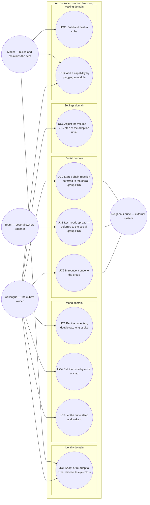

# Use case diagram — cube-core — who wants what from a cube

> **Frame**: `uc — cube-core V1`
> **Feature**: `cube-core` — backlog items S1–S7, G1, T1–T3 in [docs/roadmap.md](../../../roadmap.md)
> **Source specs**: [specs/use-cases.md](../../specs/use-cases.md) (textual use cases, owner of the numbering), [specs/requirements.md](../../specs/requirements.md)
> **Related ADRs**: ADR-0001 (concept), ADR-0005 (radio), ADR-0007 (sensor tiers), ADR-0008 (identity), ADR-0013 (PDR decisions)
> **Scope**: V1 only (tier A behaviours, P0 + P1 hardware). UC8, UC9 are tier A goals deferred to the `social-group` PDR; tier B/C goals (choir, poll, flirting) are not modelled yet.

## Context

This diagram answers "who interacts with a cube, and to achieve what?". Every oval is a goal an
actor initiates and can observe the outcome of. System-initiated behaviours (the cube dozes off,
a mood decays, a frame arrives, the rare gag) are **not** use cases: they belong to the state
diagrams ([05a](05a-state-mood-engine.md), [05b](05b-state-sleep-wake.md)) and the presence
sequence ([social-presence/02](../social-presence/02-sequence-presence.md)). Use cases are
grouped by domain, never by the firmware module that implements them (that split is in
[03-component.md](03-component.md)). Numbering follows `specs/use-cases.md`; UC2 was merged into
UC1 and its number is retired.

## Diagram

## Use cases (Cockburn brief; the full text is in `specs/use-cases.md`)

| UC | Primary actor | Success guarantee | Requirements | Backlog | Status |
|----|---------------|-------------------|--------------|---------|--------|
| UC1 Adopt or re-adopt a cube | Colleague (Maker during pre-adoption tests) | Chosen colour stored in NVS and rendered by the eyes. Abandoning the ritual keeps the previous colour | REQ-F-07, F-08 | S6 | V1 |
| UC3 Pet the cube | Colleague | A visible reaction within 150 ms of the touch (touch-down), then the gesture-specific reaction once classified: surprise, joy, purr with eyes closed | REQ-F-03, NF-01 | S3 | V1 |
| UC4 Call the cube | Colleague | Eyes widen and look up; a Bored or Tired cube returns to Curious; the cube is never annoyed by a call | REQ-F-09 | S7 | V1 |
| UC5 Let the cube sleep and wake it | Colleague | Dozes after 10 min without attention, sleeps after 30 min; any touch or a loud enough sound wakes it, the wake-up melody plays only from deep sleep | REQ-F-06, F-05, NF-08 | S5, S7 | V1 |
| UC7 Introduce a cube to the group | Colleague, Neighbour cubes as secondary actors | The awake cubes already present greet the newcomer, and it greets back if awake, each at most once per arrival, as soon as the greeting policy allows | REQ-F-10, NF-05 | G1 | V1 |
| UC8 Let moods spread | Team | Neighbours' moods pull the cube's mood | REQ-F-11 | G2 | deferred: `social-group` PDR |
| UC9 Start a chain reaction | Colleague | Each neighbour reacts once, the wave dies out | REQ-F-12 | G3 | deferred: `social-group` PDR |
| UC6 Adjust the volume | Colleague | Volume step chosen inside the adoption ritual, after the colour, stored in NVS | REQ-F-05 | S4 | V1 ships a constant; the ritual step is V1.x (ADR-0013) |
| UC11 Build and flash a cube | Maker | Same binary on every cube, identity untouched (NVS survives) | REQ-NF-09, NF-10 | T1, T2 | V1 |
| UC12 Add a capability by plugging a module | Colleague (Maker on their behalf) | Known module used after the next boot; unknown module ignored | REQ-F-20, NF-12 | — | V1 (port), behaviours later |

## Notes

- **One adoption use case**: first adoption and re-adoption share the same entry, a touch held
  during the invitation window shown after boot ([identity/02a](../identity/02a-sequence-first-boot.md)),
  and the same steps, so a separate "re-adopt" oval would model nothing. UC2 of an earlier draft is
  retired. The sequence is in [identity/02b](../identity/02b-sequence-adoption-ritual.md).
- **Actor generalisation is deliberately absent**: the Maker shares UC1 with the Colleague only to
  test the ritual, so UC1 is linked to both actors rather than inventing a parent actor. `Team` is
  a distinct actor because UC8 is a goal nobody holds alone.
- **The Neighbour cube is a secondary actor** of UC7, UC8 and UC9, never the primary actor of a
  goal of its own: receiving a presence frame is a trigger, not a goal.
- **UC4 with a single microphone**: the INMP441 gives a level, not a direction, so the cube
  cannot look *towards* a sound. The guarantee is "widen and look up". The sound classes (voice,
  clap, loud) and their thresholds are in [03-component.md](03-component.md).
- **Quiet hours are out of V1** (owner decision, validated 2026-10-14): V1 has no time source
  (C10). The cube is silent while it sleeps (S5), and silent when the office is dark from S8
  (light sensor, tier B).
- **Deferred goals are drawn** (UC8, UC9) so the traceability matrix can point at them honestly;
  their sequences and state transitions come with the `social-group` PDR (G2, G3), together
  with the rare gag (REQ-F-13, a mood-engine extension, not a goal).
- Not modelled, by proportionality: S8–S11 and G4–G11 (tier B/C) get their own ovals when they
  enter a version.
