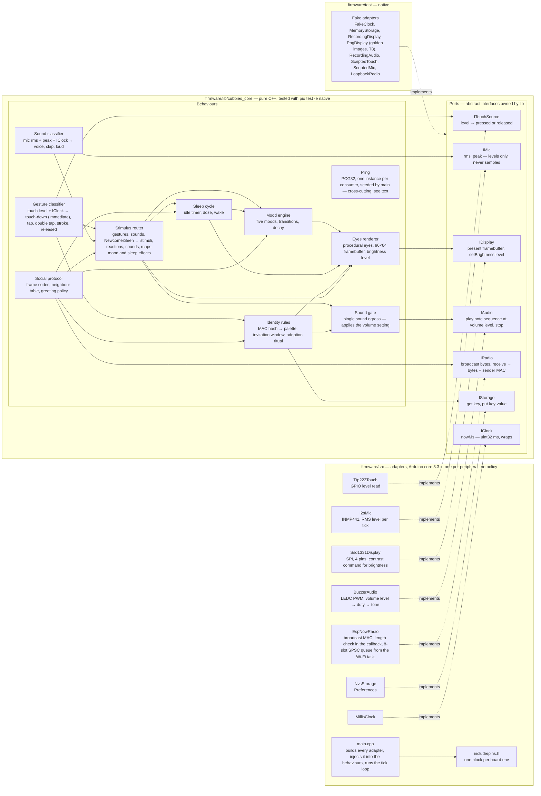

# Component diagram — cube-core — pure logic versus adapters, and the ports between them

> **Frame**: `cmp — cube-core firmware`
> **Feature**: `cube-core` — backlog items T1, T2, T3 in [docs/roadmap.md](../../../roadmap.md)
> **Related ADRs**: ADR-0004 (stack), ADR-0005 (radio adapter), ADR-0006 (display), ADR-0007 (pins), ADR-0013 (PDR decisions: lib-owned PRNG, MAC by value, touch-down stimulus)
> **Project rules captured**: "behaviour logic is pure C++ and tested natively", "time and
> randomness are injected", "every sound goes through the single audio adapter" ([CLAUDE.md](../../../../CLAUDE.md))

## Context

This diagram answers "where does a piece of code belong, and which way do dependencies point?".
`firmware/lib/cubbies_core` holds the behaviours and **owns the port interfaces**; `firmware/src/`
holds one thin adapter per peripheral that implements a port. The dependency rule is strict:
nothing in `lib/` includes Arduino, ESP-IDF or a driver header, and nothing in `lib/` reads
`millis()` or `random()`. Adapters are dumb: no timers, no policy. It does not show runtime
sequencing (see the sequence diagrams) nor the internal state of a behaviour (see the state
diagrams). This diagram is the **vocabulary source**: module names, port names and port
operations used by every other diagram come from here.

## Diagram

### Runtime rules

Cross-cutting ports, left out of the arrows for readability: `IClock` is injected into the
Gesture classifier, Sound classifier, Mood engine, Sleep cycle, Identity rules (ritual timeouts)
and Social protocol (presence period, expiry, greeting cooldown). Randomness is a lib-owned
`Prng` (PCG32, ADR-0013): `main.cpp` seeds one instance per consumer from `esp_random()` **after**
the Wi-Fi driver is up (before that the ESP32-C3 RNG is only pseudo-random); native tests pass a
fixed seed. Consumers: Eyes renderer (idle glances, burn-in drift), Mood engine (variation),
Social protocol (broadcast jitter). The Identity rules use no randomness: the MAC hash is
deterministic.

Tick fan-out from `main.cpp`, each tick in this order: Gesture classifier, Sound classifier,
Social protocol (drain RX queue, expire, broadcast if due), Stimulus router, Sleep cycle, Mood
engine, Eyes renderer, then `IDisplay.present`. **Tick budget**: one tick every 40 ms (25 fps,
REQ-NF-02); the SPI transfer of the 12 KB frame takes ≈ 16 ms at 6 MHz, leaving ≈ 24 ms for
logic. Identity rules run at boot only, tick-driven: `main.cpp` resolves the identity (MAC passed
by value), shows the invitation window, and if a hold is detected calls `startRitual()` then
`tick()` until `isDone()` ([identity/02a](../identity/02a-sequence-first-boot.md), [02b](../identity/02b-sequence-adoption-ritual.md)).
The Stimulus router, Sleep cycle and Social protocol start ticking only after the ritual ends.
In F3 the module holds three parts ([identity/05a](../identity/05a-state-invitation-window.md),
[05b](../identity/05b-state-adoption-ritual.md)): `resolveIdentity` (palette, MAC hash, `IStorage`
read), `InvitationWindow` (reads `holdMs()` from the Gesture classifier) and `AdoptionRitual`.
The window and the ritual return an `IdentityOutput` (frame, gauge, sound) that `main.cpp` applies,
like the router's `Route`, so the `Ident --> Eyes` and `Ident --> Gate` edges pass through `main.cpp`.

Routing rule of the Stimulus router (pure functions `route(gesture | sound, sleepState)` and
`routeNewcomer(sleepState)`, plus `effects(MoodEffect | SleepEffect)`, each returning a `Route`
that `main.cpp` applies): while the Sleep cycle is Awake, classified gestures, sounds and
`NewcomerSeen` go to the Mood engine, with the S3 reaction and sound (and gestures and sounds also
feed the Sleep cycle's idle timer). While not Awake, gestures and sounds go to the Sleep cycle
only, and `NewcomerSeen` is dropped. The effects the Mood engine and the Sleep cycle return (yawn,
grumpy, doze, sleep, wake) become eyes and Sound gate commands through the same `Route`, hence the
`Router --> Eyes` and `Router --> Gate` edges; neither engine calls the gate itself.

**Touch latency (REQ-NF-01)**: a tap can only be classified once the double-tap window
(T_doubletap 250 ms) has elapsed, so the Gesture classifier emits an immediate `touch-down`
stimulus on the pressed edge (eyes widen within the next tick, ≤ 40 ms) and the classified
gesture (tap, double tap, stroke) when known. Only the classified gesture reaches the Mood engine
(05a: touch-down leaves the mood unchanged); the touch-down is an eyes reaction, the same in every
mood, and a wake trigger for the Sleep cycle.

**Sound classes** (Sound classifier, port contract, ratio thresholds and baseline rules in
[05d](05d-state-sound-classifier.md); adaptive baseline = slow running mean of the rms, frozen
while a sound lasts):

`ref = max(baseline, kMinLevel)`; each duration is a run of consecutive ticks at that level.

| Class | Rule (tuning values) | Used by |
|-------|----------------------|---------|
| voice | rms ≥ R_voice·ref (2×) for ≥ 200 ms | Mood engine (attention, Bored/Tired → Curious), Sleep cycle wake from Dozing |
| clap | peak ≥ R_clap·ref (8×) with the burst shorter than 100 ms | Mood engine (attention), Sleep cycle wake from Dozing |
| loud | rms ≥ R_loud·ref (4×) for ≥ 500 ms | Mood engine (Annoyed), Sleep cycle wake from Dozing and deep wake from Asleep |

A call (UC4) is a voice or a clap and never produces Annoyed; only a sustained loud level does.

Dependency between the two state machines: the Sleep cycle reads the current mood ("is Tired"),
pauses and restarts the Mood engine. The Mood engine knows nothing about sleep. The byte that
goes on the air is computed by the Social protocol's codec, `moodByte(sleepState, wakeOrigin,
mood)`, from both machines' states (table in [05b](05b-state-sleep-wake.md), the Sleep cycle
exposes where Waking came from); neither machine knows the wire format, hence the
`Social --> MoodE` and `Social --> Sleep` read edges. Brightness is set by the Sleep cycle through the Eyes renderer, which owns
the `IDisplay` port.

## Notes

- **Clock contract**: `IClock.nowMs` is an unsigned 32-bit millisecond counter that wraps every
  49.7 days. Consumers compare ages only through `(uint32)(now - then)`; a native test runs every
  timer across the wrap. The radio adapter's queue is a single-producer (callback) single-consumer
  (tick) ring or FreeRTOS queue: "adapters are dumb" means no policy, not no synchronisation.
- **Dependency direction**: every arrow from `src/` points into `lib/`, never the reverse. The
  only way for `lib/` to reach hardware is through a port it declares itself. A direct call to
  `millis()`, `random()`, `tone()` or `esp_now_send()` inside `lib/` is a review blocker.
- **Timers live in `lib/`**: gesture timing (tap, double tap, long stroke, held at boot) and
  sound classification (clap, voice, loud) are behaviour logic driven by the injected clock, so
  the adapters only report a level. This is what lets the adoption ritual and the wake-on-noise
  rules replay in a native test.
- **One sound egress**: every behaviour plays sound through the Sound gate in `lib/`, which
  applies the volume constant (and, from V1.x, the `settings.volume` chosen in the ritual's second
  step) and forwards a volume level to `IAudio`. `BuzzerAudio` converts a level to a PWM duty
  cycle and nothing else. A
  native test can assert through `RecordingAudio` that a muted cube emits nothing. In V1 the gate
  holds a constant default volume and stores nothing; the V1.x ritual step (UC6, ADR-0013) adds
  a `Gate --> PStore` read then, not before (YAGNI).
- **Fakes, not mocks of the domain**: the native tests inject fake adapters at the ports and
  exercise the real behaviours (mock the boundaries, never the domain).
- **Microphone privacy boundary (C7, REQ-NF-07)**: the I2S sample buffer never leaves
  `I2sMic`; nothing logs samples; `IMic` exposes two numbers per tick, rms and peak (the peak is
  what lets a clap survive a 40 ms tick). Reviewed on every PR that touches the adapter.
- **Burn-in drift in every state** (REQ-NF-08): the Eyes renderer, not a mood, shifts the frame
  by one pixel every 60 s whatever the state, including the closed-eyes Asleep frame, and dims
  per the Sleep cycle.
- **Frame length constant**: `EspNowRadio` compares the received length to `kFrameSize` included
  from `lib/` (src → lib is the allowed direction), so the value is not duplicated.
- **Sensors in V1**: only the microphone (P1). The IMU (P2) and light sensor (P3) get their own
  ports (`IMotion`, `ILight`) when S8/S9 enter a version, not before.
- **No Wi-Fi station, no OTA component in V1**: the mother cube (V1.5) will add an adapter next to
  `EspNowRadio`, not a new port in `lib/`.
