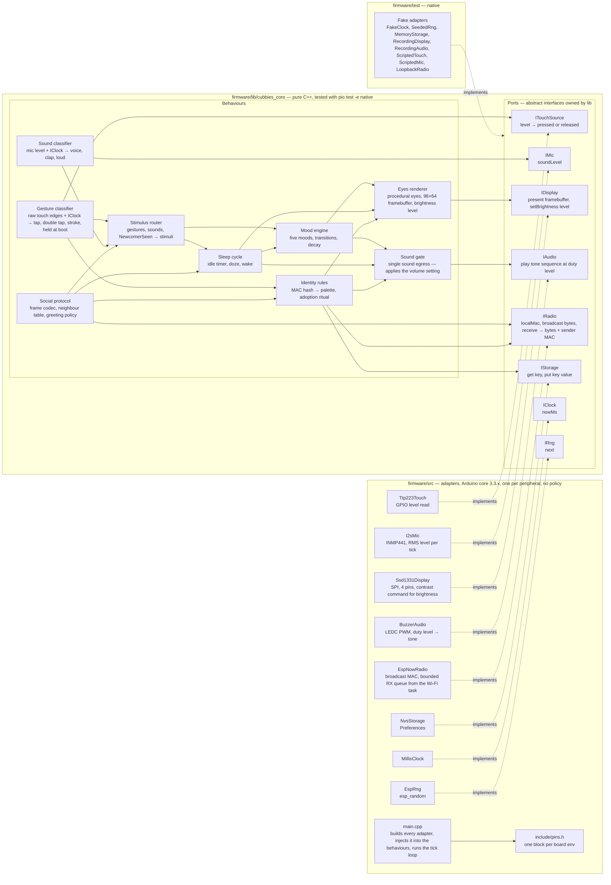

# Component diagram — cube-core — pure logic versus adapters, and the ports between them

> **Frame**: `cmp — cube-core firmware`
> **Feature**: `cube-core` — backlog items T1, T2, T3 in [docs/roadmap.md](../../../roadmap.md)
> **Related ADRs**: ADR-0004 (stack), ADR-0005 (radio adapter), ADR-0006 (display), ADR-0007 (pins)
> **Project rules captured**: "behaviour logic is pure C++ and tested natively", "time and
> randomness are injected", "every sound goes through the single audio adapter" ([CLAUDE.md](../../../../CLAUDE.md))

## Context

This diagram answers "where does a piece of code belong, and which way do dependencies point?".
`firmware/lib/cubbies_core` holds the behaviours and **owns the port interfaces**; `firmware/src/`
holds one thin adapter per peripheral that implements a port. The dependency rule is strict:
nothing in `lib/` includes Arduino, ESP-IDF or a driver header, and nothing in `lib/` reads
`millis()` or `random()`. Adapters are dumb: no timers, no policy. It does not show runtime
sequencing (see the sequence diagrams) nor the internal state of a behaviour (see the state
diagrams). This diagram is the **vocabulary source**: module names, port names and port
operations used by every other diagram come from here.

## Diagram

Cross-cutting ports, left out of the arrows for readability: `IClock` is injected into the
Gesture classifier, Sound classifier, Mood engine, Sleep cycle, Identity rules (ritual timeouts)
and Social protocol (presence period, expiry, greeting cooldown). `IRng` is injected into the Eyes
renderer (idle glances, burn-in drift), Mood engine (variation) and Social protocol (broadcast
jitter). The Identity rules use no randomness: the MAC hash is deterministic.

Tick fan-out from `main.cpp`, each tick in this order: Gesture classifier, Sound classifier,
Social protocol (drain RX queue, expire, broadcast if due), Stimulus router, Sleep cycle, Mood
engine, Eyes renderer, then `IDisplay.present`. Identity rules run at boot only: `main.cpp`
resolves the identity, then, if the pad is held, runs the ritual loop in which gestures go
straight from the Gesture classifier to Identity rules. The Stimulus router, Sleep cycle and
Social protocol start ticking only after the ritual ends.

Routing rule of the Stimulus router: while the Sleep cycle is Awake, gestures, sounds and
`NewcomerSeen` go to the Mood engine (and gestures and sounds also feed the Sleep cycle's idle
timer). While not Awake, gestures and sounds go to the Sleep cycle only, and `NewcomerSeen` is
dropped.

Dependency between the two state machines: the Sleep cycle reads the current mood ("is Tired"),
pauses and restarts the Mood engine, and derives the presence mood byte. The Mood engine knows
nothing about sleep. Brightness is set by the Sleep cycle through the Eyes renderer, which owns
the `IDisplay` port.

## Notes

- **Dependency direction**: every arrow from `src/` points into `lib/`, never the reverse. The
  only way for `lib/` to reach hardware is through a port it declares itself. A direct call to
  `millis()`, `random()`, `tone()` or `esp_now_send()` inside `lib/` is a review blocker.
- **Timers live in `lib/`**: gesture timing (tap, double tap, long stroke, held at boot) and
  sound classification (clap, voice, loud) are behaviour logic driven by the injected clock, so
  the adapters only report a level. This is what lets the adoption ritual and the wake-on-noise
  rules replay in a native test.
- **One sound egress**: every behaviour plays sound through the Sound gate in `lib/`, which
  applies the volume constant (and, later, a stored volume and any quiet policy) and forwards a
  duty level to `IAudio`. `BuzzerAudio` converts a level to a PWM duty cycle and nothing else. A
  native test can assert through `RecordingAudio` that a muted cube emits nothing. In V1 the gate
  holds a constant default volume and stores nothing until the UC6 gesture is decided (see
  [01-use-case](01-use-case.md)), so no Settings module and no `IStorage` edge exist yet (YAGNI).
- **Fakes, not mocks of the domain**: the native tests inject fake adapters at the ports and
  exercise the real behaviours (mock the boundaries, never the domain).
- **Sensors in V1**: only the microphone (P1). The IMU (P2) and light sensor (P3) get their own
  ports (`IMotion`, `ILight`) when S8/S9 enter a version, not before.
- **No Wi-Fi station, no OTA component in V1**: the mother cube (V1.5) will add an adapter next to
  `EspNowRadio`, not a new port in `lib/`.
