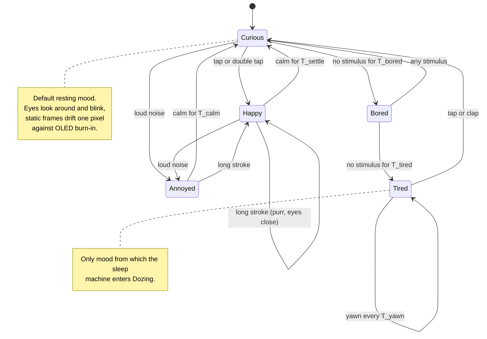

# State diagram — cube-core — mood engine

> **Frame**: `stm — Mood engine`
> **Feature**: `cube-core` — backlog items S2, S3, S7, G2 (hook only) in [docs/roadmap.md](../../../roadmap.md)
> **Related ADRs**: ADR-0001 (solo layer is the daily use), ADR-0006 (eyes drift against burn-in)
> **Module**: `Mood engine` in [03-component.md](03-component.md)

## Context

This diagram answers "what lifecycle does the mood go through, and what moves it?". The mood is
a single discrete state among the five of S2. Transitions come from stimuli delivered by the
Stimulus router (gestures, sounds, `NewcomerSeen` from the social protocol) or from timers fed by
the injected clock. The eyes rendering of each mood and the cross-fade between two moods are
rendering concerns (Eyes renderer), not states. Sleep is a separate, orthogonal machine
([05b-state-sleep-wake.md](05b-state-sleep-wake.md)): the mood engine is paused while the cube is
not Awake, and every wake restarts it in Curious.

## Diagram

## Transition table (source of the firmware constants)

| From | Trigger | To | Side effect |
|------|---------|----|-------------|
| — | machine entered at boot, and re-entered at every wake | Curious | none (the wake-up melody is owned by 05b Waking and by the boot sequence 02a) |
| Curious | tap, double tap | Happy | surprise or joy beep |
| Curious | idle ≥ T_bored | Bored | none |
| Curious, Happy | loud noise | Annoyed | grumpy beep |
| Happy | long stroke | Happy | purr, eyes close while touched |
| Happy | calm ≥ T_settle | Curious | none |
| Bored | any stimulus | Curious | none |
| Bored | idle ≥ T_tired | Tired | first yawn |
| Tired | every T_yawn | Tired | yawn (sound + eyes) |
| Tired | tap, clap | Curious | none |
| Annoyed | calm ≥ T_calm | Curious | none |
| Annoyed | long stroke | Happy | purr |

**Stimuli not listed for a state leave the mood unchanged.** They still produce the reaction
animation and beep of S3 (a tap in Happy is a surprise, a stroke in Curious is a purr), which is
how UC2 guarantees a visible reaction in every mood. "Any stimulus" in Bored means every gesture,
sound or `NewcomerSeen`. "Calm" means no gesture and no sound above the voice threshold.

Durations are constants of the Mood engine, set in one header and overridden in tests through
the injected clock. Proposed starting values: T_settle 10 s, T_calm 20 s, T_bored 3 min,
T_tired 10 min, T_yawn 45 s. These are tuning parameters, not decisions, and change without an
ADR.

## Mood encoding (shared with the presence frame)

| Value | Mood |
|-------|------|
| 0 | Curious |
| 1 | Happy |
| 2 | Bored |
| 3 | Tired |
| 4 | Annoyed |
| 5 | Asleep (sleep machine state, not a mood — see 05b) |

## Notes

- **Deterministic and replayable**: no transition reads `millis()` or `random()` directly, so a
  native test can script a stimulus timeline and assert the mood sequence.
- **Why discrete states rather than a valence/arousal vector**: five moods map one-to-one to the
  eye animations of S2 and to the beeps of S4, and the roadmap's social behaviours (G2 contagious
  mood) only need to publish one mood byte in the presence frame. A continuous model is deferred
  until a behaviour needs it. Owner decision, validated 2026-10-14.
- **Wake always restarts in Curious** (owner decision, validated 2026-10-14): resuming in Tired
  would send a just-woken cube back to Dozing two minutes later.
- **Shake is not a V1 trigger**: it needs the IMU (P2, backlog S9, tier B). When S9 enters, it
  adds "shake → Annoyed" from Curious and Happy to this table, nothing else changes.
- **G2 hook**: `NewcomerSeen` is already a stimulus in V1 (greeting). Contagious mood (G2) will add
  a transition "neighbour majority mood for T_contagion → that mood", in a follow-up revision of
  this diagram, not a new machine.
- **Not in this diagram**: the long-term "sulks when ignored for two days" (S10) needs persisted
  counters and will extend Bored when it enters a version.
