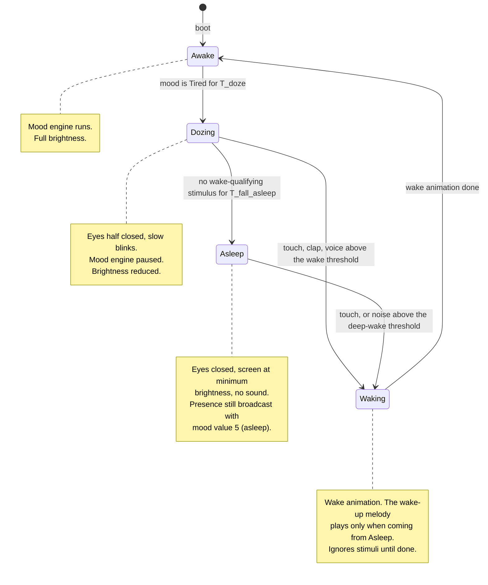

# State diagram — cube-core — sleep and wake cycle

> **Frame**: `stm — Sleep cycle`
> **Feature**: `cube-core` — backlog items S5, S7, with hooks for S8 (day rhythm) and T7 (V2 power) in [docs/roadmap.md](../../../roadmap.md)
> **Related ADRs**: ADR-0002 (no power management in V1), ADR-0006 (screen dims during sleep)
> **Module**: `Sleep cycle` in [03-component.md](03-component.md)

## Context

This diagram answers "when is the cube awake, dozing or asleep, and what wakes it?". It is
orthogonal to the mood engine ([05a](05a-state-mood-engine.md)): the mood is frozen while the cube
is not Awake, and every return to Awake restarts the mood in Curious. In V1 "asleep" is purely
behavioural (eyes closed, screen dimmed, no sound): the MCU stays fully powered (ADR-0002). V2
light sleep will refine the Asleep state without changing its transitions.

## Diagram

## Transition table

| From | Trigger | To | Side effect |
|------|---------|----|-------------|
| Awake | mood Tired for ≥ T_doze | Dozing | `Eyes.setBrightness(low)`, pause mood engine |
| Dozing | touch, clap, voice ≥ wake threshold | Waking | short wake animation, no melody |
| Dozing | no wake-qualifying stimulus for ≥ T_fall_asleep | Asleep | eyes closed, `Eyes.setBrightness(minimum)` |
| Asleep | touch, noise ≥ deep-wake threshold | Waking | yawn animation, wake-up melody through the Sound gate |
| Waking | animation complete | Awake | `Eyes.setBrightness(full)`, mood restarts in Curious |

The wake-up melody has one owner: this machine, on the Asleep → Waking path (and the boot
sequence in [identity/02a](../identity/02a-sequence-first-boot.md)). The mood engine plays nothing
when it restarts in Curious.

Proposed starting values: T_doze 2 min, T_fall_asleep 5 min. The two sound thresholds are higher
for Asleep than for Dozing so that office background noise does not wake a sleeping cube (S7). A
sound below the Dozing threshold does not reset T_fall_asleep.

## What the presence frame carries per state

The Sleep cycle derives the byte (`presenceMoodByte`) and the Social protocol reads it.

| State | Mood byte on the air |
|-------|----------------------|
| Awake | current mood (0–4) |
| Dozing | 3 (Tired, the only mood Dozing is entered from) |
| Waking | 3 if coming from Dozing, 5 if coming from Asleep, until Awake |
| Asleep | 5 (asleep) |

## Notes

- **Why a separate machine**: mood and wakefulness vary independently (a cube can be Tired and
  Awake, or Asleep while its last mood was Happy). Folding sleep into the mood enum would force
  every mood transition to check wakefulness. Two small machines are simpler than one with
  guards everywhere.
- **Waking is a real state**, not a transition action, because it lasts about a second and must
  swallow stimuli (a second tap during the yawn must not restart the melody). Both wake paths go
  through it so the "ignore stimuli" rule has one place.
- **Greetings while not Awake are suppressed**: the Stimulus router drops `NewcomerSeen` unless
  the cube is Awake, so a sleeping cube stays silent when a colleague arrives. The neighbour table
  is still updated.
- **Social layer while asleep**: presence frames keep flowing with mood value 5 so that G5
  collective sleep can be built later without a new frame type. The radio adapter is not stopped
  in V1.
- **Hooks, not states**: S8 (day rhythm) will add guards on an `ILight` port to the
  Awake → Dozing transition. T7 (V2) will turn Asleep into an ESP32 light-sleep with the touch pin
  as wake source. Neither needs a new state.
