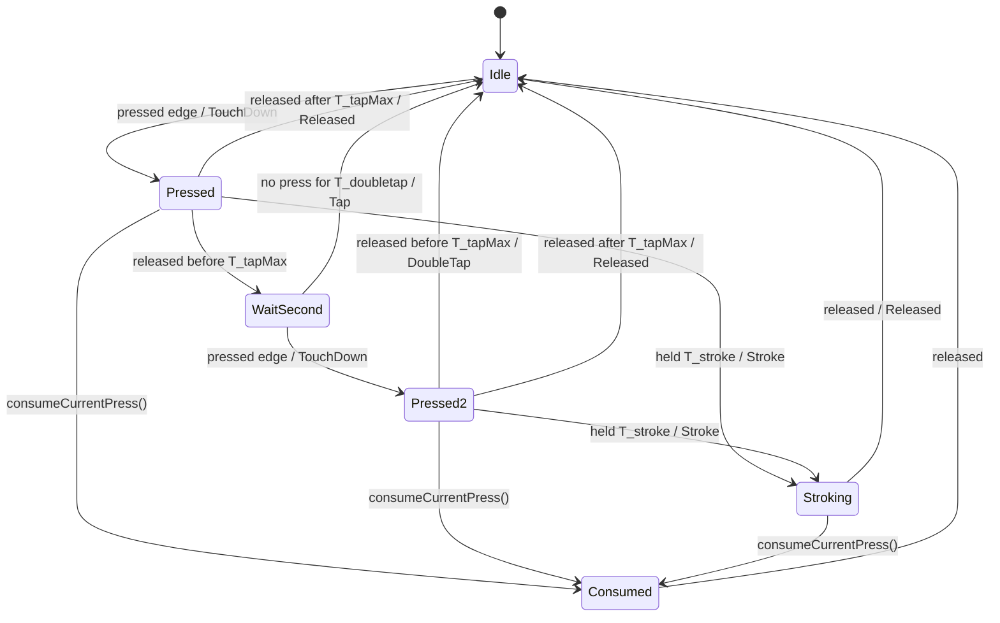

# State diagram — cube-core — gesture classifier

> **Frame**: `stm — Gesture classifier`
> **Feature**: `cube-core` — backlog item S2 (touch reactions) in [docs/roadmap.md](../../../roadmap.md)
> **Related ADRs**: ADR-0013 (touch-down stimulus, REQ-NF-01 latency)
> **Module**: `Gesture classifier` ← `ITouchSource` in [03-component.md](03-component.md)

## Context

This diagram answers "how does a one-bit touch level become tap, double tap or stroke?". The
TTP223 reports pressed or released, nothing else: a "stroke" is a long contact, and every rule
below is a duration measured on the injected clock at each tick. The classifier emits at most one
gesture per tick; the Stimulus router turns gestures into reactions and mood stimuli (05a).
Owner decisions 2026-10-15 (F2, scored options): the stroke fires while the finger is still down,
so the purr follows the contact (05a "eyes close while touched"); a press longer than T_tapMax
that is not a stroke is no tap, so a hesitant touch never beeps.

## Diagram

## Transition table

Each row is one native test (ADR-0014).

| From | Trigger | To | Emits |
|------|---------|----|-------|
| Idle | pressed edge | Pressed | `TouchDown` on the same tick (REQ-NF-01) |
| Pressed | released, press < T_tapMax | WaitSecond | nothing (the touch-down stays held until the tap is known) |
| Pressed | released, press ≥ T_tapMax | Idle | `Released` |
| Pressed | press reaches T_stroke | Stroking | `Stroke` |
| WaitSecond | no press for T_doubletap after the release | Idle | `Tap` |
| WaitSecond | pressed edge | Pressed2 | `TouchDown` |
| Pressed2 | released, press < T_tapMax | Idle | `DoubleTap` (no wait) |
| Pressed2 | released, press ≥ T_tapMax | Idle | `Released` |
| Pressed2 | press reaches T_stroke | Stroking | `Stroke` (the first tap is absorbed) |
| Stroking | released | Idle | `Released` (once, however long the contact) |
| any | `consumeCurrentPress()` | Consumed | nothing; `holdMs()` reads 0 from now on |
| Consumed | still pressed | Consumed | nothing |
| Consumed | released | Idle | nothing (no `Released`) |

`holdMs()` returns the age of the current press in Pressed, Pressed2 and Stroking, and 0
otherwise (F3, read by the invitation window, [identity/05a](../identity/05a-state-invitation-window.md)).

Starting values (tuning, not decisions): T_tapMax 400 ms, T_doubletap 250 ms, T_stroke 1.5 s.
A third quick tap after a double tap starts a new gesture.

## Notes

- **Tick resolution**: the pad is sampled every 40 ms, so every window is quantised to the tick.
  A second press first seen on the tick after T_doubletap (a press that started between 250 and
  280 ms) still counts as the second half of a double tap: the sample cannot tell a press at 245
  from one at 255 ms (owner decision 2026-10-15, PR #12 review).

- **No `Released` after a short press**: the touch-down widening stays until `Tap` or
  `DoubleTap` replaces it, which is what lets Surprise and Joy grow from the touch-down size
  (F2 step 1) instead of the eyes shrinking then popping again.
- **The boot hold is not here**: the invitation window and its gauge are a separate machine
  ([identity/05a](../identity/05a-state-invitation-window.md), F3); the classifier only exposes
  `holdMs()` and `consumeCurrentPress()`, so the pad is still sampled in one place.
- **Wrap-safe**: durations are ages on the uint32 clock (`ageMs`), never `now > then + T`.
