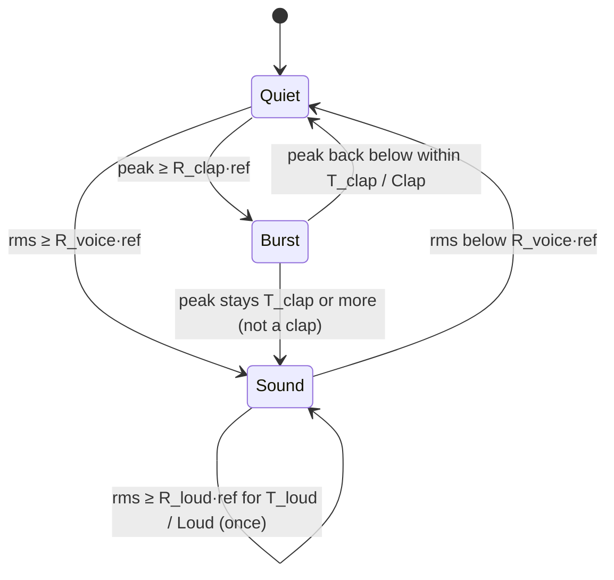

# State diagram — cube-core — sound classifier

> **Frame**: `stm — Sound classifier`
> **Feature**: `cube-core` — backlog items S6 (calls), S7 (wake on noise) in [docs/roadmap.md](../../../roadmap.md)
> **Related ADRs**: ADR-0013 (sound classes, a call never annoys)
> **Module**: `Sound classifier` ← `IMic` in [03-component.md](03-component.md)

## Context

This diagram answers "how do two numbers per tick become voice, clap or loud?". It refines the
sound-class table of [03](03-component.md) with the port contract and the threshold form, both
owner decisions of 2026-10-15 (F2, scored options):

- **Port**: `IMic` returns, at each tick, the rms and the peak of **every sample since the
  previous tick** (unsigned 16-bit, full scale of the adapter). A clap that falls between two
  ticks must still show in the peak; this is a review point of the I2S adapter (F5).
- **Thresholds are ratios over an adaptive baseline**, never absolute levels, so they hold for
  any microphone gain, enclosure and office. An absolute floor `kMinLevel` stops a near-silent
  room from turning a breath into a voice: the reference is `max(baseline, kMinLevel)`.
- **Baseline**: slow running mean of the rms (time constant ~10 s), **frozen while a sound is
  in progress** so a long conversation does not raise its own threshold; it learns only in quiet.

## Diagram

## Transition table

Each row is one native test (ADR-0014). `ref = max(baseline, kMinLevel)`.

| From | Trigger | To | Emits |
|------|---------|----|-------|
| Quiet | rms < R_voice·ref, peak < R_clap·ref | Quiet | nothing; the baseline learns |
| Quiet | peak ≥ R_clap·ref | Burst | nothing yet |
| Burst | peak back below R_clap·ref, burst < T_clap | Quiet | `Clap` |
| Burst | burst lasts T_clap or more | Sound | nothing (a long bang is no clap) |
| Quiet | rms ≥ R_voice·ref | Sound | nothing yet |
| Sound | rms stayed ≥ R_voice·ref for T_voice | Sound | `Voice`, once per sound |
| Sound | rms stayed ≥ R_loud·ref for T_loud | Sound | `Loud`, once per sound |
| Sound | rms < R_voice·ref | Quiet | nothing; the baseline resumes learning |
| any | very quiet room (baseline < kMinLevel) | — | a breath below R_voice·kMinLevel emits nothing |

Starting values (tuning, calibrated on the bench, no ADR): R_voice 2 (≈ +6 dB), R_loud 4
(≈ +12 dB), R_clap 8 (≈ +18 dB), T_voice 200 ms, T_loud 500 ms, T_clap 100 ms, baseline time
constant 10 s, kMinLevel to be measured on the prototype (provisional 64).

## Notes

- **A loud sound is also a voice**: a sustained loud level emits `Voice` at T_voice then `Loud` at
  T_loud. The Mood engine sees attention, then Annoyed; a call (voice, clap) alone never annoys.
- **The sleep thresholds of 05b** (wake from Dozing, deep wake from Asleep) are the classes
  themselves: Dozing wakes on voice or clap, Asleep wakes on loud only.
- **At most one class per tick**, like the gesture classifier.
