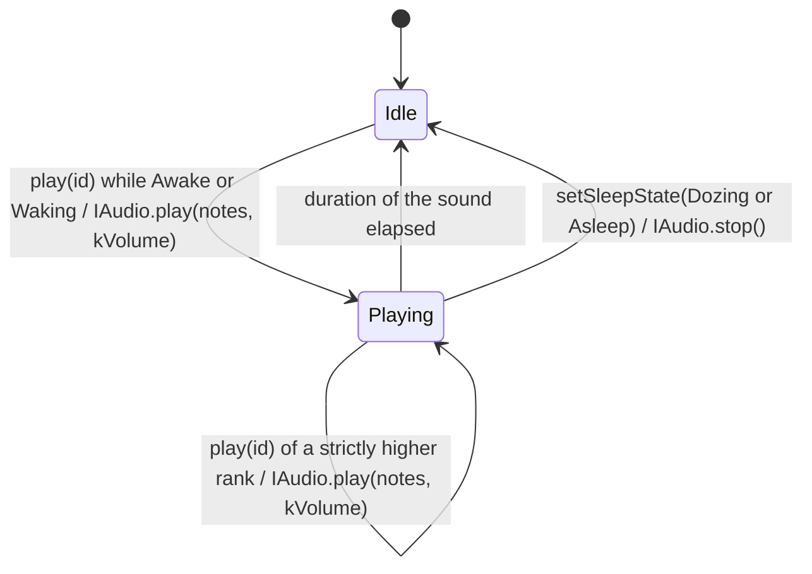

# State diagram — cube-core — sound gate

> **Frame**: `stm — Sound gate`
> **Feature**: `cube-core` — backlog item S4 in [docs/roadmap.md](../../../roadmap.md)
> **Related ADRs**: ADR-0013 (volume constant in V1, `IAudio` speaks of a level)
> **Module**: `Sound gate` → `IAudio` in [03-component.md](03-component.md)

## Context

This diagram answers "what reaches the buzzer, at what volume, and when is the cube silent?".
It refines the "one sound egress" note of [03](03-component.md) (REQ-F-04, REQ-F-05) with four
owner decisions of 2026-10-15 (F2, scored options):

- **The sounds are data in `lib/`**: a `SoundId` names each sound of the design (surprise, joy,
  purr, grumpy, yawn, hello, wake-up melody) and the gate owns their note tables. `IAudio`
  receives a note sequence (`{frequency Hz, duration ms}`, 0 Hz is a rest) and a volume level,
  and `BuzzerAudio` turns the level into a PWM duty and nothing else. Melodies replay in native
  tests through `RecordingAudio`.
- **Volume is a level 0..3** (the four steps of the V1.x ritual). V1 holds the constant
  `kVolume = 1`, the default that targets ≤ 40 dB(A) at 1 m; 3 is the ≤ 55 dB(A) maximum
  (REQ-NF-03, calibrated on the bench).
- **Silent while not awake**: `main.cpp` passes the Sleep cycle's state with
  `setSleepState()` (no new edge in 03). The gate plays in Awake and Waking (the wake-up melody
  starts on entering Waking) and rejects every sound in Dozing and Asleep; entering Dozing or
  Asleep stops a sound in progress.
- **Overlap by rank**: wake-up melody (3) > grumpy (2) > yawn (1) > surprise, joy, purr,
  hello and the ritual sounds (0). A request whose rank is strictly higher than the sound in progress replaces it;
  otherwise it is dropped. Requests are never queued, so a burst of taps cannot turn into a
  burst of beeps.

## Diagram

## Transition table

Each row is one native test (ADR-0014).

| From | Trigger | To | Side effect |
|------|---------|----|-------------|
| — | boot | Idle | none |
| Idle | `play(id)` while Awake or Waking | Playing | `IAudio.play(notes of id, kVolume)` |
| Idle | `play(id)` while Dozing or Asleep | Idle | none (rejected) |
| Playing | `play(id)` of a strictly higher rank | Playing | `IAudio.play(notes of id, kVolume)` replaces the sound |
| Playing | `play(id)` of an equal or lower rank | Playing | none (dropped) |
| Playing | sum of the note durations elapsed (`tick()`) | Idle | none |
| Playing | `setSleepState(Dozing or Asleep)` | Idle | `IAudio.stop()` |

## Notes

- **Note tables are provisional**: frequencies and durations are tuning values, chosen by ear on
  the bench; tests check the routing rules, not the music.
- **One volume, one place**: no caller passes a level; the V1.x ritual step will make `kVolume`
  a stored setting read here (a `Gate --> PStore` edge then, not before, YAGNI).
- **Ritual sounds (F3)**: `RitualChime`, `RitualTick` and `Adoption` (rank 0), for
  the adoption ritual ([identity/05b](../identity/05b-state-adoption-ritual.md)). The tick has one
  fixed pitch in V1; a pitch per palette index waits for the sound-design brick. The ritual runs
  before the Sleep cycle ticks, while the gate holds its initial Awake state.
- **Time is injected**: the gate knows a sound is over from the injected clock and the note
  durations, so `IAudio` needs no "done" callback.
