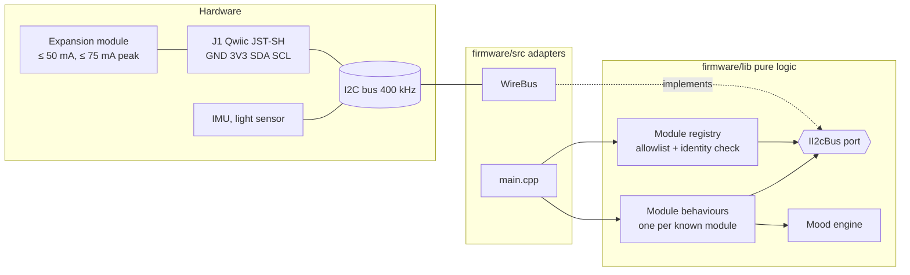

# Component diagram — expansion port

> **Frame**: `cmp — Expansion port`
> **Feature**: `expansion-port` — issue #18
> **Related ADRs**: ADR-0016, ADR-0007, ADR-0008, ADR-0014 (pure lib, thin adapters)
> **Base view**: [cube-core/03-component.md](../cube-core/03-component.md)

## Context

This diagram answers "where does module support live, and what does it depend on?". The
dependency points inward: the lib never includes Arduino.

## Diagram

## Notes

- `II2cBus` is the only new port; it is created at the first module's PDR, together with the
  first behaviour and its native tests.
- The registry holds a compile-time allowlist; the same table is in every cube (ADR-0008).
