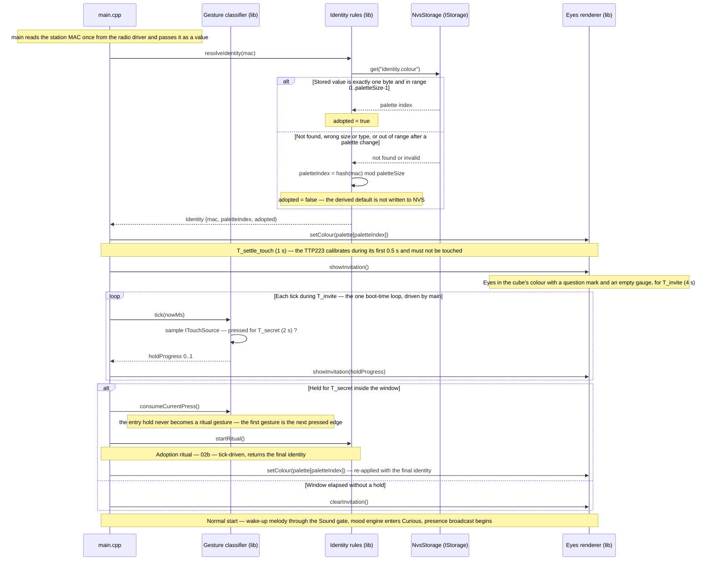

# Sequence diagram — identity — every boot resolves the eye colour

> **Frame**: `sd — Boot resolves identity`
> **Feature**: `identity` — backlog item S6 in [docs/roadmap.md](../../../roadmap.md)
> **Related ADRs**: ADR-0008 (MAC-derived default, NVS override), ADR-0006 (palette renders on OLED), ADR-0013 (invitation window, MAC by value)
> **Use case**: precondition of UC1 in [cube-core/01-use-case.md](../cube-core/01-use-case.md)
> **Modules and ports**: `Identity rules`, `Gesture classifier`, `IStorage`, `Eyes renderer`, `ITouchSource` in [cube-core/03-component.md](../cube-core/03-component.md)

## Context

This diagram answers "how does a cube get a colour on every boot, with no cable and no per-cube
build?". It covers the plain boot path, including the invitation window that leads into the
ritual. The ritual itself is in [02b-sequence-adoption-ritual.md](02b-sequence-adoption-ritual.md).

## Diagram

## Notes

- **Never an empty identity**: the MAC path is the fallback, so the eyes always have a colour,
  even on a cube that was never adopted. This is the testable guarantee of ADR-0008.
- **The derived default is not persisted** (owner decision, validated 2026-10-14). Writing it would
  make "adopted" indistinguishable from "defaulted", and would freeze defaults across a future
  palette change. The `adopted` flag tells the Maker which cubes are still spare.
- **NVS is input**: the key is exactly one `uint8`. A missing key, a value of another size or
  type (the Preferences API would otherwise return a default that looks like index 0), or an
  index out of range after a palette change all fall back to the MAC default rather than being
  trusted. Relevant after a firmware update shrinks the palette or after NVS corruption.
- **MAC passed by value** (ADR-0013, PDR 2026-10-14): the MAC is a boot-time constant, so
  `main.cpp` reads it once and hands it to the Identity rules. This drops `localMac` from
  `IRadio` (interface segregation) and removes the boot-order coupling between identity and the
  radio adapter.
- **Invitation window instead of "held while plugging in"** (ADR-0013): the TTP223 calibrates
  its baseline during the first 0.5 s after power and its datasheet forbids touching the pad in
  that window; a finger already resting on the pad would be calibrated away and never detected.
  So the cube waits T_settle_touch, then *invites*: a question mark and a gauge for T_invite; a
  touch held for T_secret inside the window enters the ritual. Same intent as the validated
  "secret gesture", same discoverability (the gauge fills), reliable on the real part.
- **Hash stability matters**: `hash(mac) mod paletteSize` is a fixed, documented function so that
  the same cube always defaults to the same colour across reflashes. A palette resize changes
  defaults, which is acceptable only for unadopted cubes.
- **An unadopted cube boots normally** (owner decision, validated 2026-10-14): the ritual is
  entered only through the invitation window, on adoption day as well as for re-adoption. Spare
  cubes and test cubes do not spend a minute in the ritual at each power-up.
- **One loop, in main**: the window and the ritual are tick-driven; `main.cpp` keeps the single
  loop and the Gesture classifier samples `ITouchSource` against the injected clock, so the
  guard replays in a native test (no blocking call inside `lib/`).
- **Durations**: T_settle_touch 1 s (twice the TTP223 0.5 s calibration window), T_invite 4 s,
  T_secret 2 s (tuning values). A hold started
  before T_invite elapses is allowed to complete (the window extends by up to T_secret) and the
  gauge never resets mid-hold.
- **Entry press consumed**: the hold that opened the ritual is consumed by the Gesture
  classifier, so its release cannot be read as the 1.5 s confirming stroke of 02b.
