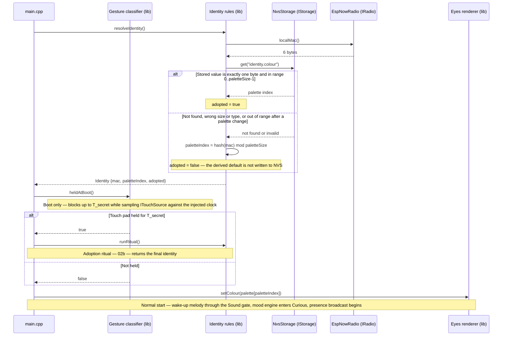

# Sequence diagram — identity — every boot resolves the eye colour

> **Frame**: `sd — Boot resolves identity`
> **Feature**: `identity` — backlog item S6 in [docs/roadmap.md](../../../roadmap.md)
> **Related ADRs**: ADR-0008 (MAC-derived default, NVS override), ADR-0006 (palette renders on OLED)
> **Use case**: precondition of UC1 in [cube-core/01-use-case.md](../cube-core/01-use-case.md)
> **Modules and ports**: `Identity rules`, `Gesture classifier`, `IStorage`, `IRadio.localMac`, `Eyes renderer` in [cube-core/03-component.md](../cube-core/03-component.md)

## Context

This diagram answers "how does a cube get a colour on every boot, with no cable and no per-cube
build?". It covers the plain boot path, including the two guards that lead into the ritual. The
ritual itself is in [02b-sequence-adoption-ritual.md](02b-sequence-adoption-ritual.md).

## Diagram

## Notes

- **Never an empty identity**: the MAC path is the fallback, so the eyes always have a colour,
  even on a cube that was never adopted. This is the testable guarantee of ADR-0008.
- **The derived default is not persisted** (owner decision taken by default). Writing it would
  make "adopted" indistinguishable from "defaulted", and would freeze defaults across a future
  palette change. The `adopted` flag tells the Maker which cubes are still spare.
- **NVS is input**: the key is exactly one `uint8`. A missing key, a value of another size or
  type (the Preferences API would otherwise return a default that looks like index 0), or an
  index out of range after a palette change all fall back to the MAC default rather than being
  trusted. Relevant after a firmware update shrinks the palette or after NVS corruption.
- **MAC comes through `IRadio.localMac`**, the one adapter that already knows it, rather than a
  dedicated port. If a non-radio build ever needs the MAC, add a port then (YAGNI).
- **Hash stability matters**: `hash(mac) mod paletteSize` is a fixed, documented function so that
  the same cube always defaults to the same colour across reflashes. A palette resize changes
  defaults, which is acceptable only for unadopted cubes.
- **An unadopted cube boots normally** (owner decision taken by default, alternatives in the PR
  Q&A): the ritual is entered only through the held-at-boot gesture, on adoption day as well as
  for re-adoption. Spare cubes and test cubes do not spend a minute in the ritual at each power-up.
- **`heldAtBoot` is lib logic**: the Gesture classifier samples `ITouchSource` against the
  injected clock for T_secret, so the guard replays in a native test.
