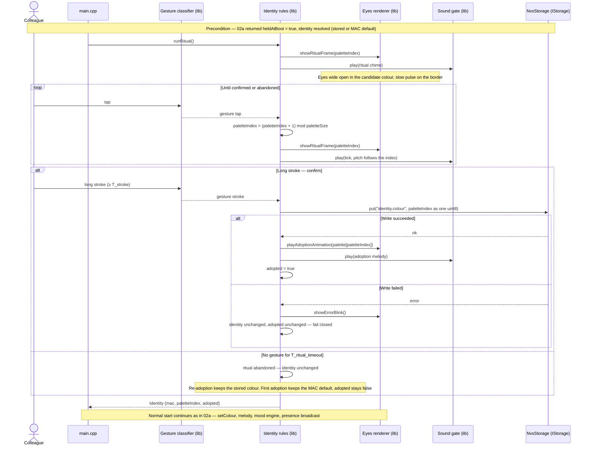

# Sequence diagram — identity — adoption ritual, entered by the held-at-boot gesture

> **Frame**: `sd — Adoption ritual`
> **Feature**: `identity` — backlog item S6 in [docs/roadmap.md](../../../roadmap.md)
> **Related ADRs**: ADR-0008 (tap cycles palette, long stroke confirms, NVS, secret gesture at boot)
> **Use case**: UC1 Adopt or re-adopt a cube in [cube-core/01-use-case.md](../cube-core/01-use-case.md)
> **Modules and ports**: `Identity rules`, `Gesture classifier`, `Sound gate`, `IStorage`, `Eyes renderer` in [cube-core/03-component.md](../cube-core/03-component.md)

## Context

This diagram answers "what happens, in time, between the colleague picking up a cube and the
colour being written to NVS?". There is one entry: the touch pad held while the cube is plugged
in ([02a](02a-sequence-first-boot.md) detected it). On adoption day the Maker hands over an
unplugged cube and the colleague plugs it in with a finger on the pad; the same gesture
re-adopts a spare cube later (both are UC1). The ritual runs before the mood engine and the
presence broadcast start, so neighbours never see a flickering colour.

## Diagram

## Notes

- **The old colour survives an abandoned ritual**: NVS is written once, at confirmation. A
  colleague who triggers the gesture by accident (cube held while plugging in) loses nothing.
- **Durations**: T_secret (hold at boot) 3 s, T_stroke 1.5 s, T_ritual_timeout 60 s of inactivity
  (the timer restarts at every tap), all through the injected clock so the ritual replays in a
  native test. Tuning values, not decisions.
- **Palette**: 8–12 entries chosen for OLED rendering (ADR-0008). The palette table lives in
  `Identity rules`, so the hash in 02a and the cycling here share one source of truth.
- **Why the ritual is in the Identity module and not a UI layer**: it is a small state machine
  (cycling, confirm, timeout) and the project rule puts state machines in `lib/`. The Gesture
  classifier delivers gestures, the Eyes renderer draws frames, the Sound gate plays.
- **Ritual entry only by the held-at-boot gesture**: owner decision, validated 2026-10-14 (an
  automatic offer on the first boot was rejected because the Maker's tests would consume it).
- **Open**: whether a double tap cycles backwards (friendlier for 12 colours, at the price of
  overloading the "joy" gesture of the mood domain). To be decided with the palette size.
