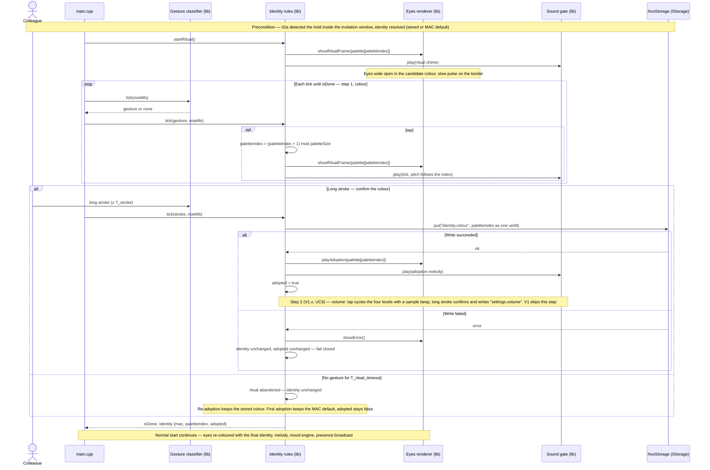

# Sequence diagram — identity — adoption ritual, entered from the invitation window

> **Frame**: `sd — Adoption ritual`
> **Feature**: `identity` — backlog item S6 (colour), S4 (volume step, V1.x) in [docs/roadmap.md](../../../roadmap.md)
> **Related ADRs**: ADR-0008 (tap cycles palette, long stroke confirms, NVS), ADR-0013 (tick-driven ritual, volume step)
> **Use case**: UC1 Adopt or re-adopt a cube, UC6 Adjust the volume in [cube-core/01-use-case.md](../cube-core/01-use-case.md)
> **Modules and ports**: `Identity rules`, `Gesture classifier`, `Sound gate`, `IStorage`, `Eyes renderer` in [cube-core/03-component.md](../cube-core/03-component.md)

## Context

This diagram answers "what happens, in time, between the colleague holding the pad during the
invitation and the colour being written to NVS?". There is one entry: the hold detected inside
the invitation window ([02a](02a-sequence-first-boot.md)). On adoption day the Maker hands over
an unplugged cube; the colleague plugs it in, waits for the question mark, and holds the pad.
The same gesture re-adopts a spare cube later (both are UC1). The ritual runs before the mood
engine and the presence broadcast start, so neighbours never see a flickering colour. It is
**tick-driven**: `main.cpp` calls `tick()` until `isDone()`, there is no second loop in `lib/`.

## Diagram

## Notes

- **Entry press consumed**: the hold that opened the ritual never counts as a ritual gesture
  (02a consumes it); the first ritual gesture is the next pressed edge, so the MAC-default colour
  cannot be confirmed by accident.
- **The old colour survives an abandoned ritual**: NVS is written once, at confirmation. A
  colleague who triggers the invitation by accident loses nothing.
- **Tick-driven, not blocking** (ADR-0013): `Identity rules` exposes `startRitual()`,
  `tick(gesture, nowMs)` and `isDone()`; `main.cpp` keeps the single loop and the native test
  advances `FakeClock` between ticks. The Stimulus router, Sleep cycle and Social protocol start
  ticking only once `isDone()`.
- **Durations**: T_stroke 1.5 s, T_doubletap 250 ms (shared with the mood domain, defined in 03), T_ritual_timeout 60 s of inactivity (the timer restarts at every
  tap), all through the injected clock so the ritual replays in a native test. Tuning values, not
  decisions.
- **Palette**: 8–12 entries chosen for OLED rendering (ADR-0008). The palette table lives in
  `Identity rules`, so the hash in 02a and the cycling here share one source of truth.
- **Volume as a second ritual step** (owner decision, ADR-0013): the colleague is already
  "configuring" the cube, the gesture alphabet (tap, long stroke) is reused with no collision with
  the awake gestures, and the NVS write path exists. V1 ships a constant volume and skips the
  step; V1.x adds it with the stored `settings.volume` read by the Sound gate.
- **Why the ritual is in the Identity module and not a UI layer**: it is a small state machine
  (cycling, confirm, timeout) and the project rule puts state machines in `lib/`. The Gesture
  classifier delivers gestures, the Eyes renderer draws frames, the Sound gate plays.
- **Ritual entry only from the invitation window**: owner decision, validated 2026-10-14 (an
  automatic offer on the first boot was rejected because the Maker's tests would consume it);
  the window replaces "held while plugging in" for the TTP223 calibration reason stated in 02a.
- **Palette and double tap (decided 2026-10-15, F3)**: 8 colours, forward only; a double tap
  moves forward by two. The ritual is the state machine of [05b](05b-state-adoption-ritual.md),
  which returns the frame and sound for `main.cpp` to apply (the `I->>E` and `I->>A` arrows
  above go through `main.cpp`). The tick has one fixed pitch until the sound-design brick.
