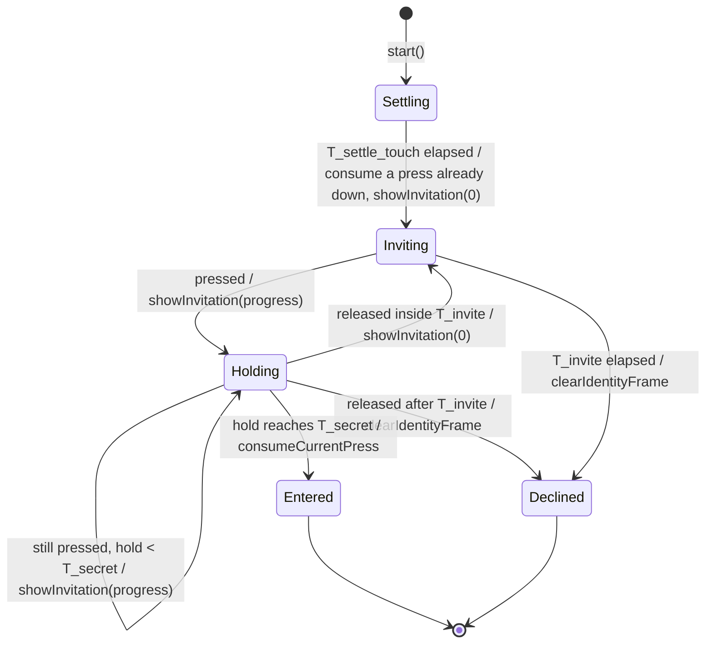

# State diagram — identity — invitation window

> **Frame**: `stm — Invitation window`
> **Feature**: `identity` — backlog item S6 in [docs/roadmap.md](../../../roadmap.md)
> **Related ADRs**: ADR-0008, ADR-0013 (invitation window replaces "held while plugging in")
> **Sequence**: [02a-sequence-first-boot.md](02a-sequence-first-boot.md)
> **Module**: `Invitation window` → `Gesture classifier` in [cube-core/03-component.md](../cube-core/03-component.md)

> **Status**: validated by the owner 2026-10-15 (F3 PDR, derived choices scored: double tap +2 470/500, settle press consumed 470/500, `IdentityOutput` returned 445/500, any gesture restarts the timeout 470/500)

## Context

This diagram answers "after boot, when does a touch open the adoption ritual?". It refines the
boot loop of 02a with three owner decisions of 2026-10-15 (F3, scored options):

- **The window is its own lib class** (`InvitationWindow`, 435/500 against 430 for folding it
  into the Identity rules and 255 for leaving it in `main.cpp`): one job, replayed in native
  tests; the ritual (05b) stays a separate machine.
- **It reads the hold from the Gesture classifier**: `holdMs()` (age of the current press, 0
  when released) and `consumeCurrentPress()` (05c amended), so the pad is sampled in one place.
- **It returns what to draw, it does not draw**: `tick()` returns an `IdentityOutput` (frame,
  gauge progress, optional sound) that `main.cpp` applies, like the Stimulus router's `Route`.

`main.cpp` calls `start()` once the colour is set, then `tick()` every loop until `entered()` or
`declined()`. The window ticks the Gesture classifier itself; gestures are ignored here.

## Diagram

## Transition table

Each row is one native test (ADR-0014). Times are ages on the injected clock.

| From | Trigger | To | Output / side effect |
|------|---------|----|----------------------|
| — | `start()` | Settling | none (the eyes already show the colour) |
| Settling | tick before T_settle_touch | Settling | none (a touch here is never read: TTP223 calibration) |
| Settling | T_settle_touch elapsed, pad released | Inviting | `showInvitation(0)` |
| Settling | T_settle_touch elapsed, pad already pressed | Inviting | `consumeCurrentPress()`, `showInvitation(0)` — the finger must lift and press again |
| Inviting | pressed (`holdMs() > 0`) | Holding | `showInvitation(progress)` |
| Inviting | press whose edge came inside T_invite, first seen held on a tick past it | Holding | `showInvitation(progress)` — the press is checked before the expiry (`holdMs()` is 0 on the edge tick) |
| Inviting | pressed, hold already ≥ T_secret (late tick) | Holding | `showInvitation(255)` — progress clamped; enters on the next tick |
| Holding | still pressed, hold < T_secret | Holding | `showInvitation(progress)`, progress = hold × 255 / T_secret |
| Holding | released, T_invite not elapsed | Inviting | `showInvitation(0)` |
| Holding | released, T_invite elapsed | Declined | `clearIdentityFrame()` |
| Holding | hold reaches T_secret (even after T_invite) | Entered | `consumeCurrentPress()`; frame left for the ritual to replace |
| Inviting | T_invite elapsed | Declined | `clearIdentityFrame()` |

Durations (tuning values, 02a): T_settle_touch 1 s, T_invite 4 s counted from the end of the
settle, T_secret 2 s.

## Notes

- **The gauge never resets mid-hold**: a hold started inside T_invite runs to T_secret even past
  the window (02a), and only a release empties the gauge.
- **A press already down at the end of the settle is consumed**: the TTP223 may have calibrated
  it away, so it cannot be trusted; lifting and pressing again is the reliable path.
- **Entry press consumed**: the classifier swallows the rest of the entry press, so its release
  is not a `Released` and its length is not a ritual stroke (02b).
- **Wrap-safe**: every duration is an `ageMs`, never `now > then + T`.
