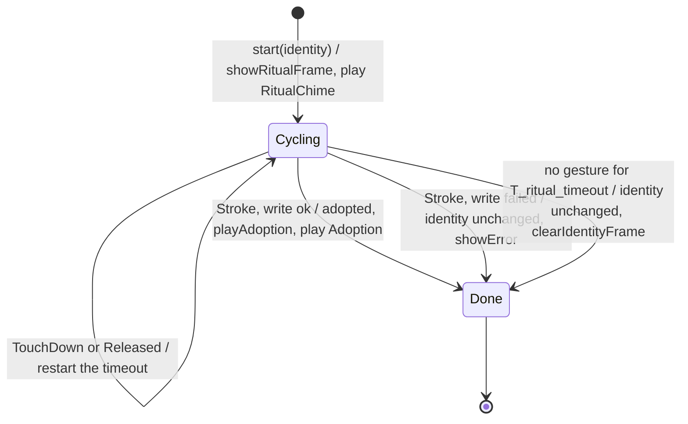

# State diagram — identity — adoption ritual

> **Frame**: `stm — Adoption ritual`
> **Feature**: `identity` — backlog item S6 in [docs/roadmap.md](../../../roadmap.md)
> **Related ADRs**: ADR-0008 (tap cycles, long stroke confirms, NVS), ADR-0013 (tick-driven)
> **Sequence**: [02b-sequence-adoption-ritual.md](02b-sequence-adoption-ritual.md)
> **Module**: `Identity rules` → `IStorage` in [cube-core/03-component.md](../cube-core/03-component.md)

## Context

This diagram answers "which gesture does what during the ritual, and what is written to NVS?".
It refines 02b with the owner decisions of 2026-10-15 (F3, scored options):

- **Palette of 8 colours, tap moves forward only** (445/500 against 440 for 10 colours and 410
  for 12): eight hues that stay distinct on the 96×64 OLED, at most seven taps to go round. A
  double tap moves forward by two, so every tap the colleague makes counts (the classifier merges
  two quick taps into one `DoubleTap`).
- **One fixed tick sound** (425/500 against 400 for a pitch per index): the pitch that follows
  the index is deferred to the sound-design brick, so the Sound gate API stays `play(id)`.
- **It returns what to draw and play** (`IdentityOutput`), like 05a; `main.cpp` applies it to
  the Eyes renderer and the Sound gate.

`main.cpp` calls `start(identity)` after the window enters, then `tick(gesture)` every loop
until `isDone()`, and reads `identity()`.

## Diagram

## Transition table

Each row is one native test (ADR-0014).

| From | Trigger | To | Output / side effect |
|------|---------|----|----------------------|
| — | `start(identity)` | Cycling | candidate = identity index; `showRitualFrame(candidate)`, `RitualChime` |
| Cycling | `Tap` | Cycling | candidate + 1 mod 8; `showRitualFrame`, `RitualTick`; timeout restarts |
| Cycling | `DoubleTap` | Cycling | candidate + 2 mod 8; `showRitualFrame`, `RitualTick`; timeout restarts |
| Cycling | `TouchDown` or `Released` | Cycling | none; timeout restarts |
| Cycling | `Stroke`, `IStorage` write ok | Done | `identity.colour` = candidate (one `uint8`), adopted = true; `playAdoption(colour)`, `Adoption` |
| Cycling | `Stroke`, `IStorage` write failed | Done | identity and adopted unchanged; `showError()` (fail closed) |
| Cycling | no gesture for T_ritual_timeout | Done | identity unchanged; `clearIdentityFrame()` |
| Done | any `tick` | Done | none |

T_ritual_timeout 60 s (tuning value, 02b), restarted by every gesture, not only taps.

## Notes

- **NVS is written once**, at confirmation: an abandoned or failed ritual leaves the stored
  colour (re-adoption) or the MAC default (first adoption, adopted stays false).
- **The MAC default can be confirmed** on purpose with a stroke as the first gesture; the entry
  hold cannot do it by accident because 05a consumed it.
- **Palette** (provisional RGB, tuned on the bench): red, orange, yellow, green, cyan, blue,
  violet, pink. The table and the MAC hash (FNV-1a 32-bit over the six MAC bytes, mod 8) live in
  the Identity rules, one source of truth for 02a and this diagram.
- **Sounds** go through the Sound gate (05e amended): `RitualChime` and `RitualTick` rank 0,
  `Adoption` rank 2 so it is never dropped behind a tick.
- **Volume step (V1.x, UC6)** is not in V1: the machine ends at the colour.
