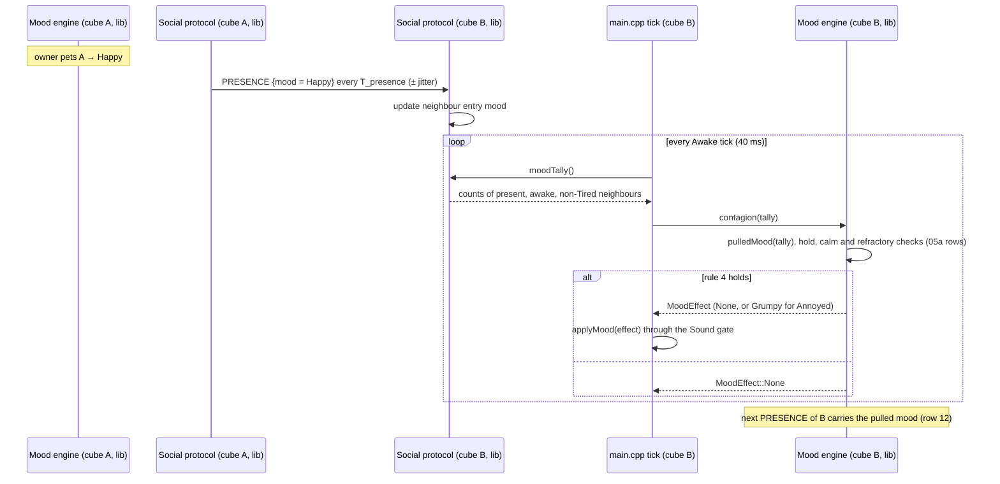

# Sequence diagram — social-group — a neighbour's mood pulls mine

> **Frame**: `sd — Mood contagion`
> **Feature**: `social-group` — backlog item G2 in [docs/roadmap.md](../../../roadmap.md), issue #52
> **Related ADRs**: ADR-0005 (versioned PRESENCE frame), ADR-0012, ADR-0013
> **Use case**: UC8 Let moods spread in [specs/use-cases.md](../../specs/use-cases.md)
> **Rules**: [05a-state-contagion.md](05a-state-contagion.md)
> **Base**: [social-presence/02](../social-presence/02-sequence-presence.md) (table, presence broadcast)

> **Status**: validated by the owner 2026-10-22 (PDR `social-group`, G2; decisions in
> [05a-state-contagion.md](05a-state-contagion.md)).

## Context

This diagram answers "which modules carry a mood from cube A to cube B, and where is the decision
taken?". The presence frame already carries the mood byte (social-presence/06); G2 adds no radio
traffic. `main.cpp` stays the only place that wires lib modules together.

## Diagram

## Notes

- **Dependency direction**: the mood engine knows a `MoodTally` (a value type in `core/Mood.h`),
  never the Social protocol. The Social protocol knows nothing of the mood engine.
- **Order in the tick**: after `social.tick()` (fresh table) and after the owner's stimuli of the
  same tick, before `mood.tick()`; owner stimuli are applied first so row 6 holds within one tick.
