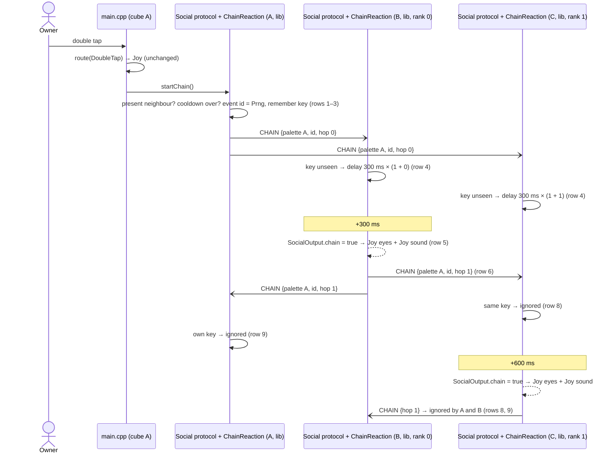

# Sequence diagram — social-group — a double tap ripples through the group

> **Frame**: `sd — Chain reaction`
> **Feature**: `social-group` — backlog item G3 in [docs/roadmap.md](../../../roadmap.md), issue #55
> **Related ADRs**: ADR-0005 (versioned frames), ADR-0012, ADR-0013
> **Use case**: UC9 Start a chain reaction in [specs/use-cases.md](../../specs/use-cases.md)
> **Rules**: [05b-state-chain.md](05b-state-chain.md) — **Frame**: CHAIN in [social-presence/06](../social-presence/06-data-flow.md)

> **Status**: validated by the owner 2026-10-22 (PDR `social-group`, G3, issue #55), scored options
> (criteria: effect 30, robustness 25, simplicity 25, fit 20): D1 double tap with a present
> neighbour 425/500 (330 triple tap, 325 single tap); D2 MAC-rank delay 430/500 (370 Prng delay,
> 340 immediate relay); D3 8-byte type 0x02 frame, (palette, 8-bit id) key, hop ≤ 3, v1 kept
> 445/500 (350 sequence counter, 335 16-bit id); D4 `ChainReaction` owned by the Social protocol
> 420/500 (380 inside the protocol, 285 separate radio reader). T_step 300 ms, kMaxHop 3,
> T_cooldown 5 s, T_trigger 10 s, T_seen 30 s accepted.

## Context

This diagram answers "which modules carry a chain event from the tapped cube to its neighbours,
and who decides when each one reacts?". The Social protocol owns the radio and the table; its
`ChainReaction` member decides; `main.cpp` turns the returned flag into eyes and sound.

## Diagram

## Notes

- **Dependency direction**: `ChainReaction` knows `Mac`, `IClock` time values and the decoded
  `Chain` struct; it never sees the radio. The Social protocol calls it from `receive()` and
  `tick()` and broadcasts what it returns.
- **Order in the tick**: `startChain()` is called after the gesture of the tick, before
  `social.tick()`, so the origin frame leaves on the same tick.
