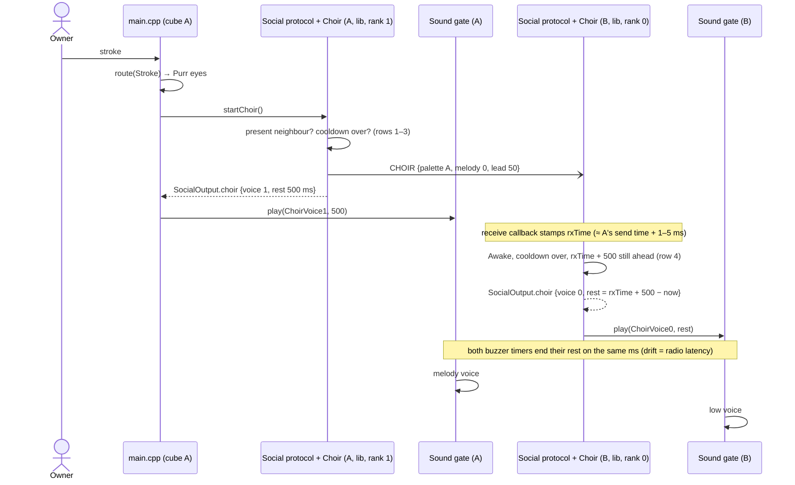

# Sequence diagram — social-group — a stroke starts a synchronised choir

> **Frame**: `sd — Choir`
> **Feature**: `social-group` — backlog item G4 in [docs/roadmap.md](../../../roadmap.md), issue #57
> **Related ADRs**: ADR-0005 (versioned frames), ADR-0012, ADR-0013 (single Sound gate)
> **Use case**: UC10 Gather the cubes for a choir in [specs/use-cases.md](../../specs/use-cases.md)
> **Rules**: [05c-state-choir.md](05c-state-choir.md) — **Frame**: CHOIR in [social-presence/06](../social-presence/06-data-flow.md)

> **Status**: design choices validated by the owner 2026-10-23 (issue #57), see 05c.

## Context

This diagram answers "how does one stroke become one melody, started on the same millisecond by
every cube in range?". The Social protocol owns the radio and the table; its `Choir` member
decides; `main.cpp` hands the voice and the lead rest to the Sound gate; the buzzer adapter's
timer plays the rest then the notes.

## Diagram

## Notes

- **Dependency direction**: `Choir` knows `IClock` time values and the decoded `ChoirFrame`; it
  never sees the radio or the audio port.
- **Order in the tick**: `startChoir()` is called after the gesture of the tick, before
  `social.tick()`, as `startChain()` (02b); the output is applied after the gesture's route, so
  the choir voice replaces the Purr sound (05c note).
