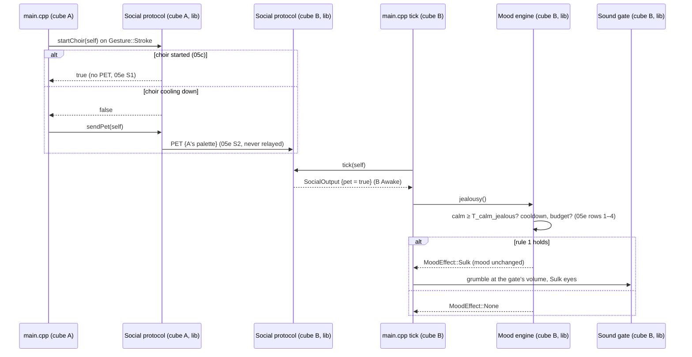

# Sequence diagram — social-group — a stroke on cube A makes cube B sulk

> **Frame**: `sd — Jealousy`
> **Feature**: `social-group` — backlog item G6 in [docs/roadmap.md](../../../roadmap.md), issue #73
> **Related ADRs**: ADR-0005 (versioned frames), ADR-0012, ADR-0013 (single Sound gate)
> **Behaviour**: B5 Jealousy in [specs/use-cases.md](../../specs/use-cases.md)
> **Rules**: [05e-state-jealousy.md](05e-state-jealousy.md) — **Base**: [02c-sequence-choir.md](02c-sequence-choir.md)

> **Status**: design choices validated by the owner 2026-11-05 (issue #73), see 05e.

## Context

This diagram answers "which modules carry a stroke on cube A to a sulk on cube B?". It reuses
the G4 stroke path: the PET frame is sent only when the stroke did not start a choir.

## Diagram

## Notes

- **Wiring**: `main.cpp` calls `sendPet()` after a `startChoir()` that sent nothing, and
  `mood.jealousy()` when the tick's `SocialOutput::pet` is set; `effects(MoodEffect::Sulk)` maps
  it to the Sulk reaction and the grumble.
- **Dependency direction** unchanged: the Social protocol and the Mood engine stay unaware of
  each other; `main.cpp` passes the flag.
