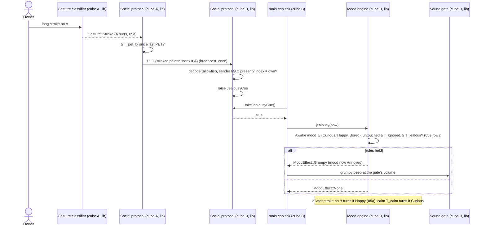

# Sequence diagram — social-group — a stroke on cube A makes cube B jealous

> **Frame**: `sd — Jealousy`
> **Feature**: `social-group` — backlog item G6 in [docs/roadmap.md](../../../roadmap.md), issue #73
> **Related ADRs**: ADR-0005 (versioned frames), ADR-0012, ADR-0013 (single Sound gate)
> **Behaviour**: B5 Jealousy in [specs/use-cases.md](../../specs/use-cases.md)
> **Rules**: [05e-state-jealousy.md](05e-state-jealousy.md) — **Frame**: PET `0x04` in
> [social-presence/06](../social-presence/06-data-flow.md)

> **Status**: design choices proposed 2026-11-05 (issue #73), see 05e.

## Context

This diagram answers "which modules carry a stroke on cube A to a sulk on cube B?". It adds one
frame type and one cue; the reaction reuses the Annoyed mood and its grumpy beep.

## Diagram

## Notes

- **New wiring**: `main.cpp` forwards a `Gesture::Stroke` to `SocialProtocol::sendPet()` and
  calls `mood.jealousy(now)` when `takeJealousyCue()` is true; the Grumpy effect is already
  mapped to the grumpy sound and eyes.
- **Touch memory**: the mood engine already receives every touch-down (`MoodEngine::touchDown()`); it also keeps the time of the last
  one for T_ignored, no new port.
- **Dependency direction** unchanged: the cue is a flag owned by `SocialProtocol` in `lib/`.
