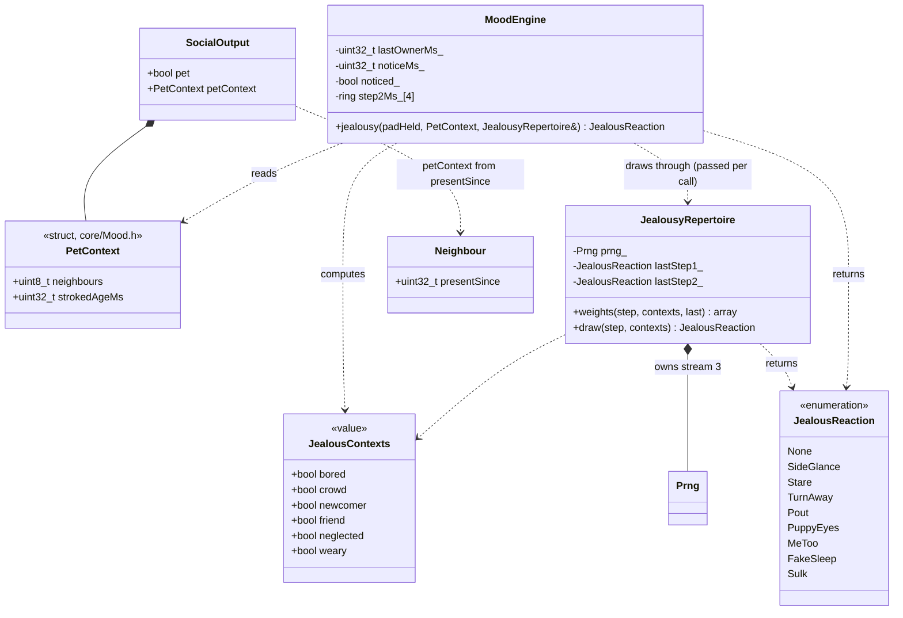

# Class diagram — social-group — jealousy repertoire types (G6a)

> **Frame**: `class — Jealousy`
> **Feature**: `social-group` — backlog item G6a in [docs/roadmap.md](../../../roadmap.md), issue #85
> **Related ADRs**: ADR-0013 (lib-owned `Prng`), ADR-0014 (tests follow the conception)
> **Rules**: [05e-state-jealousy.md](05e-state-jealousy.md) — **Sequence**: [02e-sequence-jealousy.md](02e-sequence-jealousy.md)
> **Requirement**: REQ-F-21

> **Status**: validated with the G6a PDR (issues #85, #88); implemented in issue #90.

## Context

This diagram answers "which types does G6a add, who owns what, and which way do the
dependencies point?". G6a adds three domain types (`PetContext`, `JealousReaction`,
`JealousyRepertoire`) and a contexts set, past the architecture README's threshold for a class
view.

## Diagram

## Notes

- **Dependency direction**: `PetContext` lives in `core/Mood.h`, so `MoodEngine` never includes
  `SocialProtocol.h`; the Social protocol fills it from `Neighbour::presentSince` and its table.
- **Ownership**: `Seeded` (built after the Wi-Fi driver, ADR-0013) owns the repertoire; the mood
  engine, a static global built earlier, receives it per call and holds no reference.
- **Eyes**: each non-`None` value maps to a renderer `Reaction` of the same name through the lib
  `effects(JealousReaction) → Route` (05e Repertoire).
