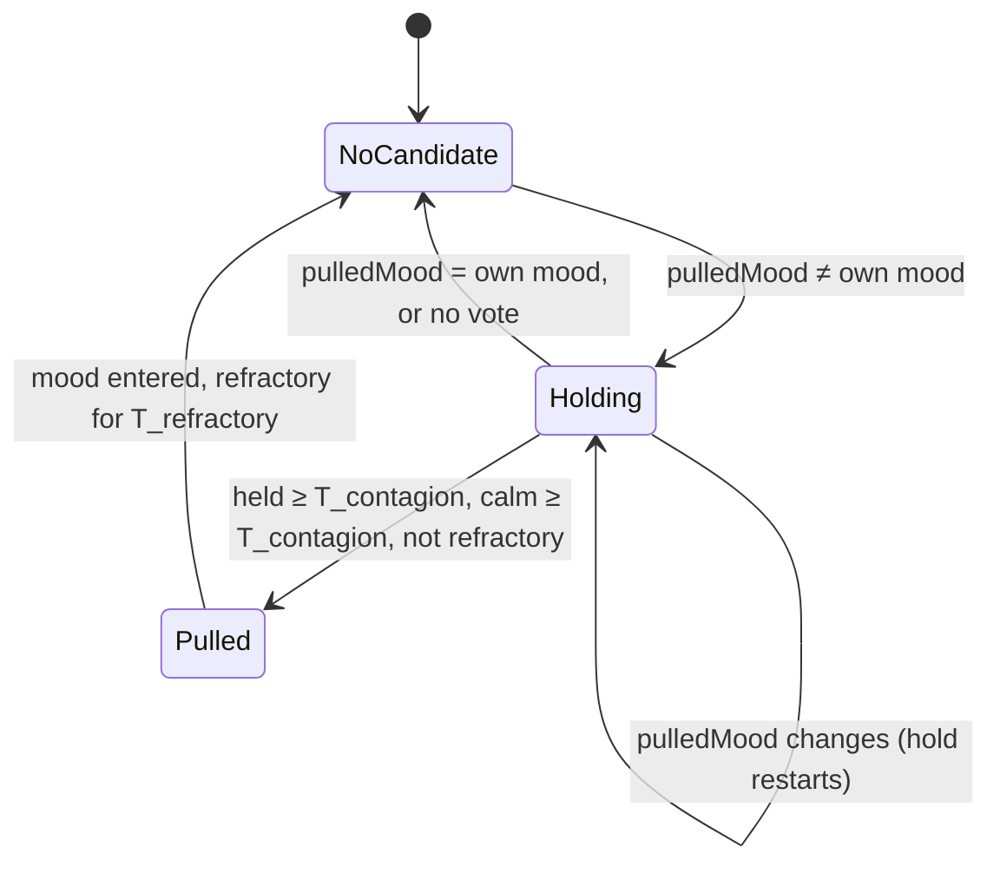

# State diagram — social-group — mood contagion (extension of the mood engine)

> **Frame**: `stm — Mood contagion`
> **Feature**: `social-group` — backlog item G2 in [docs/roadmap.md](../../../roadmap.md), issue #52
> **Related ADRs**: ADR-0001 (the social layer degrades to nothing when alone), ADR-0012 (no
> authentication, accepted nuisance risk), ADR-0013 (timings), ADR-0014 (tests follow the conception)
> **Base machine**: [cube-core/05a-state-mood-engine.md](../cube-core/05a-state-mood-engine.md) (G2 hook)
> **Input**: the neighbour table of [social-presence/05a](../social-presence/05a-state-neighbour-entry.md)
> **Sequence**: [02-sequence-contagion.md](02-sequence-contagion.md)
> **Requirement**: REQ-F-11, FS8 (mood converges within 60 s) — use case UC8

> **Status**: validated by the owner 2026-10-22 (PDR `social-group`, G2, issue #52), scored options
> (criteria: effect 30, stability 25, simplicity 25, robustness 20): D1 neighbours-only plurality
> with priority tie-break and refractory 430/500 (against 365 self-voting, 275 Prng voter model);
> D2 every mood but Tired 450/500 (410 Happy/Curious only, 360 all five); D3 mood-engine
> extension with a `MoodTally` value 450/500 (375 separate class, 325 inside the Social protocol).
> T_contagion 6 s and T_refractory 60 s accepted.

## Context

This diagram answers "when does the neighbours' mood replace mine, and what keeps the group from
ping-ponging?". Contagion is **not a new machine**: it adds one guarded transition to the mood
engine, "any mood → the pulled mood", fed once per Awake tick with a tally of the neighbours'
moods. A pull needs a stable candidate for `T_contagion`, no owner attention for that long, and
the cube must be out of its refractory period. Alone, the tally is empty and nothing changes
(ADR-0001).

## The tally (input, computed by the Social protocol)

`MoodTally` counts the moods of the **present, awake** neighbours: entries `Waiting` or
`Greeted` (not `Absent`, not `Free`), mood byte `0..4`. Asleep (`5`) and Tired (`3`) neighbours
do not vote (D2: Tired never spreads, collective sleep is G5). The cube's own mood does **not**
vote (D1).

## The pulled mood (pure function)

`pulledMood(tally)`: the mood with the most votes; ties broken by the fixed priority
**Happy > Annoyed > Curious > Bored** (energy wins over lethargy, a sulk dampens a calm group).
No vote → no candidate.

## Diagram

## Transition table (source of the native tests)

| # | Situation (cube Awake) | Result |
|---|------------------------|--------|
| 1 | no present awake neighbour (alone, all absent, all asleep or Tired) | no candidate, mood unchanged |
| 2 | plurality mood = own mood | no candidate, mood unchanged |
| 3 | plurality mood ≠ own mood, held < T_contagion | mood unchanged |
| 4 | same candidate held ≥ T_contagion, no gesture or sound for T_contagion, not refractory | enter the candidate; its entry effect applies (Grumpy beep for Annoyed); its natural timers restart from now |
| 5 | candidate changes during the hold | hold restarts from now |
| 6 | owner gesture or sound (not `NewcomerSeen`) during the hold | pull postponed until calm ≥ T_contagion — the owner always wins |
| 7 | within T_refractory of the last pull | no pull, whatever the tally |
| 8 | tie between moods | priority Happy > Annoyed > Curious > Bored |
| 9 | Tired or asleep neighbours | do not vote |
| 10 | candidate Tired | impossible (Tired never votes) |
| 11 | cube not Awake | contagion not evaluated (the engine is paused); a wake restarts it with no candidate |
| 12 | a pulled mood | is broadcast like any mood; refractory stops the echo |

Durations (tuning, no ADR): **T_contagion 6 s** (just above one presence period with jitter, and
below T_settle 10 s so a petted Happy cube has time to spread), **T_refractory 60 s** (a cube is
pulled at most once a minute: kills two-cube ping-pong, bounds forged-frame nuisance).

## Worked example (two cubes, rows 4, 7, 12)

A is petted at t0 → Happy. B hears it ≤ 6 s later, holds 6 s → Happy at ≈ 12 s, refractory to
72 s. A settles to Curious at 10 s, hears B Happy → pulled Happy at ≈ 16 s, refractory to 76 s.
B settles at 22 s and stays Curious (refractory); A settles at 26 s. Both Curious: converged
within 60 s (FS8), one visible ripple of joy.

## Notes

- **Security**: a forged presence frame can now inject a mood (risk (2) of social-presence/06,
  ADR-0012). The refractory period caps it at one mood change per minute on a desk toy; the owner's
  attention always wins (row 6). Accepted under ADR-0012, no new ADR.
- **Deterministic**: the tally, the tie-break and the clock are inputs; no `Prng` is needed.
- **No new radio field**: the mood byte of the PRESENCE frame (v1) is already enough.
