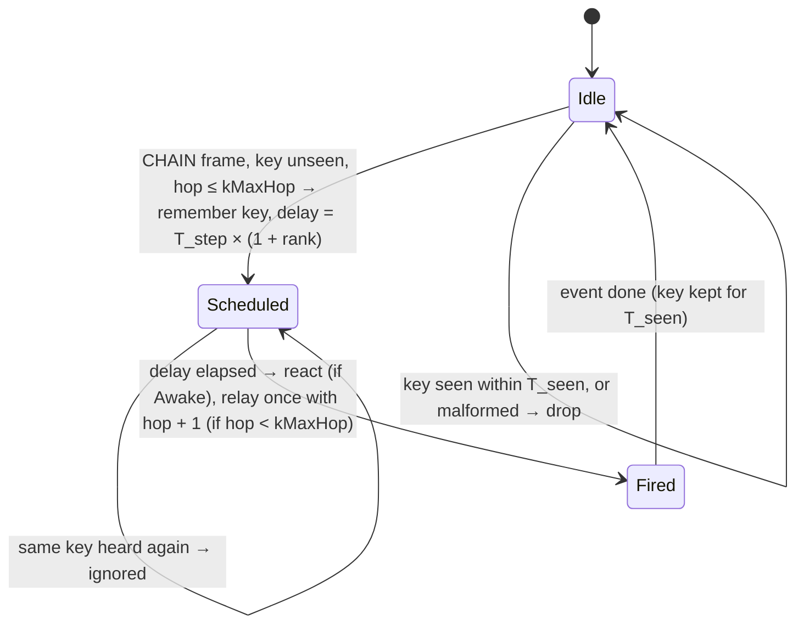

# State diagram — social-group — chain reaction (one event, one reaction and one relay per cube)

> **Frame**: `stm — Chain reaction`
> **Feature**: `social-group` — backlog item G3 in [docs/roadmap.md](../../../roadmap.md), issue #55
> **Related ADRs**: ADR-0001 (alone, nothing happens), ADR-0005 (versioned frames, allowlist),
> ADR-0012 (no authentication, accepted nuisance risk), ADR-0013 (Prng owned by the lib),
> ADR-0014 (tests follow the conception)
> **Frame layout**: CHAIN type in [social-presence/06](../social-presence/06-data-flow.md)
> **Sequence**: [02b-sequence-chain.md](02b-sequence-chain.md)
> **Requirement**: REQ-F-12, FS8 (chain hop ≤ 500 ms) — use case UC9

> **Status**: validated by the owner 2026-10-22 (PDR `social-group`, G3, issue #55), scored options
> (criteria: effect 30, robustness 25, simplicity 25, fit 20): D1 double tap with a present
> neighbour 425/500 (330 triple tap, 325 single tap); D2 MAC-rank delay 430/500 (370 Prng delay,
> 340 immediate relay); D3 8-byte type 0x02 frame, (palette, 8-bit id) key, hop ≤ 3, v1 kept
> 445/500 (350 sequence counter, 335 16-bit id); D4 `ChainReaction` owned by the Social protocol
> 420/500 (380 inside the protocol, 285 separate radio reader). T_step 300 ms, kMaxHop 3,
> T_cooldown 5 s, T_trigger 10 s, T_seen 30 s accepted.

## Context

This diagram answers "when does a cube react to a chain event, when does it relay it, and what
stops the wave from echoing forever?". The chain is a small machine **per event**, held in a
`ChainReaction` value owned by the Social protocol: the protocol does the radio I/O, the chain
object decides (dedupe, delay, relay) from pure inputs (frame, own MAC, neighbour table, clock).

## Event identity

An event is the pair **(origin palette index, event id)**: the origin draws the 8-bit event id
from the lib-owned `Prng` when the owner double-taps it. Relays copy both fields unchanged and
only increment the hop count, so every copy of one event carries the same key. A cube remembers
the last **8 keys for T_seen 30 s** (ring buffer): a key heard again in that window is ignored
(UC9 2a).

## Delay: one after another

On first hearing an event, a cube waits `delay = T_step × (1 + rank)`, where `rank` is the number
of present neighbours (`Waiting` or `Greeted`) whose MAC is lower than its own. Every cube ranks
itself against the same fleet, so the reactions fire in MAC order, one `T_step` apart
(**T_step 300 ms**, ≤ 500 ms per hop, FS8). With 16 cubes the last one reacts ≈ 5 s after the tap.
Two cubes whose tables differ may tie and react together: accepted, it still reads as a wave.

## Diagram

## Transition table (source of the native tests)

| # | Situation | Result |
|---|-----------|--------|
| 1 | owner double-taps an Awake cube, at least one present neighbour, origin cooldown over | origin broadcasts CHAIN {own palette, new event id, hop 0}, remembers the key, reacts as usual (Joy) |
| 2 | owner double-taps alone (no present neighbour) | no frame, solo Joy only (ADR-0001) |
| 3 | owner double-taps within T_trigger 10 s of the last trigger | no new frame (Joy only) |
| 4 | CHAIN frame with an unseen key | scheduled at T_step × (1 + rank); rank = present neighbours with a lower MAC |
| 5 | delay elapsed, cube Awake | chain reaction: Joy eyes and the Joy sound through the Sound gate; mood unchanged |
| 6 | delay elapsed, hop < kMaxHop (3) | relays once: same palette and event id, hop + 1 |
| 7 | delay elapsed, hop = kMaxHop | reacts, does not relay |
| 8 | same key heard again (echo, relay of a relay) within T_seen | ignored: no second reaction, no second relay |
| 9 | the origin hears its own event relayed | ignored (key remembered at row 1) |
| 10 | a new key while one event is already scheduled | ignored (one pending event at a time); the key is **not** remembered, so a later copy can still be taken |
| 11 | delay elapsed, cube not Awake (Dozing, Asleep, Waking) | no reaction, no sound; still relays (row 6), so a sleeping cube does not break the wave |
| 12 | a reaction within T_cooldown 5 s of the last chain reaction | the key is remembered, no reaction, no relay (caps forged-frame nuisance) |
| 13 | the 8-key ring is full | the oldest key is overwritten |
| 14 | key older than T_seen 30 s heard again | treated as new (row 4) |

Every age test is `(uint32)(now - then) ≥ T`, wrap-safe (social-presence/06).

## Why no echo storm

Each cube transmits **at most one frame per event** (row 6 after row 4, never again by rows 8–9),
so an event costs at most N frames for N cubes in range, then dies. `kMaxHop 3` bounds the spread
beyond the origin's radio range, the 8-key ring bounds memory, and T_cooldown bounds the reaction
rate even under a stream of forged keys.

## Notes

- **Security**: an attacker in range can forge CHAIN frames and make a cube react at most once per
  T_cooldown (5 s) — a beep and happy eyes on a desk toy, under the risk accepted by ADR-0012;
  nothing is persisted or relayed beyond kMaxHop. No new ADR.
- **Deterministic**: clock, Prng (event id only) and the table are inputs; tests replay.
- **Mood unchanged**: the chain is a reaction, not a stimulus to the mood engine (YAGNI: no
  requirement links it to moods; G2 contagion would otherwise turn every chain into a pull).
