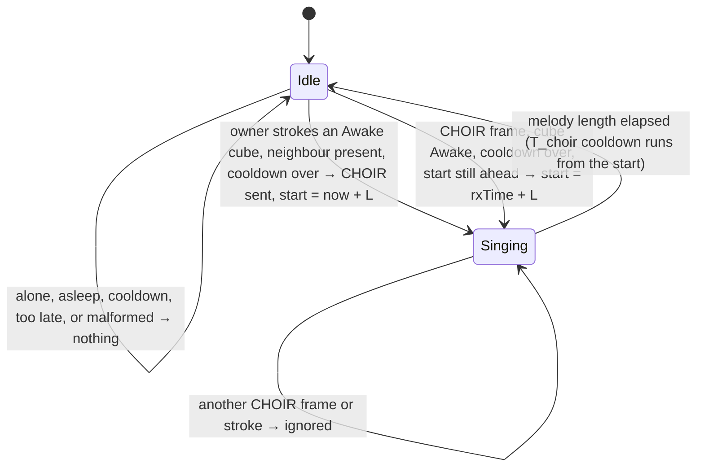

# State diagram — social-group — synchronised choir (one start, one voice per cube)

> **Frame**: `stm — Choir`
> **Feature**: `social-group` — backlog item G4 in [docs/roadmap.md](../../../roadmap.md), issue #57
> **Related ADRs**: ADR-0001 (alone, nothing happens), ADR-0005 (versioned frames, allowlist),
> ADR-0012 (no authentication, accepted nuisance risk), ADR-0013 (single Sound gate)
> **Frame layout**: CHOIR type in [social-presence/06](../social-presence/06-data-flow.md)
> **Sequence**: [02c-sequence-choir.md](02c-sequence-choir.md)
> **Requirement**: REQ-F-14, FS8 (choir drift ≤ 50 ms) — use case UC10

> **Status**: design choices validated by the owner 2026-10-23 (issue #57), scored options
> (criteria: effect 30, robustness 25, simplicity 25, fit 20): D1 stroke with a present neighbour
> 430/500 (400 automatic on gathering, 355 single tap); D2 one-shot start anchored on the receive
> time, lead rest in the Sound gate 475/500 (400 start on the tick, 290 continuous shared clock);
> D3 voice = MAC rank mod 3 445/500 (360 voices assigned by the conductor, 330 unison).
> Full dossier (this table, 02c, 06) pending owner PDR validation.

## Context

This diagram answers "when does a cube sing in a choir, which voice does it take, and how do all
cubes start on the same millisecond?". The choir is a small machine held in a `Choir` value owned
by the Social protocol, like `ChainReaction` (05b): the protocol does the radio I/O and computes
the rank; `Choir` decides from pure inputs (frame, receive time, clock, rank); `main.cpp` hands
the returned voice and lead to the Sound gate.

## Shared clock without a clock

There is no shared time base. The conductor broadcasts **"start in L ms"** (L = kLeadMs 500) and
schedules its own start at `sendTime + L`. Each receiver anchors on the frame's **receive time**
(`RxFrame.nowMs`, stamped by the radio callback) and schedules `rxTime + L`. The gap between the
two anchors is the radio latency (≈ 1–5 ms for an 8-byte broadcast), which is the whole drift
budget used, far under 50 ms. Crystal drift over a few-second melody (≈ 40 ppm) is below 1 ms.

The 40 ms tick would add up to 40 ms of quantisation if a cube started on "the first tick after
the start time". It does not: on the tick that hears the frame, the cube asks the Sound gate to
play its voice **after a lead rest of `startAt − now` ms**, and the buzzer adapter's timer
(`esp_timer`, 1 ms) plays the rest then the notes. The tick's phase no longer matters.

Frames wait at most a few ticks in the RX queue; the anchor is the receive time, so that wait only
shortens the rest. A frame drained after its start time is too late: the cube stays silent.

## Voices

`rank` = present neighbours (`Waiting` or `Greeted`) whose MAC is lower than the cube's own (the
conductor counted like any other); **voice = rank mod 3**: 0 low, 1 melody, 2 high. Every voice
has the same total length. Two cubes with different tables may share a voice: accepted, it still
sounds like a choir. With one neighbour, the two cubes take voices 0 and 1.

## Diagram

## Transition table (source of the native tests)

| # | Situation | Result |
|---|-----------|--------|
| 1 | owner strokes an Awake cube, at least one present neighbour, cooldown over | conductor broadcasts CHOIR {own palette, melody 0, lead 50 (× 10 ms), 0}; plays its voice after a 500 ms rest; Purr eyes as usual |
| 2 | owner strokes alone (no present neighbour) | no frame, solo Purr only (ADR-0001) |
| 3 | owner strokes within T_choir 60 s of the last choir start (conducted or sung) | no frame, Purr only |
| 4 | CHOIR frame, cube Awake, cooldown over | sings voice `rank mod 3` after a rest of `rxTime + L − now` ms |
| 5 | CHOIR frame, cube not Awake (Dozing, Asleep, Waking) | silent, no state change |
| 6 | CHOIR frame while a choir is pending or singing | ignored (no second start) |
| 7 | CHOIR frame within T_choir 60 s of the last start | ignored (caps forged-frame nuisance) |
| 8 | CHOIR frame drained after its start time (`rxTime + L ≤ now`) | silent, cooldown not started |
| 9 | any CHOIR frame | never relayed: one frame per choir, no echo |
| 10 | voice rank: k present neighbours have a lower MAC | voice k mod 3 |
| 11 | the cube falls asleep during the rest or the melody | the Sound gate stops it (05e), as for any sound |
| 12 | a reaction sound (tap, double tap, chain, greeting) during the rest or the melody | dropped: the choir voices rank 2 in the Sound gate |

Every time test is `(uint32)(now - then) ≥ T` or `(int32)(startAt - now) > 0`, wrap-safe
(social-presence/06).

## Why no echo storm

The conductor sends one frame; receivers never transmit for a choir (row 9). Forged CHOIR frames
make a cube sing at most once per T_choir 60 s (row 7), through the Sound gate at the constant V1
volume (ADR-0012 nuisance risk; no new ADR). Cubes out of the conductor's range do not sing:
accepted (a desk cluster is in range; relays would add latency to the drift budget).

## Notes

- **The cube is never loud**: voices are ordinary `SoundId`s in the Sound gate's note table, at
  `kVolume`, silent unless Awake or Waking. The gate only gains a lead rest (`play(id, restMs)`).
- **Placeholder melody**: three short voices (≈ 2.4 s) until the sound-design brick.
- **Conductor's Purr sound**: the choir voice (rank 2) replaces the Purr sound on the stroke tick;
  the conductor's eyes still purr. Accepted: the 500 ms rest is the conductor's breath.
- **Two conductors within 500 ms**: each cube follows the first frame it hears (row 6); the two
  halves may start up to 500 ms apart. Rare, accepted.
- **Deterministic**: clock, receive time and the table are inputs; no Prng needed.
- **Mood unchanged**: the choir is a performance, not a stimulus (as 05b).
- **Bench**: FS8 drift measured on two prototypes with a microphone recording (verification plan).
