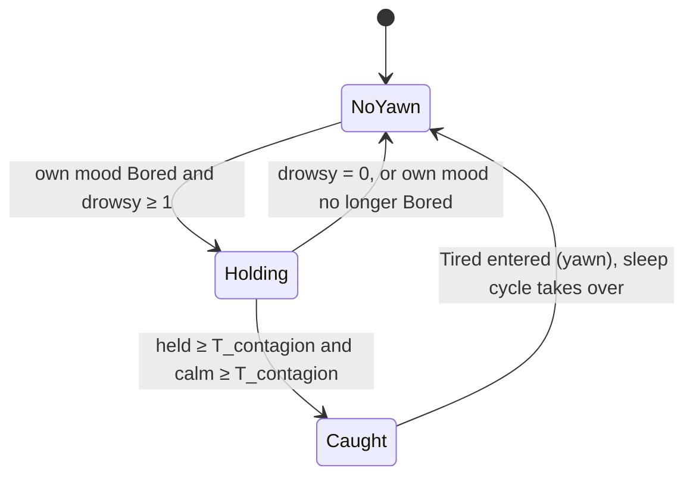

# State diagram — social-group — collective sleep, the first yawn spreads (extension of the mood engine)

> **Frame**: `stm — Yawn contagion`
> **Feature**: `social-group` — backlog item G5 in [docs/roadmap.md](../../../roadmap.md), issue #59
> **Related ADRs**: ADR-0001 (alone, the social layer is nothing), ADR-0012 (no authentication,
> accepted nuisance risk), ADR-0013 (timings, single Sound gate), ADR-0014 (tests follow the conception)
> **Base machines**: [cube-core/05a-state-mood-engine.md](../cube-core/05a-state-mood-engine.md),
> [cube-core/05b-state-sleep-wake.md](../cube-core/05b-state-sleep-wake.md) (Tired → Dozing → Asleep), [05a-state-contagion.md](05a-state-contagion.md) (G2 hook)
> **Sequence**: [02d-sequence-yawn.md](02d-sequence-yawn.md)
> **Requirement**: REQ-F-20, FS8 — behaviour B4 (system-initiated, outcome of UC5 and UC8)

> **Status**: design choices validated by the owner 2026-10-23 (issue #59), scored options
> (criteria: visible effect 30, owner safety 25, simplicity 25, robustness 20): D1 only a Bored
> cube catches the yawn 440/500 (against 405 Bored or calm Curious, 360 any calm mood); D2 the
> caught cube enters Tired and yawns, then the usual sleep cycle runs 470/500 (against 350 straight
> to Dozing). No new frame: the PRESENCE mood byte already says "drowsy" (3 Tired or dozing, 5 asleep).

## Context

This diagram answers "when does a neighbour's yawn make my cube sleepy, and why can it never put
to sleep a cube someone is using?". Like G2, collective sleep is **not a new machine**: it adds
one guarded transition to the mood engine, **Bored → Tired**, fed once per Awake tick with the
number of drowsy neighbours. Entering Tired already yawns (through the Sound gate) and already
starts the sleep cycle's doze timer; a Tired cube broadcasts mood 3, so the yawn ripples on to the
next idle cube. A cube the owner pays attention to is never Bored, so it never catches it.

## The input (computed by the Social protocol)

`MoodTally::drowsy` counts the **present** neighbours (`Waiting` or `Greeted`) whose mood byte is
3 (Tired, or dozing) or 5 (asleep). It sits next to the G2 votes, which it does not change.

## Diagram

## Transition table (source of the native tests)

| # | Situation (cube Awake) | Result |
|---|------------------------|--------|
| 1 | no present drowsy neighbour (alone, all absent, all awake and not Tired) | nothing; Bored → Tired on its own timer (T_tired 5 min) |
| 2 | own mood Curious, Happy or Annoyed, drowsy neighbour present | nothing (D1: a cube with attention never catches it) |
| 3 | Bored, drowsy ≥ 1, held < T_contagion | mood unchanged |
| 4 | Bored, drowsy ≥ 1 held ≥ T_contagion, no gesture or sound for T_contagion | enter Tired: `MoodEffect::Yawn` (through the Sound gate), yawn timer from now |
| 5 | drowsy falls to 0 during the hold | hold dropped; a new drowsy neighbour restarts it from now |
| 6 | owner gesture or sound during the hold | Bored → Curious (05a), hold dropped — the owner always wins |
| 6b | owner touch-down during the hold | mood unchanged, calm broken: the yawn waits a fresh T_contagion of calm |
| 7 | neighbour asleep (byte 5) or dozing (byte 3) | counts as drowsy, like Tired |
| 8 | absent neighbour (`Absent`, `Free`) | never counts |
| 9 | own mood already Tired | nothing new (no second yawn beyond the Tired yawn timer) |
| 10 | cube not Awake | not evaluated (the engine is paused); a wake restarts in Curious with no hold |
| 11 | both a G2 candidate and a drowsy neighbour hold | the yawn is evaluated first; a yawn does not start the G2 refractory, a caught yawn resets the calm, so a G2 pull out of Tired waits a fresh T_contagion; a G2 pull drops the yawn hold (mood no longer Bored) |
| 12 | caught cube | broadcasts mood 3, so its own idle neighbours catch the yawn (one hop per T_contagion and up) |

Durations: **T_contagion 6 s** reused from G2 (one presence period with jitter). No refractory:
Tired is left only by an owner stimulus or by falling asleep, so a cube catches the yawn at most
once per Bored spell.

## Worked example (three idle cubes A, B, C)

Nobody touches the desks. A reaches Tired on its own after Bored (5 min) and yawns. B and C have
been Bored for a while: 6 s after A's next presence frame each catches the yawn (row 4), yawns and
broadcasts 3. All three doze 2 min later and sleep 20 min after that: the office falls asleep
together. If someone strokes B meanwhile, B turns Curious (row 6) and stays awake.

## Notes

- **Owner safety**: Bored means at least 3 min without any stimulus (T_bored); the yawn only
  shortens the remaining Bored → Tired wait. Any touch or sound still wakes every state.
- **Sound**: the yawn is the existing Tired effect, played through the single Sound gate at its
  volume; a dozing or asleep cube is never evaluated, so it never yawns aloud.
- **Security**: a forged PRESENCE frame with mood 3 can make an already idle cube sleepy sooner,
  a nuisance accepted under ADR-0012 like G2; it can never act on a cube in use.
- **Deterministic**: the tally and the clock are inputs; no `Prng`.
