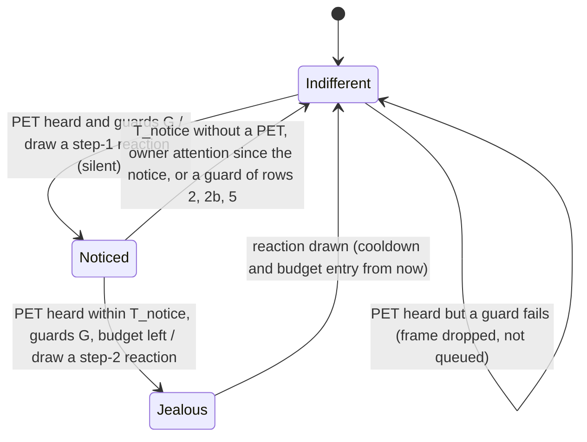

# State diagram — social-group — jealousy, petting another cube makes mine react, a little differently each time

> **Frame**: `stm — Jealousy`
> **Feature**: `social-group` — backlog items G6 (issue #73, PR #75) and G6a (issue #85) in
> [docs/roadmap.md](../../../roadmap.md)
> **Related ADRs**: ADR-0001 (alone, the social layer is nothing), ADR-0012 (no authentication,
> accepted nuisance risk, rate limits), ADR-0013 (timings, single Sound gate, lib-owned `Prng`),
> ADR-0014 (tests follow the conception, golden images)
> **Base machines**: [cube-core/05a-state-mood-engine.md](../cube-core/05a-state-mood-engine.md),
> [05c-state-choir.md](05c-state-choir.md) (the stroke that starts a choir),
> [social-presence/05a-state-neighbour-entry.md](../social-presence/05a-state-neighbour-entry.md)
> (`presentSince`)
> **Views**: [02e-sequence-jealousy.md](02e-sequence-jealousy.md),
> [04-class-jealousy.md](04-class-jealousy.md)
> **Requirement**: REQ-F-21, FS8 — behaviour B5 (system-initiated, outcome of UC3 on a neighbour)

> **Status**: G6 design choices validated by the owner 2026-11-05 (issue #73), scored options.
> D1 signal (effect 30, robustness 25, simplicity 25, protocol fit 20): a new PET frame type
> `0x04` 405/500, against reusing the CHOIR receipt 275 and the PRESENCE mood byte (neighbour
> Happy) 265. D2 with the choir (same criteria): a stroke starts the choir when its cooldown
> allows, otherwise it sends PET 450/500, against both frames with PET ignored during a choir 350
> and sulking after the song 320. D3 effect (effect 30, owner safety 25, simplicity 25,
> robustness 20): a transient sulk, mood unchanged, 445/500, against entering Annoyed 355 (it
> would spread through G2, beyond "eyes and beep"). Row 11 added after the adversarial review
> (same criteria as D3): no sulk while singing 430/500, against D2 to the letter 365.
>
> G6a choices (issue #85), carried over from the design study of PR #76 and rescored on top of
> G6:
> - D3' (cute 30, never mean 20, simplicity 20, no dependency on ADR-0018 15, consistency with
>   validated decisions 15): D3 kept, every reaction leaves the mood unchanged, 440/500 (owner
>   2026-11-05), against an Annoyed top step under the ADR-0018 budget 330 and Annoyed only when
>   Neglected 300; the Annoyed step is deferred to G6b.
> - D6 crescendo (cute 35, simplicity 25, testability 20, owner safety 20): a silent glance at the
>   first PET, a reaction with a sound at a second PET within T_notice (cute 5, simplicity 4,
>   testability 4, safety 5: 455/500), against one reaction at every accepted PET as in G6
>   (cute 3, simplicity 5, testability 5, safety 3: 390) and a three-step crescendo (cute 4,
>   simplicity 2, testability 3, safety 5: 350).
> - D7 choice (cute and surprise 35, context fit 25, testability 20, simplicity 20): weight
>   tables by context drawn with a lib-owned `Prng` 440/500, against one fixed reaction per
>   context 375 and pure chance 345.
>
> Sensitivity: with cute raised to 50 and the other weights scaled down (rounded to 5), D3'
> gives 400 against 380 (Annoyed step) and D6 465 against 370 (one step) and 360 (three steps);
> the ranking holds. D7 was scored as totals only in PR #76, so it has no per-criterion check.
>
> Face sheet choices (issue #88, owner 2026-11-06):
> - D8 Stare blinks (simplicity 40, fidelity to this table 30, regression risk 30): drawn by the
>   renderer inside the Stare reaction, pinned by a renderer test, `Timeline` untouched, 440/500,
>   against a repeating `Timeline` mode 330.
> - D9 idle glances: held while a **timed** reaction plays; the held TouchDown and Purr keep them,
>   so a long press or stroke never shows a static frame for 10 s (FS1, adversarial review of
>   the face sheet PR).
> - Face retouches after the first sheet (470/500 against accepting it as drawn 380): SideGlance
>   lowers the top lids a little (it no longer matches the Greet frame), Stare is 2 px taller,
>   Pout lowers its inner corners. Second sheet validated (450/500).
>
> Owner validation of the G6a behaviour is recorded in the PR. The G6a PDR passes only once the
> face sheet of the seven new reactions is accepted as well (gates.md: reference images rendered
> and accepted); the sheet is its own PR, before any repertoire test.

## Context

This diagram answers "how does my cube react when the owner strokes another cube, why is the
reaction different from one time to the next, and why can it never nag a cube someone is using
or a sleeping office?". Jealousy is **not a mood**: like the chain reaction (05b row 5) it is a
transient reaction, eyes and at most one short sound through the Sound gate, and the mood
engine's state is unchanged (D3, D3').

G6 (PR #75) shipped one reaction, the Sulk. G6a turns it into a two-step crescendo: the first
stroke heard on a neighbour is only **noticed** (a silent glance), a second one within T_notice,
on the same neighbour or another, makes the cube **jealous** (a reaction, most with a sound). At
each step the **context**, what the cube already knows, selects a weight table, and a lib-owned
`Prng` draws one reaction from it, so the reaction fits the situation yet stays a little
unpredictable. The sender rules, the receiver guards and the G6 rate limits are unchanged; only
the step-2 reaction consumes the cooldown and the budget.

## Sender rules (Social protocol, unchanged from G6)

| # | Situation (owner stroke on cube A) | Result |
|---|------------------------------------|--------|
| S1 | A Awake, a neighbour present, choir cooldown over | CHOIR start as in 05c; **no PET** (D2: the group sings, nobody sulks) |
| S2 | A Awake, a neighbour present, choir cooldown running, PET cooldown over | one PET frame `{A's palette}`, PET cooldown T_pet_tx from now |
| S3 | PET cooldown running (stroke within T_pet_tx of the last PET) | nothing sent |
| S4 | A not Awake, or no neighbour present | nothing sent (the stroke wakes or pleases A only) |

PET is never relayed: only the cubes in A's range hear it. With T_pet_tx 10 s, a step 2 from
one neighbour needs a second stroke on it between 10 s and T_notice after the first one heard.

## The input (Social protocol)

`SocialOutput::pet` keeps its G6 meaning (a valid PET heard this tick, the cube Awake and not
singing). G6a adds `SocialOutput::petContext` (type `PetContext`, declared in `core/Mood.h` like
`MoodTally`, so the mood engine never includes the Social protocol), filled on the same tick from
the **first** PET drained in it:

- `neighbours`: the number of present table entries (`Waiting` or `Greeted`);
- `strokedAgeMs`: how long that sender has been present, `ageMs(now, presentSince)` of its
  present entry; a sender with no present entry gives 0 (a stranger is a newcomer).

`Neighbour::presentSince` is new (social-presence/05a): set to now when a MAC is stored (Free or
evicted slot) and wherever the entry's `greeted` bit is reset (back after more than T_regreet,
greeted again as new); kept when a known MAC comes back within T_regreet (a coffee break keeps
the friendship). So that ages never wrap on a cube left on for weeks, a refresh that finds
`age ≥ T_friend` sets `presentSince = now − T_friend` (the same idea as the PR #22 bound on
absent ages).

## Receiver machine (cube B)

**Guards G** (both steps, the G6 receiver rows 2, 2b, 3, 5 and 11): Awake, calm ≥
T_calm_jealous, pad not held, outside T_jealous of the last step-2 reaction, not singing a choir
voice. The outcome for a cube already Noticed depends on the guard that fails: rows 2 and 2b
(the owner is there) and row 5 (not Awake) return it to Indifferent; row 4 (budget) and row 11
(singing: `pet` is not set, so the engine is not called) leave it Noticed until T_notice
elapses.

The engine evaluates the Noticed timeouts lazily, at the next PET: no tick is needed to leave
Noticed, and nothing is shown when it does.

## Repertoire (G6a)

| Reaction | Step | Eyes | Sound (placeholder until the sound brick) | Length |
|----------|------|------|-------------------------------------------|--------|
| SideGlance | 1 | both eyes slide to the side of the last glance and hold, top lids a little low | none | 3 s |
| Stare | 1 | eyes a little taller, held at a side look offset, blink suspended, then three fast blinks in the last 600 ms (drawn by the renderer, pinned by a renderer test, D8) | none | 3 s |
| TurnAway | 1 | eyes at the largest look offset, opposite the side of the last glance | none | 3 s |
| Pout | 2 | lower lids raised, eyes narrowed, inner corners a little low | short "hmpf", rank 2 | 3 s |
| PuppyEyes | 2 | eyes enlarged with a highlight, lids tilted | small whimper, rank 2 | 3 s |
| MeToo | 2 | eyes hop up and down | rising chirp, rank 2 | 3 s |
| FakeSleep | 2 | eyes close, one eye half-opens and peeks sideways, closes again | none | 3 s |
| Sulk | 2 | the G6 Sulk eyes (existing, golden unchanged) | the G6 grumble (existing), rank 2 | 900 ms (G6) |

Each reaction is a new `Reaction` value of the eyes renderer (Sulk exists), so the eyes play it
like any other reaction and its length is `reactionDurationMs(reaction)`, the only constant
(T_react in this document names it). The look offset is drawn inside the renderer, which holds
the idle glances while a timed reaction plays (D9). The new sounds rank 2 in the Sound gate, like the
grumble (cube-core/05e): a choir voice (3) wins, a greeting (0) is replaced.

A lib function `Route effects(JealousReaction r)` in the Stimulus router (next to
`effects(MoodEffect)`, tested natively) maps each reaction to its eyes and sound; `main.cpp`
only applies the route.

The seven new eye animations are drawn first, as a face sheet of golden images (one per
reaction at its key frame, two for MeToo and FakeSleep) plus the Stare blink test, validated by the owner before any
repertoire logic (gates.md, ADR-0014).

## Contexts and weights

The mood engine computes the contexts; the repertoire only weighs and draws.

| Context | Holds when | Step 1 modifiers | Step 2 modifiers |
|---------|-----------|------------------|------------------|
| — base | always | SideGlance 3, Stare 2, TurnAway 2 | Pout 3, PuppyEyes 2, MeToo 2, FakeSleep 1, Sulk 2 |
| Bored | mood Bored | TurnAway +1 | PuppyEyes +3 |
| Crowd | `petContext.neighbours` ≥ 2 | Stare +2 | MeToo +3 |
| Newcomer | `petContext.strokedAgeMs` < T_friend | TurnAway +2 | Sulk +2 |
| Friend | `petContext.strokedAgeMs` ≥ T_friend | SideGlance +2 | Pout +2, Sulk −2 |
| Neglected | no owner attention for ≥ T_lonely | — | PuppyEyes +2 |
| Weary | ≥ 3 step-2 reactions within T_weary | SideGlance +2 | FakeSleep +4, Sulk = 0 |

Rules: each reaction starts from its base weight; every context that holds adds its modifiers,
clamped at 0, **Weary applied last**. The **last reaction drawn at the same step gets weight 0**
(no immediate repeat; every combination keeps at least four positive weights at step 2 and three
at step 1, so at least two remain).

**Owner attention** is a touch-down, a gesture or a sound, the events that already break the
calm in G6 row 2. The engine keeps a dedicated `lastOwnerMs_` for it (the calm timestamp also
moves on a G2 pull or a caught yawn, so it cannot serve). **Weary** reads the engine's ring of
step-2 times, the G6 budget ring kept at four entries (enough for three within T_weary); the
ring is cleared only once its newest entry is older than max(kJealousWindow, T_weary) = 30 min
(the budget still reads its entries against 10 min).

**Draw**: `r = prng.uniform(sum of the weights)`, then walk the reactions of the step in the
order of the repertoire table and pick the first whose cumulative weight exceeds `r`. A guard
or budget failure draws nothing, so the `Prng` sequence does not move (like `ChainReaction`).

## Ownership

`JealousyRepertoire` (`lib/`) holds the weight tables and the no-repeat memory (the last
reaction of each step), and owns its `Prng` (`Prng(seed, 3)`, after the eyes 1 and the social
protocol 2), built in `Seeded` after the Wi-Fi driver is up (ADR-0013). The mood engine keeps
the guards, the crescendo state, `lastOwnerMs_`, the cooldown and the step-2 ring, and computes
the contexts. `mood.jealousy(padHeld, out.petContext, seeded->repertoire)` returns a
`JealousReaction` (`None` or one of the eight); the mood engine is a static global built before
`Seeded`, so it holds no reference to the repertoire. Class view:
[04-class-jealousy.md](04-class-jealousy.md).

## Receiver transition table (source of the native tests)

Rows 1 to 11 are the G6 rows, reworded for the crescendo; rows 12 onward are new in G6a.

| # | Situation (valid PET frame received by cube B) | Result |
|---|-----------------------------------------------|--------|
| 1 | B Indifferent, guards G hold | Noticed: draw a step-1 reaction (eyes only, silent), notice time = now; mood unchanged; no cooldown or budget entry |
| 1b | B Noticed less than T_notice ago, no owner attention since, guards G hold, budget left | draw a step-2 reaction, its eyes and sound; mood unchanged; cooldown and budget entry from now; back to Indifferent |
| 2 | own gesture, touch-down or sound within T_calm_jealous | nothing (the owner is with B, B is not jealous); the PET is not kept; a Noticed cube returns to Indifferent |
| 2b | B's pad held right now, however long (a stroke emits no gesture after its Stroke) | nothing (Codex review on PR #75: a held cube is in use); a Noticed cube returns to Indifferent |
| 3 | within T_jealous of the last step-2 reaction | nothing; Noticed is not entered either (the bound on forged frames) |
| 4 | Noticed, kJealousBudget step-2 reactions already in the last kJealousWindow | nothing; B stays Noticed until T_notice elapses |
| 5 | B Dozing, Waking or Asleep | nothing (the engine is paused; never wakes, never sounds); Noticed is dropped |
| 6 | several PET frames in the same tick or from several cubes | at most one step; the context comes from the first PET drained |
| 7 | B's mood any of the five | the reaction plays in every mood (Bored only shifts the weights, rows 15–16); the mood, its timers and the G2 tally are unchanged |
| 8 | any reaction | does not break the calm, move `lastOwnerMs_`, start the G2 refractory, drop a G5 hold, or count as a stimulus for the idle timer |
| 9 | malformed PET (palette out of range, reserved byte ≠ 0) | dropped by the codec (`dropRange`), no effect |
| 10 | B restarts (wake) | Noticed dropped; `lastOwnerMs_` = now (a wake follows the owner or a noise); cooldown, step-2 ring and no-repeat memory kept (they bound forged traffic across wakes) |
| 11 | B started a choir voice less than kSingMs ago (a CHOIR drained in the same tick counts) (longest lead + 10 s, the bound of 05c row 6) | nothing (owner amendment 2026-11-05: the group sings, nobody sulks); a Noticed cube stays Noticed |
| 12 | Noticed, the PET comes T_notice or more after the notice | treated as from Indifferent (row 1): a new step 1 |
| 12b | Noticed, owner attention after the notice time but more than T_calm_jealous before this PET | treated as from Indifferent (row 1): a new step 1 |
| 13 | B touched while a reaction is shown | the touch-down reaction replaces it at once (the renderer plays one reaction at a time) and the touch follows 05a (a stroke purrs): the cube forgives; a step-2 sound already started finishes (it is short and rank 2) |
| 14 | draw with seed s and contexts c | equals the reference sequence for (s, c), computed with the draw rule above (replayable) |
| 15 | `jealousWeights(step, contexts, last)` on combined contexts | exact vectors: Crowd + Friend at step 1 → SideGlance 5, Stare 4, TurnAway 2; Crowd + Friend + Neglected at step 2 → Pout 5, PuppyEyes 4, MeToo 5, FakeSleep 1, Sulk 0; Weary + Newcomer at step 2 → Pout 3, PuppyEyes 2, MeToo 2, FakeSleep 5, Sulk 0 |
| 16 | each context of the table holds alone | its modifiers apply; Weary sets Sulk to 0; a synthetic table with a modifier larger than its base weight yields 0, not a negative weight |
| 16b | three step-2 reactions in the last 30 min, the last one 11 min ago | Weary holds (the ring is not cleared after 10 min) |
| 17 | the same step drawn twice in a row | never the same reaction twice (weight 0) |
| 18 | 10 000 draws on one context, no-repeat off | each frequency within 2 percentage points of its weight share |
| 19 | a guard or the budget fails | no draw: the `Prng` sequence does not move |
| 20 | a new MAC stored (Free or evicted slot, including a cube back after its entry was freed past T_regreet) | `presentSince` = now: Newcomer until T_friend |
| 20b | a known MAC back from `Absent` within T_regreet | `presentSince` kept: still a Friend if it was one |
| 20c | a known MAC back from `Absent` after more than T_regreet (greeted again) | `presentSince` = now: a Newcomer again |
| 20d | a refresh with `age(presentSince) ≥ T_friend` | `presentSince` = now − T_friend (no wrap after 49 days) |
| 20e | PET whose sender has no present entry | `strokedAgeMs` = 0 (Newcomer), `neighbours` as counted |
| 21 | any PET frame, accepted or dropped | nothing written to NVS, never relayed, no MAC in any log or counter (ADR-0012) |

Durations and budgets: **T_calm_jealous 6 s** (= T_contagion, a cube held in the last 6 s is in
use), **T_jealous 60 s**, **budget 4 step-2 reactions per 10 min** (ADR-0012 global budget, like
the greeting budget), **T_pet_tx 10 s** sender cooldown, all from G6. New in G6a (tuning
parameters, ADR-0013): **T_notice 60 s**, **T_friend 30 min**, **T_lonely 5 min** (below the
10 min doze chain of FS5, so it can hold while awake), **T_weary 30 min**; reaction lengths from
the renderer (table above).

## Worked example (cubes A, B, C; seed fixed in the test)

B has been left alone for 6 min (Neglected; C's arrival greeting kept it awake), Curious, with A
present for an hour (Friend) and C just arrived (Crowd). Alice strokes A: the choir starts and
all sing (S1). Thirty seconds later she strokes A again: the choir is cooling down, A sends PET
(S2). B notices: a step-1 draw among SideGlance 5, Stare 4, TurnAway 2, say a SideGlance. Alice
strokes A once more 15 s later: B is jealous, a step-2 draw among Pout 5, PuppyEyes 4, MeToo 5,
FakeSleep 1, Sulk 0, say MeToo: its eyes hop and it chirps. C, which only just met A (Newcomer),
turns away, then sulks. Bob strokes B: the hop stops, B purrs. Later, after three step-2
reactions in the last 30 min (the last a MeToo), B is Weary and not Neglected or Bored (a
colleague talked to it 2 min ago): a new pair of strokes on A draws among Pout 5, PuppyEyes 2,
MeToo 0 (no repeat), FakeSleep 5, Sulk 0, say a FakeSleep (5 of 12) that peeks sideways.

## Notes

- **Owner safety**: at most one step-2 reaction per minute and four per ten minutes, as in G6;
  step 1 is silent; the mood never changes, so nothing spreads or lingers.
- **Sound**: every sound goes through the Sound gate at its volume (placeholders, sound design
  later); a non-Awake cube is never evaluated, so it never grumbles in its sleep.
- **Security**: a forged PET frame can make an awake idle cube glance (at most once per
  T_notice once the budget is spent, each glance silent), and two within T_notice can make it
  react once a minute, a nuisance accepted under ADR-0012 and capped by the G6 cooldown and
  budget; it carries no command beyond that and never changes the mood, so ADR-0018 does not
  apply.
- **Deterministic**: the clock, the context and the `Prng` are inputs; a seeded test replays any
  sequence.
- **Naming**: this short sulk is not S10's "sulks when ignored for two days".
- **Later (G6b)**: an Annoyed top step once ADR-0018 is Accepted (D3' deferred it), Tear,
  BrokenHeart, Mimic (copies the neighbour's purr, higher), Sigh, Tremble, an exaggerated
  reconciliation and the group sulk; the light (S8) and motion (S9) contexts and the optional
  "sworn enemy" pair come after.
