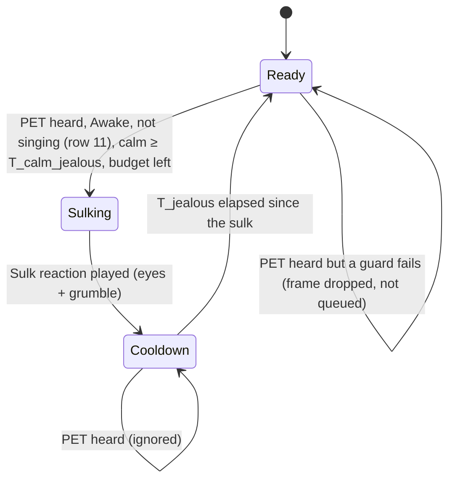

# State diagram — social-group — jealousy, petting another cube makes mine sulk

> **Frame**: `stm — Jealousy`
> **Feature**: `social-group` — backlog item G6 in [docs/roadmap.md](../../../roadmap.md), issue #73
> **Related ADRs**: ADR-0001 (alone, the social layer is nothing), ADR-0012 (no authentication,
> accepted nuisance risk, rate limits), ADR-0013 (timings, single Sound gate), ADR-0014 (tests
> follow the conception)
> **Base machines**: [cube-core/05a-state-mood-engine.md](../cube-core/05a-state-mood-engine.md),
> [05c-state-choir.md](05c-state-choir.md) (the stroke that starts a choir)
> **Sequence**: [02e-sequence-jealousy.md](02e-sequence-jealousy.md)
> **Requirement**: REQ-F-21, FS8 — behaviour B5 (system-initiated, outcome of UC3 on a neighbour)

> **Status**: design choices validated by the owner 2026-11-05 (issue #73), scored options.
> D1 signal (effect 30, robustness 25, simplicity 25, protocol fit 20): a new PET frame type
> `0x04` 405/500, against reusing the CHOIR receipt 275 and the PRESENCE mood byte (neighbour
> Happy) 265. D2 with the choir (same criteria): a stroke starts the choir when its cooldown
> allows, otherwise it sends PET 450/500, against both frames with PET ignored during a choir 350
> and sulking after the song 320. D3 effect (effect 30, owner safety 25, simplicity 25,
> robustness 20): a transient sulk, mood unchanged, 445/500, against entering Annoyed 355 (it
> would spread through G2, beyond "eyes and beep"). Row 11 added after the adversarial review
> (same criteria as D3): no sulk while singing 430/500, against D2 to the letter 365.

## Context

This diagram answers "when does a stroke on a neighbour make my cube sulk, and why can it never
nag a cube someone is using or a sleeping office?". Jealousy is **not a mood**: like the chain
reaction (05b row 5) it is a transient reaction, Sulk eyes and a grumble through the Sound gate,
and the mood engine's state is unchanged. Two small rules carry it: the sender's (when a stroke
sends PET) and the receiver's (when a PET makes this cube sulk).

## Sender rules (Social protocol)

| # | Situation (owner stroke on cube A) | Result |
|---|------------------------------------|--------|
| S1 | A Awake, a neighbour present, choir cooldown over | CHOIR start as in 05c; **no PET** (D2: the group sings, nobody sulks) |
| S2 | A Awake, a neighbour present, choir cooldown running, PET cooldown over | one PET frame `{A's palette}`, PET cooldown T_pet_tx from now |
| S3 | PET cooldown running (stroke within T_pet_tx of the last PET) | nothing sent |
| S4 | A not Awake, or no neighbour present | nothing sent (the stroke wakes or pleases A only) |

PET is never relayed: only the cubes in A's range hear it.

## Receiver machine (cube B)

## Receiver transition table (source of the native tests)

| # | Situation (valid PET frame received by cube B) | Result |
|---|-----------------------------------------------|--------|
| 1 | B Awake, calm ≥ T_calm_jealous, out of cooldown, budget left | `MoodEffect::Sulk`: Sulk eyes and the grumble through the Sound gate; mood unchanged; cooldown and budget entry from now |
| 2 | B Awake, own gesture, touch-down or sound within T_calm_jealous | nothing (the owner is with B, B is not jealous); the PET is not kept |
| 3 | within T_jealous of the last sulk | nothing |
| 4 | kJealousBudget sulks already in the last kJealousWindow | nothing |
| 5 | B Dozing, Waking or Asleep | nothing (the engine is paused; never wakes, never sounds) |
| 6 | several PET frames in the same tick or from several cubes | at most one sulk |
| 7 | B's mood any of the five | the sulk plays the same; the mood, its timers and the G2 tally are unchanged |
| 8 | sulk effect | does not break the calm, start the G2 refractory, or count as a stimulus for the idle timer |
| 9 | malformed PET (palette out of range, reserved byte ≠ 0) | dropped by the codec (`dropRange`), no effect |
| 10 | B restarts (wake) | cooldown and budget kept (they bound forged traffic across wakes) |
| 11 | B started a choir voice less than kSingMs ago (a CHOIR drained in the same tick counts) (longest lead + 10 s, the bound of 05c row 6) | nothing (owner amendment 2026-11-05: the group sings, nobody sulks) |

Durations and budgets: **T_calm_jealous 6 s** (= T_contagion, a cube held in the last 6 s is in
use), **T_jealous 60 s**, **budget 4 sulks per 10 min** (ADR-0012 global budget, like the
greeting budget), **T_pet_tx 10 s** sender cooldown.

## Worked example (cubes A and B on neighbouring desks)

Alice strokes A: the choir starts and both sing (S1). Thirty seconds later she strokes A again:
the choir is cooling down, A sends PET (S2). B was left alone for minutes: it sulks (row 1),
narrowed eyes glancing away and a low grumble, then shows its mood again. Bob, B's owner, was
tapping B two seconds before: nothing (row 2).

## Notes

- **Owner safety**: the sulk is one short reaction, at most once per minute and four times per
  ten minutes; the mood never changes, so nothing spreads or lingers.
- **Sound**: the grumble is a Sound gate sound at the gate's volume (placeholder, sound design
  later); a non-Awake cube is never evaluated, so it never grumbles in its sleep.
- **Security**: a forged PET frame can make an awake idle cube sulk, a nuisance accepted under
  ADR-0012 and capped by the cooldown and the budget; it carries no command beyond that.
- **Deterministic**: the clock is injected; no `Prng`.
