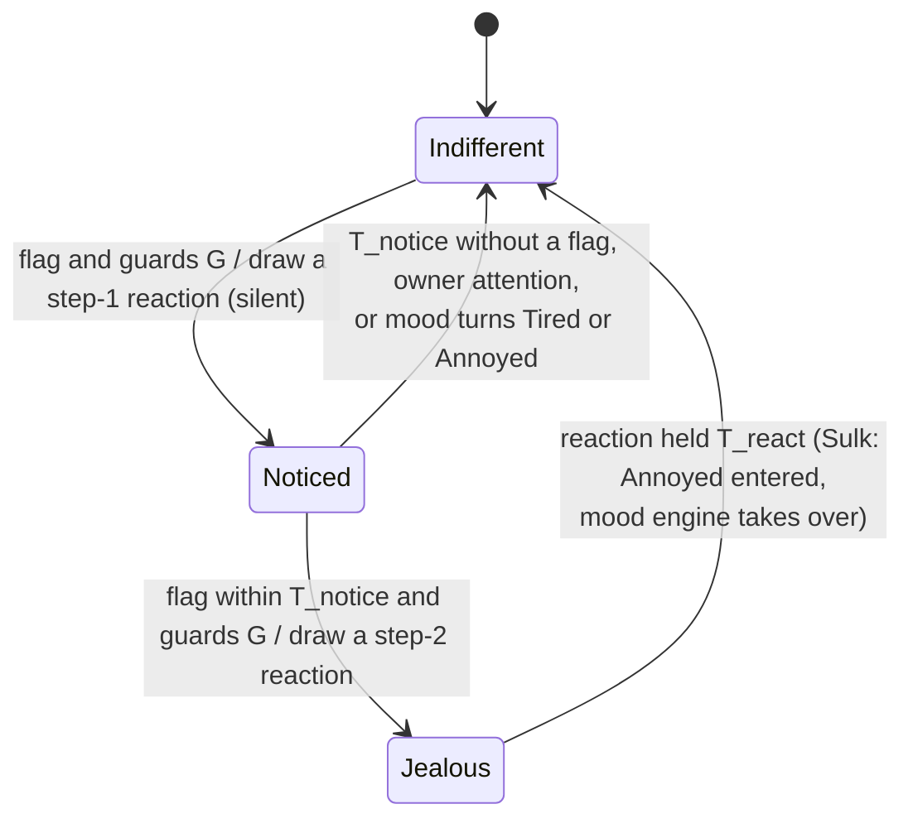

# State diagram — social-group — jealousy, a repertoire of cute reactions chosen by context (extension of the mood engine)

> **Frame**: `stm — Jealousy`
> **Feature**: `social-group` — backlog item G6a in [docs/roadmap.md](../../../roadmap.md), issue #73
> **Related ADRs**: ADR-0001 (alone, the social layer is nothing), ADR-0012 (no authentication,
> accepted nuisance risk; its "nudge only" clause is superseded for bounded one-shot events by
> ADR-0018, separate PR), ADR-0013 (timings, single Sound gate, lib-owned `Prng`), ADR-0014
> (tests follow the conception, golden images)
> **Base machines**: [cube-core/05a-state-mood-engine.md](../cube-core/05a-state-mood-engine.md)
> (Annoyed, its grumpy beep, its exits), [05a-state-contagion.md](05a-state-contagion.md) (G2),
> [05c-state-choir.md](05c-state-choir.md) (G4)
> **Sequence**: [02e-sequence-jealousy.md](02e-sequence-jealousy.md)
> **Requirement**: REQ-F-22, FS8 — behaviour B5 (system-initiated, outcome of UC3 on a neighbour)

> **Status**: design choices proposed 2026-11-05 (issue #73), scored options:
> - D1 signal (cute effect and timing 35, simplicity 25, robustness 20, reuse by G7/G10 20): a
>   one-shot PET frame `0x04` 430/500, against 300 a "petted" bit in PRESENCE (0–6 s late),
>   250 inferring the stroke from the mood byte and 330 reacting to the CHOIR start (once per 60 s).
> - D2 the sulk reaction is the existing Annoyed mood, left by the existing rules.
> - D3 choir on the same stroke (cute 40, simplicity 30, fit with G4 30): a jealous cube refuses
>   to sing 440/500, against 320 a silent frown while singing and 310 no PET after a choir start.
> - D4 echo through G2 (owner safety 40, cute 30, simplicity 30): the sulk starts the G2
>   refractory and a recently attended cube is never pulled into Annoyed 410/500, against 330
>   and 290.
> - D5 ADR-0012 "a received frame only nudges the mood": superseding ADR-0018 450/500.
> - D6 crescendo (cute 35, simplicity 25, testability 20, reuse 20) 450/500: a light silent
>   reaction first, a stronger one if the neighbour is stroked again within T_notice.
> - D7 choice (cute and surprise 35, context fit 25, testability 20, simplicity 20): weight
>   tables by context drawn with a lib-owned `Prng` 440/500, against 375 one fixed reaction per
>   context and 345 pure chance.
> - D8 scope (cute 35, deliverable 25, risk 20, reuse 20): G6a engine + six V1 contexts + eight
>   reactions 445/500; G6b the remaining reactions and the group sulk; later the light and motion
>   contexts (S8, S9) and the optional "sworn enemy" pair, against 340 everything in G6 and 355 a
>   minimal G6.
> Owner validation recorded in the PR.

## Context

This diagram answers "how does my cube react when the owner strokes another cube, why is the
reaction different from one time to the next, and why can it never annoy a cube its owner is
busy with?". Jealousy is a two-step crescendo on top of the mood engine, fed by
`SocialOutput::jealous`, which the Social protocol sets for one tick when a valid PET frame
arrives from a present neighbour while the cube is Awake. At each step the **context** (what the
cube already knows) selects a weight table, and the cube's lib-owned `Prng` draws one reaction
from it, so the reaction fits the situation yet stays a little unpredictable. Every reaction is
eyes plus at most one short sound through the Sound gate. Only the Sulk reaction changes the mood
(to Annoyed); the others are held overlays (T_react 3 s) over the unchanged mood.

"Ignored" means no owner attention at all: no touch-down, no gesture and no call (voice, clap)
for T_ignored; `Loud` and `NewcomerSeen` do not count as attention. A cube being petted or spoken
to is never jealous.

## The input (computed by the Social protocol)

`SocialProtocol::tick(self)` sets `SocialOutput::jealous`, and `SocialOutput::jealousOf` (the
stroked neighbour's table entry: its age and the crowd size), when on this tick a decoded PET
frame names the palette index of its sender's present table entry (`Waiting` or `Greeted`) and
`self.sleep` is Awake. The flag is cleared every tick, so a PET received while not Awake is lost.

## Diagram

**Guards G** (both steps): Awake, mood ∈ {Curious, Happy, Bored}, ignored ≥ T_ignored, and
no step-2 reaction within T_jealous.

## Repertoire (G6a)

| Reaction | Step | Eyes | Sound (placeholder until the sound brick) |
|----------|------|------|-------------------------------------------|
| SideGlance | 1 | both eyes slide to one side and hold | none |
| Stare | 1 | eyes fixed toward one side, no blink for T_react, then three fast blinks | none |
| TurnAway | 1 | eyes slide to the far edge, away from the side of the last glance | none |
| Pout | 2 | lower lids raised, eyes narrowed | short "hmpf" |
| PuppyEyes | 2 | eyes enlarged with a highlight, lids tilted | small whimper |
| MeToo | 2 | eyes hop up and down | rising chirp |
| FakeSleep | 2 | eyes close, one eye half-opens and peeks, closes again | none |
| Sulk | 2 | Annoyed eyes (existing) | grumpy beep (existing) |

New eye frames (Stare, TurnAway, Pout, PuppyEyes, MeToo, FakeSleep) get golden images reviewed
in the TDD PR; SideGlance reuses the renderer's look offset (`setLook`), Sulk reuses Annoyed.

## Contexts and weights

Each reaction of the step starts from its base weight; every context that holds adds its
modifiers (never below 0). The **last reaction drawn at the same step gets weight 0** (no
immediate repeat); if every weight is 0, the base table is used without the repeat rule.

| Context | Source | Holds when | Step 1 modifiers | Step 2 modifiers |
|---------|--------|-----------|------------------|------------------|
| — base | — | always | SideGlance 3, Stare 2, TurnAway 2 | Pout 3, PuppyEyes 2, MeToo 2, FakeSleep 1, Sulk 2 |
| Bored | mood | mood Bored | TurnAway +1 | PuppyEyes +3 |
| Happy | mood | mood Happy (via G2 or a call) | Stare +1 | Pout +2 |
| Crowd | table | ≥ 2 present neighbours | Stare +2 | MeToo +3 |
| Newcomer | table | stroked neighbour present < T_friend | TurnAway +2 | Sulk +2 |
| Friend | table | stroked neighbour present ≥ T_friend | SideGlance +2 | Pout +2, Sulk −2 |
| Neglected | attention memory | ignored ≥ T_lonely | — | PuppyEyes +2 |
| Weary | episode counter | ≥ 3 step-2 reactions within T_weary | SideGlance +2 | FakeSleep +4, Sulk = 0 |

## Transition table (source of the native tests)

| # | Situation (cube Awake unless stated) | Result |
|---|--------------------------------------|--------|
| 1 | no flag | nothing |
| 2 | flag, guards G hold, Indifferent | Noticed: draw a step-1 reaction, its effect (eyes only), notice time = now; mood unchanged |
| 3 | flag, guards G hold, Noticed, less than T_notice after the notice | Jealous: draw a step-2 reaction, its effect; episode time = now; back to Indifferent after T_react |
| 4 | step-2 reaction Sulk | enter Annoyed: `MoodEffect::Grumpy`; calm and idle timers restart from now (lasts T_calm unless stroked); the G2 refractory starts, G2 and G5 holds are dropped |
| 5 | step-2 reaction other than Sulk | mood unchanged; overlay held T_react; a G5 yawn hold is kept |
| 6 | Noticed and T_notice elapses without a flag, owner attention, or the mood turns Tired or Annoyed | Indifferent, silently |
| 7 | flag, owner attention less than T_ignored ago | nothing: a cube just petted or spoken to is not jealous |
| 8 | flag, mood Tired or Annoyed | nothing (a sleepy cube does not care; an annoyed one already shows it) |
| 9 | flag less than T_jealous after the last step-2 reaction | nothing; Noticed is not entered either (rate limit, the bound on forged frames) |
| 10 | cube Dozing, Asleep or Waking when the PET arrives | no flag (Social protocol); nothing is replayed at the wake |
| 11 | jealous cube is stroked during any reaction | the overlay stops; 05a applies (Annoyed → Happy, purr): the cube forgives |
| 12 | Sulk left alone | Annoyed → Curious after calm T_calm (05a) |
| 13 | weights with seed s and context c | the draw equals the reference sequence for (s, c) (replayable) |
| 14 | the same step drawn twice in a row | never the same reaction twice (weight 0), unless every weight is 0 |
| 15 | each context of the table holds alone | its modifiers apply, never below 0; Weary sets Sulk to 0 |
| 16 | PET from a MAC that is not present, or whose index differs from that entry | no flag (Social protocol) |
| 17 | PET frame with a reserved byte not zero or an out-of-range index | dropped by the decoder (`dropRange`), counted |
| 18 | several PET frames in one tick | one flag, one step at most |
| 19 | own stroke, Awake, ≥ 1 present neighbour, ≥ T_pet_tx since the last PET | sends one PET; own mood follows 05a (purr) |
| 20 | own stroke while not Awake, alone, or within T_pet_tx | no PET (ADR-0001) |
| 21 | flag and a G2 pull or G5 yawn due on the same tick | jealousy is evaluated first, right after `social.tick(self)` |
| 22 | CHOIR cue on the tick a step-2 reaction starts or while it is held (or Annoyed from a Sulk) | not sung: `SelfState::sulking` makes the Choir module return no voice (05c row 13); cooldown as usual |
| 23 | CHOIR cue while Noticed | sung as usual |
| 24 | G2 candidate Annoyed on a cube attended less than T_ignored ago | no pull into Annoyed (05a-contagion row 13) |
| 25 | `restart()` (boot, every wake) | last attention = now (T_ignored grace), Noticed dropped; episode time and the Weary counter kept |

Durations (tuning parameters, ADR-0013): **T_ignored 30 s**, **T_notice 60 s**,
**T_jealous 60 s**, **T_react 3 s**, **T_pet_tx 10 s**, **T_friend 30 min**,
**T_lonely 10 min**, **T_weary 30 min**; T_calm 20 s reused from 05a.

## Worked example (cubes A, B, C; seed fixed in the test)

B has been alone for 15 min (Neglected), Curious, with A present for an hour (Friend) and C just
arrived (Crowd). Alice strokes A: B draws a step-1 reaction, SideGlance favoured by Friend.
Alice strokes A again 15 s later: B draws step 2 among Pout 5, PuppyEyes 4, MeToo 5, FakeSleep 1,
Sulk 0 — say MeToo: its eyes hop and it chirps. C, which saw the same strokes and only just met
A (Newcomer), turns away, then sulks. Bob strokes B: the hop stops, B purrs. An hour later, after
three episodes, B is Weary: a new double stroke on A gets a FakeSleep that peeks at A.

## Notes

- **Owner safety**: at most one step-2 reaction per T_jealous per cube, sounds only through the
  Sound gate at its volume, never while dozing or asleep; the sulk starts the G2 refractory and
  row 24 protects the stroked cube, so a stroke never ripples into a chorus of grumbles.
- **Security**: two forged PET frames within T_notice can force one reaction per minute on an
  idle awake cube, reversible by a touch, with no effect beyond eyes, one sound and the mood. That
  departs from ADR-0012's "nudge only" clause, so it waits for ADR-0018 (separate PR, before TDD).
- **Deterministic**: the flag, the context, the clock and the `Prng` are inputs; a seeded test
  replays any sequence.
- **Naming**: this short sulk is not S10's "sulks when ignored for two days".
- **Later**: G6b adds Tear, BrokenHeart, Mimic (copies the neighbour's purr, higher), Sigh,
  Tremble, an exaggerated reconciliation and the group sulk; the light (S8) and motion (S9)
  contexts and the optional "sworn enemy" pair come after.
