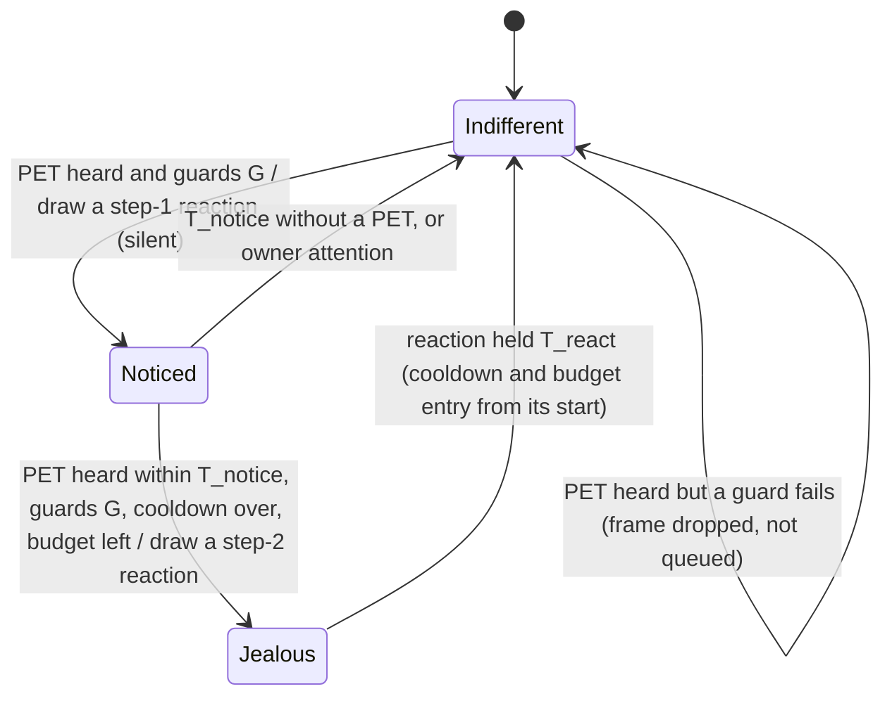

# State diagram — social-group — jealousy, petting another cube makes mine react, a little differently each time

> **Frame**: `stm — Jealousy`
> **Feature**: `social-group` — backlog items G6 (issue #73, PR #75) and G6a (issue #85) in
> [docs/roadmap.md](../../../roadmap.md)
> **Related ADRs**: ADR-0001 (alone, the social layer is nothing), ADR-0012 (no authentication,
> accepted nuisance risk, rate limits), ADR-0013 (timings, single Sound gate, lib-owned `Prng`),
> ADR-0014 (tests follow the conception, golden images)
> **Base machines**: [cube-core/05a-state-mood-engine.md](../cube-core/05a-state-mood-engine.md),
> [05c-state-choir.md](05c-state-choir.md) (the stroke that starts a choir)
> **Sequence**: [02e-sequence-jealousy.md](02e-sequence-jealousy.md)
> **Requirement**: REQ-F-21, FS8 — behaviour B5 (system-initiated, outcome of UC3 on a neighbour)

> **Status**: G6 design choices validated by the owner 2026-11-05 (issue #73), scored options.
> D1 signal (effect 30, robustness 25, simplicity 25, protocol fit 20): a new PET frame type
> `0x04` 405/500, against reusing the CHOIR receipt 275 and the PRESENCE mood byte (neighbour
> Happy) 265. D2 with the choir (same criteria): a stroke starts the choir when its cooldown
> allows, otherwise it sends PET 450/500, against both frames with PET ignored during a choir 350
> and sulking after the song 320. D3 effect (effect 30, owner safety 25, simplicity 25,
> robustness 20): a transient sulk, mood unchanged, 445/500, against entering Annoyed 355 (it
> would spread through G2, beyond "eyes and beep"). Row 11 added after the adversarial review
> (same criteria as D3): no sulk while singing 430/500, against D2 to the letter 365.
>
> G6a choices (issue #85), carried over from the design study of PR #76 and rescored on top of
> G6. D3' (cute 30, never mean 20, simplicity 20, no dependency on ADR-0018 15, consistency with
> validated decisions 15): D3 kept, every reaction leaves the mood unchanged, 440/500 (owner
> 2026-11-05), against an Annoyed top step under the ADR-0018 budget 330 and Annoyed only when
> Neglected 300; the Annoyed step is deferred to G6b. D6 crescendo (cute 35, simplicity 25,
> testability 20, reuse 20): a silent reaction first, a stronger one if the neighbour is stroked
> again within T_notice, 450/500. D7 choice (cute and surprise 35, context fit 25, testability 20,
> simplicity 20): weight tables by context drawn with a lib-owned `Prng` 440/500, against one
> fixed reaction per context 375 and pure chance 345. Owner validation of the G6a design is
> recorded in the PR.

## Context

This diagram answers "how does my cube react when the owner strokes another cube, why is the
reaction different from one time to the next, and why can it never nag a cube someone is using
or a sleeping office?". Jealousy is **not a mood**: like the chain reaction (05b row 5) it is a
transient reaction, eyes and at most one short sound through the Sound gate, and the mood
engine's state is unchanged (D3, D3').

G6 (PR #75) shipped one reaction, the Sulk. G6a turns it into a two-step crescendo: the first
stroke on a neighbour is only **noticed** (a silent glance), a second one within T_notice makes
the cube **jealous** (a reaction with a sound). At each step the **context**, what the cube
already knows, selects a weight table, and a lib-owned `Prng` draws one reaction from it, so the
reaction fits the situation yet stays a little unpredictable. The sender rules, the receiver
guards and the G6 rate limits are unchanged; only the step-2 reaction consumes the cooldown and
the budget.

## Sender rules (Social protocol, unchanged from G6)

| # | Situation (owner stroke on cube A) | Result |
|---|------------------------------------|--------|
| S1 | A Awake, a neighbour present, choir cooldown over | CHOIR start as in 05c; **no PET** (D2: the group sings, nobody sulks) |
| S2 | A Awake, a neighbour present, choir cooldown running, PET cooldown over | one PET frame `{A's palette}`, PET cooldown T_pet_tx from now |
| S3 | PET cooldown running (stroke within T_pet_tx of the last PET) | nothing sent |
| S4 | A not Awake, or no neighbour present | nothing sent (the stroke wakes or pleases A only) |

PET is never relayed: only the cubes in A's range hear it. With T_pet_tx 10 s, a step 2 needs a
second stroke on A between 10 s and T_notice after the first one heard.

## The input (Social protocol)

`SocialOutput::pet` keeps its G6 meaning (a valid PET heard this tick, the cube Awake and not
singing). G6a adds `SocialOutput::petContext`, filled on the same tick:

- `neighbours`: the number of present table entries (`Waiting` or `Greeted`);
- `strokedAgeMs`: how long the sender has been present, from a new `Neighbour::presentSince`,
  set when a new MAC is stored (Free or evicted slot) and kept when a known MAC comes back from
  `Absent`; a PET whose sender has no present entry gives 0 (a stranger is a newcomer).

A long absence frees the entry after T_regreet (10 min), so that cube comes back as a new MAC,
while a coffee break keeps the friendship.

## Receiver machine (cube B)

**Guards G** (both steps, the G6 receiver rows 2, 2b, 5 and 11): Awake, calm ≥ T_calm_jealous,
pad not held, not singing a choir voice, and outside T_jealous of the last step-2 reaction. A
PET heard while Noticed that fails only the budget leaves the cube Noticed.

## Repertoire (G6a)

| Reaction | Step | Eyes | Sound (placeholder until the sound brick) |
|----------|------|------|-------------------------------------------|
| SideGlance | 1 | both eyes slide to one side and hold | none |
| Stare | 1 | eyes held at a side look offset (`setLook`), blink suspended for T_react, then three fast blinks (a new `Timeline` case, pinned by a timeline test) | none |
| TurnAway | 1 | eyes at the largest look offset (`setLook`), opposite the side of the last glance | none |
| Pout | 2 | lower lids raised, eyes narrowed | short "hmpf", rank 2 |
| PuppyEyes | 2 | eyes enlarged with a highlight, lids tilted | small whimper, rank 2 |
| MeToo | 2 | eyes hop up and down | rising chirp, rank 2 |
| FakeSleep | 2 | eyes close, one eye half-opens and peeks sideways, closes again | none |
| Sulk | 2 | the G6 Sulk eyes (existing) | the G6 grumble (existing), rank 2 |

The new sounds rank 2 in the Sound gate, like the grumble (cube-core/05e): a choir voice (3)
wins, a greeting (0) is replaced. SideGlance, Stare and TurnAway reuse the look offset
(`setLook`) and Sulk reuses the G6 reaction; the four new eye frames (Pout, PuppyEyes, MeToo,
FakeSleep) are drawn first, as a face sheet of golden images validated by the owner before any
repertoire logic (gates.md, ADR-0014, F1b precedent). The reaction length is the renderer's
`reactionDurationMs(reaction)`, 3 s for every G6a reaction; T_react names it and is not a second
constant.

## Contexts and weights

Each reaction of the step starts from its base weight; every context that holds adds its
modifiers (never below 0), **Weary applied last**. The **last reaction drawn at the same step
gets weight 0** (no immediate repeat; every step keeps at least two positive weights).

| Context | Source | Holds when | Step 1 modifiers | Step 2 modifiers |
|---------|--------|-----------|------------------|------------------|
| — base | — | always | SideGlance 3, Stare 2, TurnAway 2 | Pout 3, PuppyEyes 2, MeToo 2, FakeSleep 1, Sulk 2 |
| Bored | mood engine | mood Bored | TurnAway +1 | PuppyEyes +3 |
| Crowd | `petContext` | ≥ 2 present neighbours | Stare +2 | MeToo +3 |
| Newcomer | `petContext` | stroked neighbour present < T_friend | TurnAway +2 | Sulk +2 |
| Friend | `petContext` | stroked neighbour present ≥ T_friend | SideGlance +2 | Pout +2, Sulk −2 |
| Neglected | mood engine | no owner attention for ≥ T_lonely | — | PuppyEyes +2 |
| Weary | repertoire | ≥ 3 step-2 reactions within T_weary | SideGlance +2 | FakeSleep +4, Sulk = 0 |

"Owner attention" is a touch-down, a gesture or a sound, the events that already break the calm
in G6 row 2.

## Ownership

A `JealousyRepertoire` class in `lib/` holds the weights, the no-repeat memory and the Weary
counter, and owns its `Prng` (`Prng(seed, 3)`, after the eyes 1 and the social protocol 2),
built in `Seeded` after the Wi-Fi driver is up (ADR-0013). The mood engine keeps the guards, the
crescendo state, the cooldown and the budget; `mood.jealousy(padHeld, out.petContext,
seeded->repertoire)` returns a `JealousReaction` (`None` or one of the eight), and `main.cpp`
plays it (the mood engine is a static global built before `Seeded`, so it holds no reference to
the repertoire).

## Receiver transition table (source of the native tests)

Rows 1 to 11 are the G6 rows, reworded for the crescendo; rows 12 onward are new in G6a.

| # | Situation (valid PET frame received by cube B) | Result |
|---|-----------------------------------------------|--------|
| 1 | B Indifferent, guards G hold | Noticed: draw a step-1 reaction (eyes only, silent), notice time = now; mood unchanged; no cooldown or budget entry |
| 1b | B Noticed less than T_notice ago, guards G hold, budget left | Jealous: draw a step-2 reaction, its eyes and sound; mood unchanged; cooldown and budget entry from now; back to Indifferent after T_react |
| 2 | own gesture, touch-down or sound within T_calm_jealous | nothing (the owner is with B, B is not jealous); the PET is not kept; a Noticed cube returns to Indifferent |
| 2b | B's pad held right now, however long (a stroke emits no gesture after its Stroke) | nothing (Codex review on PR #75: a held cube is in use) |
| 3 | within T_jealous of the last step-2 reaction | nothing; Noticed is not entered either (the bound on forged frames) |
| 4 | Noticed, kJealousBudget step-2 reactions already in the last kJealousWindow | nothing; B stays Noticed until T_notice elapses |
| 5 | B Dozing, Waking or Asleep | nothing (the engine is paused; never wakes, never sounds); Noticed is dropped |
| 6 | several PET frames in the same tick or from several cubes | at most one step |
| 7 | B's mood any of the five | the reaction plays the same; the mood, its timers and the G2 tally are unchanged |
| 8 | any reaction | does not break the calm, start the G2 refractory, drop a G5 hold, or count as a stimulus for the idle timer |
| 9 | malformed PET (palette out of range, reserved byte ≠ 0) | dropped by the codec (`dropRange`), no effect |
| 10 | B restarts (wake) | Noticed dropped; cooldown, budget, Weary counter and no-repeat memory kept (they bound forged traffic across wakes) |
| 11 | B started a choir voice less than kSingMs ago (a CHOIR drained in the same tick counts) (longest lead + 10 s, the bound of 05c row 6) | nothing (owner amendment 2026-11-05: the group sings, nobody sulks) |
| 12 | Noticed and T_notice elapses without a PET | Indifferent, silently |
| 13 | B touched or stroked while a reaction is shown | the reaction stops at once; the touch follows 05a (a stroke purrs): the cube forgives |
| 14 | draw with seed s and contexts c | equals the reference sequence for (s, c) (replayable) |
| 15 | `weights(step, contexts, last)` on combined contexts | exact vectors: Crowd + Friend at step 1 → SideGlance 5, Stare 4, TurnAway 2; Crowd + Friend + Neglected at step 2 → Pout 5, PuppyEyes 4, MeToo 5, FakeSleep 1, Sulk 0; Weary + Newcomer at step 2 → Sulk 0 |
| 16 | each context of the table holds alone | its modifiers apply, never below 0; Weary sets Sulk to 0 |
| 17 | the same step drawn twice in a row | never the same reaction twice (weight 0) |
| 18 | 10 000 draws on one context, no-repeat off | frequencies within ±2 % of the weights |
| 19 | a guard or the budget fails | no draw: the `Prng` sequence does not move (like ChainReaction) |
| 20 | a new MAC stored (Free or evicted slot, including a cube back after its entry was freed past T_regreet) | `presentSince` = now: Newcomer until T_friend |
| 20b | a known MAC back from `Absent` | `presentSince` kept: still a Friend if it was one |
| 20c | PET whose sender has no present entry | `strokedAgeMs` = 0 (Newcomer), `neighbours` as counted |
| 21 | any PET frame, accepted or dropped | nothing written to NVS, never relayed, no MAC in any log or counter (ADR-0012) |

Durations and budgets: **T_calm_jealous 6 s** (= T_contagion, a cube held in the last 6 s is in
use), **T_jealous 60 s**, **budget 4 step-2 reactions per 10 min** (ADR-0012 global budget, like
the greeting budget), **T_pet_tx 10 s** sender cooldown, all from G6. New in G6a (tuning
parameters, ADR-0013): **T_notice 60 s**, **T_react 3 s** (from the renderer), **T_friend 30 min**,
**T_lonely 5 min** (below the 10 min doze chain of FS5, so it can hold while awake),
**T_weary 30 min**.

## Worked example (cubes A, B, C; seed fixed in the test)

B has been left alone for 6 min (Neglected; C's arrival greeting kept it awake), Curious, with A
present for an hour (Friend) and C just arrived (Crowd). Alice strokes A: the choir starts and
all sing (S1). Thirty seconds later she strokes A again: the choir is cooling down, A sends PET
(S2). B notices: a step-1 draw among SideGlance 5, Stare 4, TurnAway 2, say a SideGlance. Alice
strokes A once more 15 s later: B is jealous, a step-2 draw among Pout 5, PuppyEyes 4, MeToo 5,
FakeSleep 1, Sulk 0, say MeToo: its eyes hop and it chirps. C, which only just met A (Newcomer),
turns away, then sulks. Bob strokes B: the hop stops, B purrs. An hour later, after three
episodes (the last a MeToo), B is Weary and not Neglected (a colleague talked to it 3 min ago):
a new pair of strokes on A draws among Pout 5, PuppyEyes 2, MeToo 0 (no repeat), FakeSleep 5,
Sulk 0, say a FakeSleep (5 of 12) that peeks sideways.

## Notes

- **Owner safety**: at most one sounding reaction per minute and four per ten minutes, as in G6;
  step 1 is silent; the mood never changes, so nothing spreads or lingers.
- **Sound**: every sound goes through the Sound gate at its volume (placeholders, sound design
  later); a non-Awake cube is never evaluated, so it never grumbles in its sleep.
- **Security**: a forged PET frame can make an awake idle cube glance, and two within T_notice
  can make it react once a minute, a nuisance accepted under ADR-0012 and capped by the G6
  cooldown and budget; it carries no command beyond that and never changes the mood.
- **Deterministic**: the clock, the context and the `Prng` are inputs; a seeded test replays any
  sequence.
- **Naming**: this short sulk is not S10's "sulks when ignored for two days".
- **Later (G6b)**: an Annoyed top step once ADR-0018 is Accepted (D3' deferred it), Tear,
  BrokenHeart, Mimic (copies the neighbour's purr, higher), Sigh, Tremble, an exaggerated
  reconciliation and the group sulk; the light (S8) and motion (S9) contexts and the optional
  "sworn enemy" pair come after.
