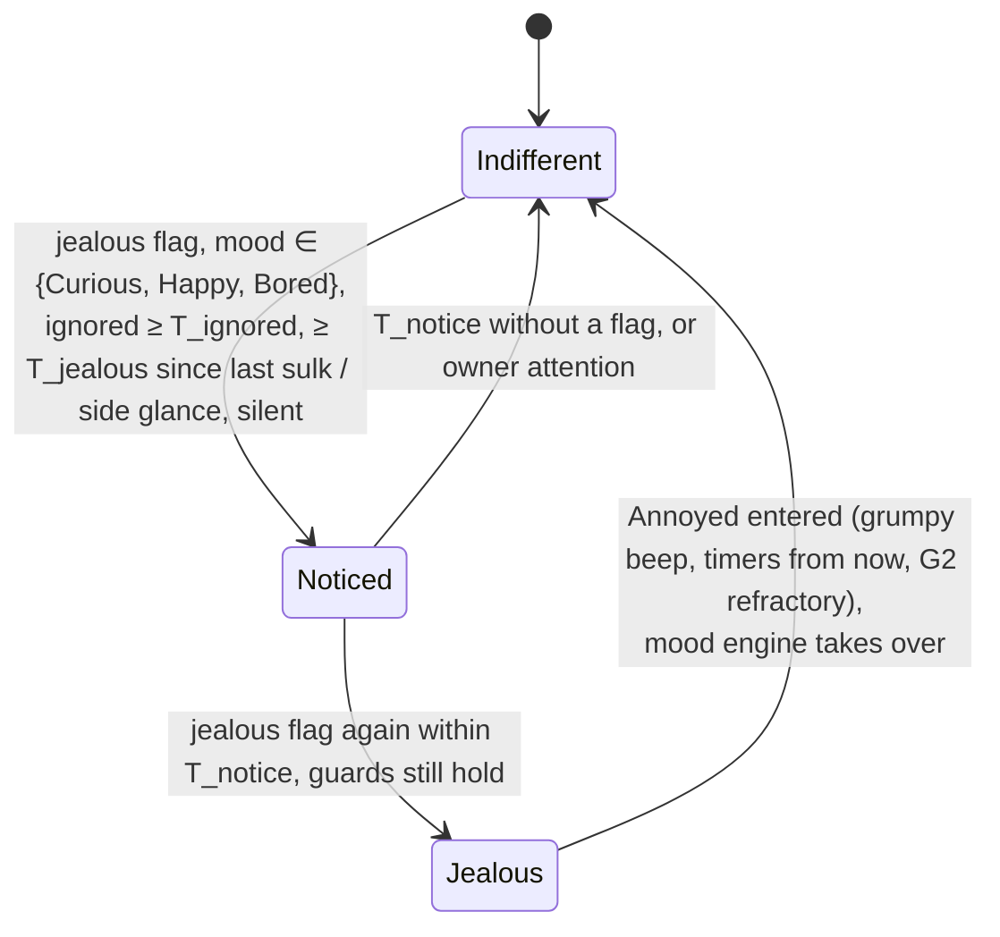

# State diagram — social-group — jealousy, a neighbour gets stroked and mine sulks (extension of the mood engine)

> **Frame**: `stm — Jealousy`
> **Feature**: `social-group` — backlog item G6 in [docs/roadmap.md](../../../roadmap.md), issue #73
> **Related ADRs**: ADR-0001 (alone, the social layer is nothing), ADR-0012 (no authentication,
> accepted nuisance risk; its "nudge only" clause is superseded for bounded one-shot events by
> ADR-0018, separate PR), ADR-0013 (timings, single Sound gate), ADR-0014 (tests follow the conception)
> **Base machines**: [cube-core/05a-state-mood-engine.md](../cube-core/05a-state-mood-engine.md)
> (Annoyed, its grumpy beep, its exits), [05a-state-contagion.md](05a-state-contagion.md) (G2),
> [05c-state-choir.md](05c-state-choir.md) (G4)
> **Sequence**: [02e-sequence-jealousy.md](02e-sequence-jealousy.md)
> **Requirement**: REQ-F-22, FS8 — behaviour B5 (system-initiated, outcome of UC3 on a neighbour)

> **Status**: design choices proposed 2026-11-05 (issue #73), scored options:
> - D1 signal (cute effect and timing 35, simplicity 25, robustness 20, reuse by G7/G10 20): a
>   one-shot PET frame `0x04` 430/500, against 300 a "petted" bit in PRESENCE (0–6 s late),
>   250 inferring the stroke from the mood byte (ambiguous with contagion) and 330 reacting to
>   the CHOIR start (only once per T_choir 60 s, and a stroke on a cube already in a choir
>   cooldown would go unseen).
> - D2 the sulk is the existing Annoyed mood, left by the existing rules (a stroke forgives →
>   Happy, calm T_calm → Curious): no new eyes, no new sound, no new exit to test.
> - D3 choir on the same stroke (cute 40, simplicity 30, fit with G4 30): the jealous cube
>   refuses to sing 440/500, against 320 a silent frown while singing and 310 no PET when the
>   stroke conducted a choir.
> - D4 echo through G2 (owner safety 40, cute 30, simplicity 30): the sulk starts the G2
>   refractory and a recently touched cube is never pulled into Annoyed 410/500, against 330
>   refractory only and 290 accepting the echo.
> - D5 ADR-0012 "a received frame only nudges the mood": a superseding ADR-0018 allows a bounded
>   one-shot social event 450/500, against 350 arguing equivalence here and 305 requiring two PET
>   frames in 3 s.
> - D6 context (cute 35, simplicity 25, testability 20, reuse 20): a crescendo 450/500 (a first
>   stroke on the neighbour earns a side glance, a second within T_notice the real sulk), against
>   410 a reaction per mood (needs a new expression), 340 a stronger reaction for a long-known
>   neighbour (memory per neighbour) and 340 a single reaction.
> Owner validation recorded in the PR.

## Context

This diagram answers "when does a stroke on another cube make mine jealous, and why can it never
annoy a cube its owner is busy with?". Like G2 and G5, jealousy is **not a new machine**: it adds
a two-step crescendo ending in one guarded transition **→ Annoyed**, fed by `SocialOutput::jealous`, which the Social protocol
sets for one tick when a valid PET frame arrives from a present neighbour while the cube is
Awake. Annoyed already plays the grumpy beep through the Sound gate and already shows its eyes; a
stroke on the jealous cube already turns it Happy, so the owner "makes up" with one caress.
"Ignored" means no owner attention at all: no touch-down, no gesture and no call (voice, clap)
for T_ignored, so a cube being petted or spoken to is never jealous.

## The input (computed by the Social protocol)

`SocialProtocol::tick(self)` sets `SocialOutput::jealous` when, on this tick, a decoded PET frame
names the palette index of its sender's present table entry (`Waiting` or `Greeted`) and
`self.sleep` is Awake. The flag is cleared every tick, so a PET received while not Awake is
lost, never replayed at the wake.

## Diagram

## Transition table (source of the native tests)

| # | Situation (cube Awake unless stated) | Result |
|---|--------------------------------------|--------|
| 1 | no jealous flag | nothing |
| 2 | flag, mood Curious, ignored ≥ T_ignored, no previous sulk, not Noticed | enter Noticed: `MoodEffect::SideGlance` (the eyes glance sideways, no sound), mood unchanged, notice time = now |
| 2b | flag while Noticed, less than T_notice after the notice, guards of row 2 still hold | enter Annoyed: `MoodEffect::Grumpy` (through the Sound gate); sulk time, calm and idle timers restart from now (the sulk lasts T_calm unless stroked); the G2 refractory starts and the G2 hold is dropped |
| 3 | flag, mood Bored, or Happy (reachable only through a G2 pull, since T_settle < T_ignored), ignored ≥ T_ignored | same crescendo as rows 2 and 2b (Bored is the most ignored cube of all); a G5 yawn hold is dropped (no longer Bored) |
| 2c | Noticed and T_notice elapses without a flag, or any owner attention | back to Indifferent, silently |
| 4 | flag, owner touch-down, gesture or call less than T_ignored ago | nothing: a cube that was just petted or spoken to is not jealous |
| 5 | flag, mood Tired | nothing: a sleepy cube does not care, and the flag never wakes it |
| 6 | flag, mood already Annoyed | nothing, sulk time unchanged |
| 7 | cube Dozing, Asleep or Waking when the PET arrives | no flag (Social protocol); nothing is replayed at the wake |
| 8 | flag less than T_jealous after the last sulk | nothing (rate limit, also the bound on forged frames) |
| 9 | jealous cube is stroked | Annoyed → Happy, purr (05a row): the cube forgives |
| 10 | jealous cube left alone | Annoyed → Curious after calm T_calm (05a row) |
| 11 | PET from a MAC that is not a present neighbour, or whose index differs from that neighbour's table entry | no flag (Social protocol) |
| 12 | PET frame with a reserved byte not zero or an out-of-range index | dropped by the decoder (`dropRange`), counted |
| 13 | several PET frames in one tick (several neighbours stroked) | one flag, one step of the crescendo |
| 14 | own stroke, Awake, at least one present neighbour, ≥ T_pet_tx since the last PET | sends one PET; its own mood follows 05a (purr) |
| 14b | own stroke while not Awake, or with no present neighbour, or within T_pet_tx | no PET (ADR-0001) |
| 15 | flag and a G2 pull or G5 yawn due on the same tick | jealousy is evaluated first; a sulk drops both holds and starts the G2 refractory (row 2) |
| 16 | CHOIR cue while Noticed | sings as usual (only the sulk refuses) |
| 16b | CHOIR cue on the tick a sulk starts, or while the cube is still Annoyed from a sulk | the cube refuses to sing: no choir voice, frown kept (D3); the Choir module's cooldown runs as usual |
| 17 | G2 candidate Annoyed on a cube touched less than T_ignored ago | no pull into Annoyed (D4, new row 13 of [05a-state-contagion](05a-state-contagion.md)): the stroked cube never catches its neighbours' sulk |
| 18 | `restart()` (boot, every wake) | last attention = now (a woken cube gets a T_ignored grace), Noticed dropped; the sulk time is kept, as the G2 refractory is |

Durations (tuning parameters, ADR-0013): **T_ignored 30 s**, **T_jealous 60 s**,
**T_pet_tx 10 s**, **T_notice 60 s**; T_calm 20 s reused from 05a.

## Worked example (cubes A and B on neighbouring desks)

Nobody has touched B for a minute; it is Curious. Alice strokes A: A purrs, conducts a choir and
sends one PET. Within a tick B glances sideways at nothing, silently, and sings along (rows 2,
16). Alice strokes A again 15 s later (past T_pet_tx): B frowns and grumbles (row 2b). A is not
pulled into Annoyed by B's mood (row 17). Bob strokes B: B purrs and turns Happy (row 9), then Curious
after T_settle. Alice strokes A a third time 20 s later: B was petted 20 s ago (row 4) and its last sulk is
under T_jealous (row 8), so it stays Curious.

## Notes

- **Owner safety**: the only sound is the existing grumpy beep at the Sound gate's volume. Per
  cube, a PET causes at most one grumble per T_jealous: the sulk starts the G2 refractory, so the
  jealous cube is not pulled back into Annoyed by its neighbours' sulks, and the stroked cube is
  protected by row 17. Never while dozing or asleep.
- **Security**: two forged PET frames force Annoyed on an idle awake cube, at most once per minute,
  reversible by a touch and with no effect beyond the mood. That departs from ADR-0012's "nudge
  only" clause, so it waits for ADR-0018 (separate PR, before the TDD).
- **Deterministic**: the flag and the clock are inputs; no `Prng`.
- **Naming**: this short sulk is not S10's "sulks when ignored for two days" (a Bored extension).
