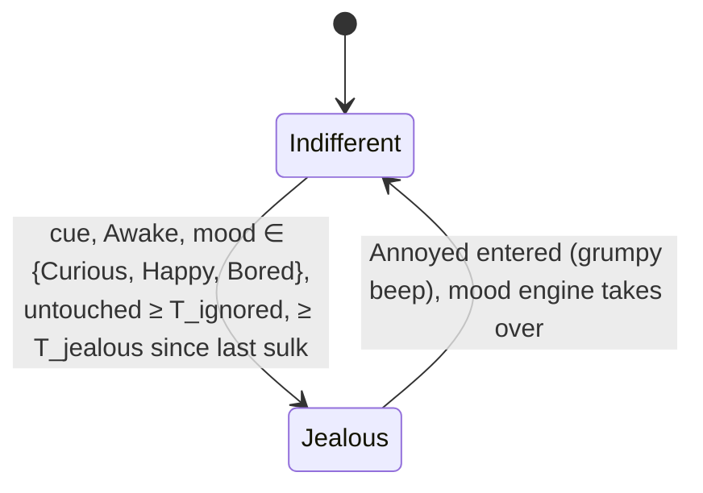

# State diagram — social-group — jealousy, a neighbour gets stroked and mine sulks (extension of the mood engine)

> **Frame**: `stm — Jealousy`
> **Feature**: `social-group` — backlog item G6 in [docs/roadmap.md](../../../roadmap.md), issue #73
> **Related ADRs**: ADR-0001 (alone, the social layer is nothing), ADR-0012 (no authentication,
> accepted nuisance risk), ADR-0013 (timings, single Sound gate), ADR-0014 (tests follow the conception)
> **Base machine**: [cube-core/05a-state-mood-engine.md](../cube-core/05a-state-mood-engine.md)
> (Annoyed, its grumpy beep, its exits)
> **Sequence**: [02e-sequence-jealousy.md](02e-sequence-jealousy.md)
> **Requirement**: REQ-F-22, FS8 — behaviour B5 (system-initiated, outcome of UC3 on a neighbour)

> **Status**: design choices proposed 2026-11-05 (issue #73), scored options (criteria: cute
> effect and timing 35, simplicity 25, robustness 20, reuse by G7/G10 20): D1 a one-shot PET
> frame `0x04` 430/500 (against 300 a "petted" bit in PRESENCE, 0–6 s late, and 250 inferring
> the stroke from the mood byte, ambiguous with contagion). D2 the sulk is the existing Annoyed
> mood, left by the existing rules (a stroke forgives → Happy, calm T_calm → Curious) rather than
> a new timed state: no new eyes, no new sound, no new exit to test. Owner validation pending in
> the PR.

## Context

This diagram answers "when does a stroke on another cube make mine jealous, and why can it never
annoy a cube its owner is busy with?". Like G2 and G5, jealousy is **not a new machine**: it adds
one guarded transition **→ Annoyed**, fed by a `JealousyCue` that the Social protocol raises when
a valid PET frame arrives from a present neighbour. Annoyed already plays the grumpy beep through
the Sound gate and already shows its eyes; a stroke on the jealous cube already turns it Happy,
so the owner "makes up" with one caress.

## The input (computed by the Social protocol)

`SocialProtocol` raises one `JealousyCue` per decoded PET frame whose sender MAC is a present
neighbour (`Waiting` or `Greeted`) and whose stroked palette index is not the cube's own. The
cue is consumed by the next Awake tick; cues arriving while not Awake are discarded.

## Diagram

## Transition table (source of the native tests)

| # | Situation (cube Awake unless stated) | Result |
|---|--------------------------------------|--------|
| 1 | no cue | nothing |
| 2 | cue, mood Curious, untouched ≥ T_ignored, no previous sulk | enter Annoyed: `MoodEffect::Grumpy` (through the Sound gate), sulk time = now |
| 3 | cue, mood Happy or Bored, untouched ≥ T_ignored | enter Annoyed, as row 2 (Bored is the most ignored cube of all) |
| 4 | cue, any touch-down on this cube less than T_ignored ago | nothing: a cube that was just petted is not jealous |
| 5 | cue, mood Tired | nothing: a sleepy cube does not care, and the cue never wakes it |
| 6 | cue, mood already Annoyed | nothing, sulk time unchanged |
| 7 | cube Dozing or Asleep | cue discarded, never evaluated (the engine is paused) |
| 8 | cue less than T_jealous after the last sulk | nothing (rate limit, also the bound on forged frames) |
| 9 | jealous cube is stroked | Annoyed → Happy, purr (05a row): the cube forgives |
| 10 | jealous cube left alone | Annoyed → Curious after calm T_calm (05a row) |
| 11 | PET from a MAC that is not a present neighbour, or naming the cube's own palette index | no cue (dropped by the Social protocol) |
| 12 | PET frame with a reserved byte not zero or an out-of-range index | dropped by the decoder (`dropRange`), counted |
| 13 | several cues in one tick (several neighbours stroked) | one evaluation, at most one sulk |
| 14 | this cube's own long stroke | sends one PET, at most once per T_pet_tx; its own mood follows 05a (purr) |
| 15 | a G2 pull or a G5 yawn is due on the same tick as a cue | jealousy is evaluated first and enters Annoyed, which drops the G5 hold (no longer Bored); G2 pulls out of Annoyed follow 05a-contagion as for any Annoyed cube |

Durations (tuning parameters, ADR-0013): **T_ignored 30 s**, **T_jealous 60 s**,
**T_pet_tx 10 s**; T_calm 20 s reused from 05a.

## Worked example (cubes A and B on neighbouring desks)

Nobody has touched B for a minute; it is Curious. Alice strokes A: A purrs and sends one PET.
Within a tick B frowns and grumbles (row 2). Bob notices and strokes B: B purrs and turns Happy
(row 9). Alice strokes A again 20 s later: B was just petted (row 4), it stays Happy.

## Notes

- **Owner safety**: the cube is never loud: the only sound is the existing grumpy beep at the
  Sound gate's volume, once per T_jealous at most, and never while dozing or asleep.
- **Security**: a forged PET frame can make an awake idle cube grumble once per minute, a
  nuisance accepted under ADR-0012 like G2 and G5; it cannot wake a cube or change its identity.
- **Deterministic**: the cue and the clock are inputs; no `Prng`.
