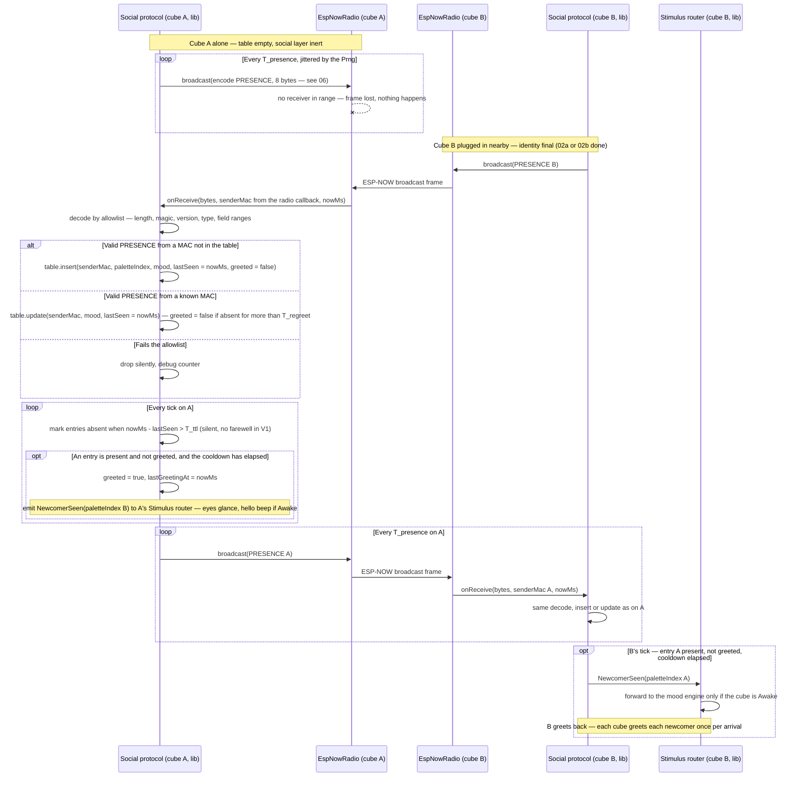

# Sequence diagram — social-presence — presence broadcast, neighbour table, greeting a newcomer

> **Frame**: `sd — Presence and greeting`
> **Feature**: `social-presence` — backlog item G1 in [docs/roadmap.md](../../../roadmap.md)
> **Related ADRs**: ADR-0001 (social layer degrades to nothing when alone), ADR-0005 (ESP-NOW broadcast, versioned frames), ADR-0008 (MAC is the social key)
> **Use case**: UC7 Introduce a cube to the group in [cube-core/01-use-case.md](../cube-core/01-use-case.md)
> **Modules and ports**: `Social protocol`, `Stimulus router`, `IRadio`, `IClock`, `Prng` in [cube-core/03-component.md](../cube-core/03-component.md)
> **Frame layout**: [06-data-flow.md](06-data-flow.md)

## Context

This diagram answers "how do cubes learn about each other, forget each other, and welcome a
newcomer, with no pairing?". Two cubes are shown: cube A already on the desk, cube B arriving. The
same code runs on both. Mood contagion (G2) and chain reactions (G3) reuse this table and are not
shown.

## Diagram

## Notes

- **Symmetry**: there is no leader and no handshake. Each cube greets the other on *its own* first
  sight, which happens within one T_presence on both sides. Greeting is a local stimulus, not a
  frame type: no extra message and nothing to acknowledge (owner decision, validated 2026-10-14;
  a dedicated GREET frame is re-evaluated when G3 introduces the event frame).
- **Greeting policy** (this section is the single owner of the policy; [06](06-data-flow.md) and
  ADR-0012 link here), so the cube is never loud under flapping or spoofing, yet never misses a
  newcomer while Awake (UC7 guarantee):
  - greeting is decided on the tick, not on receive: an entry is greeted when it is present, not
    yet greeted, and at least `T_greet_cooldown` (proposal 10 s) has elapsed since the last
    greeting. Several cubes plugged in together are therefore greeted one after another, none is
    skipped,
  - `greeted` is set only when the greeting is actually emitted, so a newcomer seen during the
    cooldown is greeted on a later tick. A newcomer seen while the cube is not Awake is dropped by
    the router, and the entry stays greeted: the sleeping cube does not greet on waking (deliberate,
    the colleague has moved on),
  - an entry that goes absent and comes back is re-greeted only if it was absent for more than
    `T_regreet` (proposal 10 min, far above `T_ttl`). Three lost frames in a busy office do not
    cause a second hello,
  - a global budget caps greetings at 6 per 10 min (tunable), the ADR-0012 mitigation against a
    forged stream of newcomers.
- **One table, one rule**: entries are never deleted on expiry, only marked absent when
  `nowMs - lastSeen > T_ttl`; the `lastSeen` of an absent entry is what the re-greet rule reads.
  When the table is full, a newcomer evicts the absent entry with the oldest `lastSeen`, and is
  dropped if every entry is present.
- **Timers**: T_presence 5 s with ±1 s jitter from the Prng (so a fleet does not synchronise its
  broadcasts), T_ttl 3 × T_presence = 15 s. Tuning values; the G4 choir will need a tighter
  period and will revisit them.
- **Alone means inert**: with an empty table, the only social activity is one broadcast every
  T_presence. No mood effect, no sound, which is ADR-0001's "degrades to nothing" requirement.
- **Table bounds**: fixed capacity of 16 entries (more than the planned fleet). Eviction only
  replaces absent entries, so a burst of forged MACs cannot push a present neighbour out. A
  *sustained* stream of 16 forged MACs re-sent within `T_ttl` does keep every slot present and
  hides real newcomers: this is part of the accepted residual risk stated in
  [06](06-data-flow.md). Fixed arrays, no heap, so it is testable natively and safe on the C3.
- **The sender MAC is unauthenticated**: it comes from the 802.11 header through the receive
  callback, not from the payload, but any ESP32 can transmit with a forged source MAC. Forging a
  known neighbour's MAC overwrites its mood byte and refreshes `lastSeen`. Spoofing is accepted in
  V1 with its consequences listed honestly in [06](06-data-flow.md) and submitted to the owner.
- **Time arithmetic**: all ages use modular unsigned subtraction on `nowMs` (wrap at 49.7 days),
  see [06](06-data-flow.md).
- **Native test**: `LoopbackRadio` fake connects two `Social protocol` instances with a scripted
  `FakeClock`, so insert, update, greet-once, cooldown, re-greet hysteresis and expiry are
  asserted without hardware.
