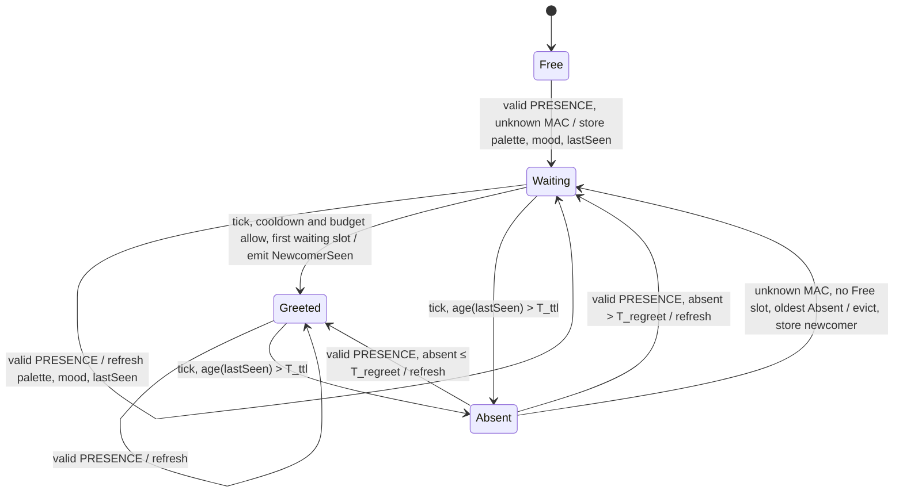

# State diagram — social-presence — neighbour entry and greeting

> **Frame**: `stm — Neighbour entry`
> **Feature**: `social-presence` — backlog item G1 in [docs/roadmap.md](../../../roadmap.md)
> **Related ADRs**: ADR-0005, ADR-0008, ADR-0012 (greeting budget), ADR-0013 (lib-owned Prng)
> **Sequence**: [02-sequence-presence.md](02-sequence-presence.md) (owner of the greeting policy) — frame: [06-data-flow.md](06-data-flow.md)
> **Module**: `Social protocol` in [cube-core/03-component.md](../cube-core/03-component.md)

> **Status**: validated by the owner 2026-10-15 (F4, scored options: pull `IRadio` 475/500,
> sliding greeting budget 470/500, `SelfState` passed per tick 445/500)

## Context

This diagram answers "what states does one slot of the neighbour table go through, and when
does the cube greet?". It formalises the rules of 02 so each transition becomes a native test
(ADR-0014). Three owner decisions of 2026-10-15 (F4) fix the module contract:

- **`IRadio` is pulled** (475/500, against 380 for `main.cpp` pushing frames and 245 for a lib
  callback): `broadcast(bytes, len)` and `bool receive(RxFrame&)`; the adapter owns the 8-slot
  queue, `SocialProtocol::tick()` drains at most 4 frames, so the flood budget is tested natively.
- **The greeting budget is a sliding window** (470/500, against 410 for a fixed 10-min bucket
  that allows 12 greetings across a boundary, and 385 for a token bucket): the timestamps of the
  last 6 greetings in a ring; a greeting is allowed when the oldest is more than 10 min old.
- **The cube's own state comes in per tick** (445/500, against 405 for references to the Sleep
  cycle and Mood engine and 315 for `main.cpp` computing the byte): `tick(SelfState)` with
  palette index, adopted flag, sleep state, wake origin and mood; the codec's pure `moodByte()`
  maps them per 05b. The `Social --> Sleep` and `Social --> MoodE` read edges pass through
  `main.cpp`, like the `Ident --> Eyes` edge.

`tick()` returns a `SocialOutput` (newcomer flag and palette index) that `main.cpp` hands to
`routeNewcomer(sleepState)`, like the router's `Route`.

## Diagram

`Absent` keeps whether the entry had been greeted only through `lastSeen`: the re-greet rule
reads its age. An `Absent` slot evicted for a newcomer starts over in `Waiting`.

## Transition table

Each row is one native test (ADR-0014). Ages are `ageMs(now, then)` on the injected clock.

| From | Trigger | To | Output / side effect |
|------|---------|----|----------------------|
| Free | valid PRESENCE, MAC not in table | Waiting | store MAC, palette, mood, `lastSeen = frame.nowMs` |
| Waiting | valid PRESENCE, same MAC | Waiting | refresh palette, mood, `lastSeen` |
| Waiting | tick, no greeting in the last T_greet_cooldown, fewer than 6 greetings in the last 10 min, lowest waiting slot | Greeted | `SocialOutput{newcomer, paletteIndex}`, push `nowMs` in the budget ring |
| Waiting | tick, cooldown not elapsed | Waiting | none (greeted on a later tick, never skipped) |
| Waiting | tick, budget spent (6 in the last 10 min) | Waiting | none (greeted once the oldest greeting is 10 min old) |
| Waiting | tick, another slot greeted this tick | Waiting | none (one greeting per tick) |
| Greeted | valid PRESENCE, same MAC | Greeted | refresh |
| Waiting, Greeted | tick, `age(lastSeen) > T_ttl` | Absent | none (silent, no farewell in V1) |
| Absent | valid PRESENCE, absent `age ≤ T_regreet` | Greeted | refresh (no second hello) |
| Absent | valid PRESENCE, absent `age > T_regreet` | Waiting | refresh (greeted again) |
| Absent (oldest `lastSeen`) | valid PRESENCE, unknown MAC, no Free slot | Waiting | evict, store the newcomer |
| — | valid PRESENCE, unknown MAC, every slot Waiting or Greeted | — | drop, count `dropFull` |
| — | frame failing the allowlist (06) | — | drop, count by reason: `dropLen`, `dropMagic`, `dropVersion`, `dropType`, `dropRange` |

Per tick, in this order: drain at most 4 frames from `IRadio`, expire, greet at most one slot,
broadcast PRESENCE if due. The first tick broadcasts; each broadcast schedules the next at
`T_presence − 1 s + Prng.uniform(2001)` ms, i.e. 5 s ± 1 s.

Timers (02, tuning values): T_presence 5 s ± 1 s, T_ttl 15 s, T_greet_cooldown 10 s, T_regreet
10 min, budget 6 greetings per 10 min, table capacity 16.

## Notes

- **Greeting while not Awake**: the Social protocol does not know the sleep state's routing; the
  greeting is emitted, counted in the cooldown and budget, and dropped by the router (02: the
  sleeping cube does not greet on waking).
- **Codec in its own unit**: `encodePresence` / `decodePresence` and `moodByte` are pure
  functions over a byte array, fuzzed natively; the table and the timers live in
  `SocialProtocol`.
- **Wrap-safe**: every age is `ageMs(now, then)`; a native test starts the clock just below the
  32-bit wrap.
