# Data-flow diagram — social-presence — the versioned ESP-NOW frame, from the air to the neighbour table

> **Feature**: `social-presence` — backlog items G1, T3 in [docs/roadmap.md](../../../roadmap.md)
> **Related ADRs**: ADR-0005 (versioned frames, allowlist parsing, drop on unknown), ADR-0008 (MAC and colour as identity)
> **Project rule captured**: "Radio frames are versioned and validated" ([CLAUDE.md](../../../../CLAUDE.md)), security policy INPUT rules
> **Sequence**: [02-sequence-presence.md](02-sequence-presence.md) — mood encoding: [cube-core/05a](../cube-core/05a-state-mood-engine.md), per sleep state: [cube-core/05b](../cube-core/05b-state-sleep-wake.md)

## Context

This diagram answers "what bytes cross the air, which fields are trusted, and where does an
untrusted frame die?". The data-flow view is the privacy and input-validation checkpoint of the
study: each edge names the data it carries and flags personal data. (Data-flow has no UML frame
tag.)

## Frame layout (V1, protocol version 1)

| Offset | Size | Field | Allowed values | Notes |
|--------|------|-------|----------------|-------|
| 0 | 2 | magic | `0x43 0x42` ("CB") | rejects other ESP-NOW users on the channel |
| 2 | 1 | version | `1` | any other value → drop |
| 3 | 1 | type | `0x01` PRESENCE | other values reserved (G2 event, G3 chain) → drop in V1 |
| 4 | 1 | palette index | `0 .. paletteSize-1` | out of range → drop |
| 5 | 1 | mood | `0 .. 5` per the table in 05a (5 = asleep) | out of range → drop |
| 6 | 1 | flags | bit0 adopted, others `0` | unknown bits set → drop |
| 7 | 1 | reserved | `0` | must be zero in v1 |

Total 8 bytes, far below the 250-byte ESP-NOW payload limit. The sender MAC is **not** in the
payload: it is taken from the receive callback metadata, which the radio stack fills in from the
802.11 header. Frames whose length is not exactly 8 are dropped before any field is read.

**Palette index on the air** means every cube in range must share the palette table. A firmware
that changes the palette bumps the protocol version, so older cubes drop its frames rather than
show the wrong colour (owner decision taken by default, alternative in the PR Q&A: 2 bytes of
RGB565 instead of the index). The radio channel is a fixed constant in V1 and will be revisited
by the V1.5 mother-cube ADR, since a Wi-Fi station must follow its access point's channel.

## Diagram

```mermaid
flowchart LR
  subgraph TX ["Cube B — sender"]
    IdB["Identity {paletteIndex, adopted}"] -->|"palette index, adopted flag"| Enc["Social protocol — encode"]
    MoodB["Sleep cycle — presenceMoodByte"] -->|"mood byte 0..5"| Enc
    Enc -->|"8 bytes, v1 PRESENCE"| RadB["EspNowRadio — broadcast FF:FF:FF:FF:FF:FF"]
  end

  RadB -->|"ESP-NOW frame, fixed channel, unencrypted"| Air(("2.4 GHz air"))
  Air -.->|"PII: sender MAC (a stable device identifier)"| RadA

  subgraph RX ["Cube A — receiver"]
    RadA["EspNowRadio — RX callback"] -->|"bytes + senderMac + nowMs"| Q["Bounded RX queue (Wi-Fi task → tick)"]
    Q --> L{"length == 8 ?"}
    L -->|no| Drop["Drop silently, debug counter"]
    L -->|yes| V{"magic, version == 1, type in allowlist ?"}
    V -->|no| Drop
    V -->|yes| F{"palette index, mood, flags, reserved in range ?"}
    F -->|no| Drop
    F -->|yes| Dec["Decoded Presence {senderMac, paletteIndex, mood, adopted}"]
    Dec -->|"insert or update, lastSeen"| Tab["Neighbour table (16 fixed slots, RAM only)"]
    Tab -->|"NewcomerSeen(paletteIndex), once per arrival, cooldown"| RouterA["Stimulus router → Mood engine if Awake"]
    Tab -. "never persisted, never forwarded" .-> Tab
  end
```

## Notes

- **Only one PII-bearing edge**: the sender MAC. It is a stable identifier of a device that sits on
  a named colleague's desk, so it is personal data in the GDPR sense. Mitigations in V1: it stays
  in RAM in the neighbour table, is never written to NVS, never relayed in a payload, never logged
  outside debug builds. Frames carry a colour, not a name.
- **Allowlist, not denylist**: every field is checked against the set of values the current
  firmware understands. A newer cube sending v2 frames to an older cube is dropped, not
  misread, which is what makes mixed-version fleets (before the mother cube delivers OTA) safe.
- **No encryption, no authentication in V1**: ESP-NOW broadcast cannot be encrypted (encryption
  needs a registered peer per MAC), and the source MAC can be forged by any ESP32. The threat is
  spoofed presence or garbage frames. Consequences are bounded by design: a forged frame can at
  most insert one table entry and trigger one greeting per cooldown while the cube is Awake, and
  the table capacity caps the state an attacker can create. ESP-NOW unicast with per-peer keys
  is possible later for the OTA path (V1.5), which does need integrity.
- **Decode in `lib/`, I/O in `src/`**: the allowlist checks are pure functions over a byte array,
  so they are fuzzed and unit-tested natively. The adapter only moves bytes from the ESP-NOW
  receive callback (which runs in the Wi-Fi task on Arduino core 3) into a bounded queue that the
  tick drains. No parsing in the callback.
- **Adopted flag**: no V1 consumer beyond debug builds (the Maker spotting spare cubes). It costs
  one bit and avoids a protocol bump when G-tier behaviours want it, so it is kept.
- **Reserved byte and flags**: kept at zero and checked, so that a v1 receiver rejects frames from
  a future firmware that reuses them, instead of guessing.
