# Data-flow diagram — social-presence — the versioned ESP-NOW frame, from the air to the neighbour table

> **Frame**: none (data-flow is not a native UML diagram)
> **Feature**: `social-presence` — backlog items G1, T3 in [docs/roadmap.md](../../../roadmap.md)
> **Related ADRs**: ADR-0005 (versioned frames, allowlist parsing, drop on unknown), ADR-0008 (MAC and colour as identity)
> **Project rule captured**: "Radio frames are versioned and validated" ([CLAUDE.md](../../../../CLAUDE.md)), security policy INPUT rules
> **Sequence**: [02-sequence-presence.md](02-sequence-presence.md) — mood encoding: [cube-core/05a](../cube-core/05a-state-mood-engine.md), per sleep state: [cube-core/05b](../cube-core/05b-state-sleep-wake.md)

## Context

This diagram answers "what bytes cross the air, which fields are trusted, and where does an
untrusted frame die?". The data-flow view is the privacy and input-validation checkpoint of the
study: each edge names the data it carries and flags personal data. (Data-flow has no UML frame
tag.)

## Frame layout (V1, protocol version 1)

| Offset | Size | Field | Allowed values | Notes |
|--------|------|-------|----------------|-------|
| 0 | 2 | magic | `0x43 0x42` ("CB") | filters unrelated ESP-NOW traffic on the channel |
| 2 | 1 | version | `1` | any other value → drop |
| 3 | 1 | type | `0x01` PRESENCE | other values reserved (G2 event, G3 chain) → drop in V1 |
| 4 | 1 | palette index | `0 .. paletteSize-1` | out of range → drop |
| 5 | 1 | mood | `0 .. 5` per the table in 05a (5 = asleep) | out of range → drop |
| 6 | 1 | flags | bit0 adopted, others `0` | unknown bits set → drop |
| 7 | 1 | reserved | `0` | must be zero in v1 |

Total 8 bytes, far below the 250-byte ESP-NOW payload limit. The sender MAC is **not** in the
payload: it is taken from the receive callback metadata, which the radio stack fills in from the
802.11 header.

**Receive path budget** (the input the design must bound is the frame *rate*, not only the
frame content):

| Stage | Rule |
|-------|------|
| Receive callback (Wi-Fi task) | `len != 8` → drop and count `dropLen`, before any copy. A length compare is not parsing. Otherwise copy into a fixed slot `{uint8_t[8], mac[6], nowMs}` |
| RX queue | 8 fixed slots, single producer (callback) single consumer (tick). **Drop newest when full**, count `rxOverflow`. The callback never blocks |
| Tick drain | at most 4 frames decoded per tick, the rest wait for the next tick, so a flood cannot starve gestures, eyes or display |
| Decode (lib) | allowlist on every field, drop counted by reason: `dropMagic`, `dropVersion`, `dropType`, `dropRange` |

A native test injects 1 000 frames in one tick through `LoopbackRadio` and asserts the tick
budget and the counters.

**Palette index on the air** means every cube in range must share the palette table. A firmware
that changes the palette bumps the protocol version, so older cubes drop its frames rather than
show the wrong colour (owner decision, validated 2026-10-14; 2 bytes of RGB565 become preferable
once relayed OTA makes mixed fleets normal, to be revisited in the V1.5 ADR). The radio channel
is a fixed constant in V1 and will be revisited
by the V1.5 mother-cube ADR, since a Wi-Fi station must follow its access point's channel.

## Diagram

```mermaid
flowchart LR
  subgraph TX ["Cube B — sender"]
    IdB["Identity {paletteIndex, adopted}"] -->|"palette index, adopted flag"| Enc["Social protocol — encode"]
    MoodB["Sleep cycle — presenceMoodByte"] -->|"mood byte 0..5"| Enc
    Enc -->|"8 bytes, v1 PRESENCE"| RadB["EspNowRadio — broadcast FF:FF:FF:FF:FF:FF"]
  end

  RadB -->|"ESP-NOW frame, fixed channel, unencrypted"| Air(("2.4 GHz air"))
  Air -.->|"PII: sender MAC (a stable device identifier)"| RadA

  subgraph RX ["Cube A — receiver"]
    RadA["EspNowRadio — RX callback, Wi-Fi task"] --> L{"length == 8 ?"}
    L -->|no| Drop["Drop silently, counter by reason"]
    L -->|yes| Q["RX queue, 8 fixed slots, drop newest when full"]
    Q -->|"at most 4 per tick"| V{"magic, version == 1, type in allowlist ?"}
    V -->|no| Drop
    V -->|yes| F{"palette index, mood, flags, reserved in range ?"}
    F -->|no| Drop
    F -->|yes| Dec["Decoded Presence {senderMac, paletteIndex, mood, adopted}"]
    Dec -->|"insert or update, lastSeen"| Tab["Neighbour table (16 fixed slots, RAM only)"]
    Tab -->|"NewcomerSeen(paletteIndex), once per arrival, cooldown"| RouterA["Stimulus router → Mood engine if Awake"]
    Tab -. "never persisted, never forwarded" .-> Tab
  end
```

## Notes

- **Only one PII-bearing edge**: the sender MAC. It is a stable identifier of a device that sits on
  a named colleague's desk, so it is personal data in the GDPR sense. Mitigations in V1: it stays
  in RAM in the neighbour table, is never written to NVS, never relayed in a payload, never
  logged. Debug output prints the palette index and at most a 16-bit hash prefix of the MAC,
  and drop counters are keyed by reason, never by MAC. Frames carry a colour, not a name.
- **Privacy**: the sender itself leaks its MAC in cleartext every T_presence together with a mood
  byte, so anyone with a Wi-Fi sniffer in range can infer when a named colleague is at their desk.
  The MAC leak is inherent to 802.11 (every ESP-NOW frame carries it), not added by this protocol;
  a random locally-administered MAC was not retained because the MAC is the social identity
  (ADR-0008). Retention is RAM only, cleared at power-off. Lawful basis is the consent of the
  colleague who accepts the cube, given on adoption day (the household exemption does not apply
  at work), which the adoption-day briefing must state.
- **Allowlist, not denylist**: every field is checked against the set of values the current
  firmware understands. A newer cube sending v2 frames to an older cube is dropped, not
  misread, which is what makes mixed-version fleets (before the mother cube delivers OTA) safe.
- **No encryption, no authentication in V1, accepted residual risk**: ESP-NOW broadcast cannot be
  encrypted (encryption needs a registered peer per MAC), and the source MAC can be forged by any
  ESP32. An attacker in radio range can therefore (1) keep 16 forged entries present and hide real
  newcomers, (2) impersonate a known cube's presence and mood byte (a nuisance today, mood
  injection the day G2 contagion ships), (3) trigger one greeting per cooldown while the cube is
  Awake. Accepted in V1 because the consequences are a nuisance on a desk toy: nothing is
  persisted, nothing is actuated beyond eyes and a beep, and a global greeting budget (proposal:
  at most 6 greetings per 10 min, a tunable in the Social protocol) caps the noise. Accepted by
  the owner on 2026-10-14 and recorded in ADR-0012 (amends ADR-0005). V2 hook: a fleet key
  provisioned at adoption into NVS, never in source (per-peer keys were scored out in ADR-0012).
- **Decode in `lib/`, I/O in `src/`**: the allowlist checks are pure functions over a byte array,
  so they are fuzzed and unit-tested natively. The adapter only compares the length and moves
  bytes from the ESP-NOW receive callback (which runs in the Wi-Fi task on Arduino core 3) into
  the fixed-slot queue (a FreeRTOS queue or a single-producer single-consumer ring) that the tick
  drains. No parsing in the callback.
- **Time arithmetic**: `nowMs` is an unsigned 32-bit millisecond counter that wraps every
  49.7 days, and a desk cube stays powered for months. Every age test (`T_ttl`, cooldown,
  `T_regreet`) is written as `(uint32)(now - then) > T`, never `now > then + T`. A native test
  starts `FakeClock` just below the wrap.
- **Adopted flag**: no V1 consumer beyond debug builds (the Maker spotting spare cubes). It costs
  one bit and avoids a protocol bump when G-tier behaviours want it, so it is kept.
- **Reserved byte and flags**: kept at zero and checked, so that a v1 receiver rejects frames from
  a future firmware that reuses them, instead of guessing.
- **OTA integrity (V1.5 hook)**: ADR-0005 mentions a SHA-256-verified image. A hash defends
  against corruption, not against a hostile image: the V1.5 ADR must require a *signed* image
  (public key in firmware is fine, no secret), so it does not inherit the weaker claim.
