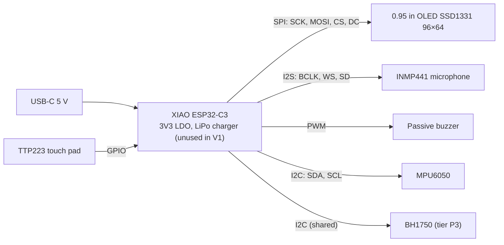

# Electronics specification — cubbies V1

> **Status**: draft. The GPIO allocation becomes a **signed contract** at the CDR
> ([gates.md](../architecture/gates.md)); changing a pin afterwards reopens a decision with the owner.
> Decisions: ADR-0002 (power), ADR-0003 (board), ADR-0006 (display), ADR-0007 (pin budget).
> Native KiCad schematic: `electronics/cubbies-v1.kicad_sch` (to create), PDF export next
> to it.

## Block diagram

## GPIO allocation (contract, V1)

Source of truth in code: `firmware/include/pins.h`. Both must match; ERC and a review check it.

| Function | Signal | XIAO ESP32-C3 | Label | C3 Super Mini (prototypes) | Notes |
|----------|--------|---------------|-------|----------------------------|-------|
| Display | SCK | GPIO8 | D8 | GPIO4 | hardware SPI |
| Display | MOSI | GPIO10 | D10 | GPIO6 | |
| Display | CS | GPIO3 | D1 | GPIO7 | |
| Display | DC | GPIO9 | D9 | GPIO5 | GPIO9 is a strapping pin (10 kΩ pull-up + BOOT button on the XIAO): its only load is the SSD1331 D/C# input, never pulled low externally; pressing BOOT while running only glitches DC |
| Display | RESET | 3V3 via RC | — | 3V3 via RC | 10 kΩ / 100 nF, see calculations §3 |
| Microphone | BCLK | GPIO20 | D7 | GPIO2 | |
| Microphone | WS | GPIO21 | D6 | GPIO3 | |
| Microphone | SD | GPIO5 | D3 | GPIO10 | L/R pin to GND (left) |
| Buzzer | PWM | GPIO2 | D0 | GPIO8 | through a transistor stage, see calculations |
| Touch | OUT | GPIO4 | D2 | GPIO1 | TTP223 active high, momentary mode |
| I2C | SDA | GPIO6 | D4 | GPIO0 | 4.7 kΩ pull-ups on the modules |
| I2C | SCL | GPIO7 | D5 | GPIO21 | |
| **Used** | | **11 / 11** | | **11** | no free GPIO: extras on I2C only |

## Power

| Rail | Source | Consumers | Budget |
|------|--------|-----------|--------|
| 5 V | USB-C | XIAO input | ≤ 500 mA peak (REQ-NF-04) |
| 3V3 | XIAO LDO TI TLV75733 (700 mA class; the thermal budget, not the rating, is the limit) | ESP32-C3, OLED, mic, IMU, touch, buzzer stage | typical ≤ 300 mA (thermal), see calculations §1 |

Current budget detail and buzzer stage sizing: [calculations.md](calculations.md).

## Interfaces and settings

| Interface | Parameter | Value | Why |
|-----------|-----------|-------|-----|
| SPI | clock | 6 MHz (SSD1331 maximum 6.67 MHz, t_cycle ≥ 150 ns) | 96×64×16 bit at 25 fps needs 2.5 Mbit/s; 6 MHz allows ≈ 48 fps raw (REQ-NF-02) |
| I2S | sample rate, format | 16 kHz, 32-bit slots, mono left | level and event detection only (C7) |
| PWM | frequency range | 1–5 kHz, duty ≤ 50 % | volume by duty, REQ-NF-03 |
| I2C | clock | 400 kHz | MPU6050 and BH1750 both support it |

## Open points for the CDR

- SSD1331 module variant (7-pin with RESET exposed is the common one): RESET is held by an RC
  because no GPIO is free (ADR-0007).
- Buzzer: direct drive from a GPIO is out (≥ 30 mA); N-MOSFET low-side stage, values in
  calculations §2.
- Strapping pins: GPIO2 (XIAO buzzer) and GPIO8 (Super Mini buzzer) are strapping pins; the
  100 kΩ gate pull-down holds them low at reset. The ESP32-C3 datasheet lists GPIO2 = 1 in both
  boot modes and recommends a pull-up against glitches, while noting GPIO2 does not select the
  mode; GPIO8 must be 1 for download boot. CDR check (gate checklist): verify boot and download
  mode with the stage fitted; if either fails, swap the buzzer with an I2C line (pulled up) or
  with the touch input on GPIO4.
- GPIO8 on the XIAO carries SPI SCK: the display's SCK input does not load it at reset.
- TTP223 mode pads (A/B) set for momentary, active high.
