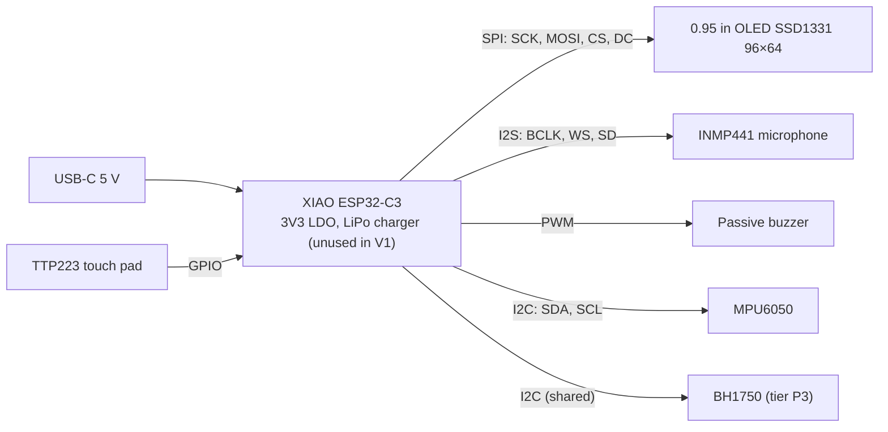

# Electronics specification — cubbies V1

> **Status**: draft. The GPIO allocation becomes a **signed contract** at the CDR
> ([gates.md](../architecture/gates.md)); changing a pin afterwards reopens a decision with the owner.
> Decisions: ADR-0002 (power), ADR-0003 (board), ADR-0006 (display), ADR-0007 (pin budget).
> Native KiCad 9 schematic: [`hardware/electronics/cubbies-v1.kicad_sch`](../../hardware/electronics/cubbies-v1.kicad_sch),
> PDF export next to it; every symbol carries a Justification field (C-NNNN / ADR). ERC:
> `kicad-cli sch erc --severity-all hardware/electronics/cubbies-v1.kicad_sch` (0 violations). Its R and C
> values feed the ngspice benches through `hardware/electronics/sim/schematic.lib`.

## Block diagram

## GPIO allocation (contract, V1)

Source of truth in code: `firmware/include/pins.h`. Both must match; ERC and a review check it.

| Function | Signal | XIAO ESP32-C3 | Label | C3 Super Mini (prototypes) | Notes |
|----------|--------|---------------|-------|----------------------------|-------|
| Display | SCK | GPIO8 | D8 | GPIO4 | hardware SPI |
| Display | MOSI | GPIO10 | D10 | GPIO6 | |
| Display | CS | GPIO3 | D1 | GPIO7 | |
| Display | DC | GPIO9 | D9 | GPIO5 | GPIO9 is a strapping pin (10 kΩ pull-up + BOOT button on the XIAO): its only load is the SSD1331 D/C# input, never pulled low externally; pressing BOOT while running only glitches DC |
| Display | RESET | 3V3 via RC | — | 3V3 via RC | 10 kΩ / 1 µF X7R + 1N4148 discharge diode (C-0006, ADR-0015) |
| Microphone | BCLK | GPIO20 | D7 | GPIO2 | |
| Microphone | WS | GPIO21 | D6 | GPIO3 | |
| Microphone | SD | GPIO5 | D3 | GPIO10 | L/R pin to GND (left) |
| Buzzer | PWM | GPIO6 | D4 | GPIO0 | AO3400 low-side stage, 82 Ω series (C-0003, C-0004); moved off GPIO2 by ADR-0015 |
| Touch | OUT | GPIO4 | D2 | GPIO1 | TTP223 active high, momentary mode |
| I2C | SDA | GPIO2 | D0 | GPIO8 | 47 kΩ board pull-up (R5) holds the strapping pin high at reset with or without modules; module pull-ups set the bus speed (C-0007, C-0008, ADR-0015) |
| I2C | SCL | GPIO7 | D5 | GPIO21 | |
| **Used** | | **11 / 11** | | **11** | no free GPIO: extras on I2C only |

## Power

| Rail | Source | Consumers | Budget |
|------|--------|-----------|--------|
| 5 V | USB-C | XIAO input | ≤ 500 mA peak (REQ-NF-04) |
| 3V3 | XIAO LDO TI TLV75733 (700 mA class; the thermal budget, not the rating, is the limit) | ESP32-C3, OLED, mic, IMU, touch, buzzer stage | typical ≤ 300 mA (thermal), see [calculations/log.md](calculations/log.md) C-0001, C-0002 |

Current budget detail and buzzer stage sizing: [calculations/log.md](calculations/log.md).

## Interfaces and settings

| Interface | Parameter | Value | Why |
|-----------|-----------|-------|-----|
| SPI | clock | 6 MHz (SSD1331 maximum 6.67 MHz, t_cycle ≥ 150 ns) | 96×64×16 bit at 25 fps needs 2.5 Mbit/s; 6 MHz allows ≈ 48 fps raw (REQ-NF-02) |
| I2S | sample rate, format | 16 kHz, 32-bit slots, mono left | level and event detection only (C7) |
| PWM | frequency range | 1–5 kHz, duty ≤ 50 % | volume by duty, REQ-NF-03 |
| I2C | clock | 400 kHz | MPU6050 and BH1750 both support it |

## Open points for the CDR

- SSD1331 module variant (7-pin with RESET exposed is the common one): RESET is held by an RC
  because no GPIO is free (ADR-0007).
- Buzzer: direct drive from a GPIO is out (≥ 30 mA); N-MOSFET low-side stage, values in
  [calculations/log.md](calculations/log.md) C-0003 to C-0005.
- Strapping pins (C-0008, ADR-0015): GPIO2 must read 1 at reset; it carries SDA, held at
  ≥ 3.2 V by a 47 kΩ board pull-up (R5) even when no I2C module is fitted (tiers P0/P1). The
  buzzer's 100 kΩ gate pull-down sits on GPIO6, not a strapping pin. On the Super Mini, GPIO8
  (1 for download boot) carries SDA and its onboard LED (extra sink current on SDA, prototypes
  only); its GPIO2 carries mic BCLK and gets the same 47 kΩ pull-up; the buzzer sits on GPIO0.
  CDR bench check: boot and download mode with no module and with every module fitted.
- GPIO8 on the XIAO carries SPI SCK: the display's SCK input does not load it at reset.
- TTP223 mode pads (A/B) set for momentary, active high.
- I2C expansion port J1 (issue #18, owner MCDA 2026-10-16: JST-SH 4-pin Qwiic/STEMMA QT,
  450/500 against a 2.54 mm header 410 and a 5-pin with interrupt 310): pins GND, 3V3, SDA, SCL;
  no interrupt line (no free GPIO, ADR-0007); one more module's pull-ups are within C-0007.
  Per-module power budget and enclosure access stay open in issue #18.
